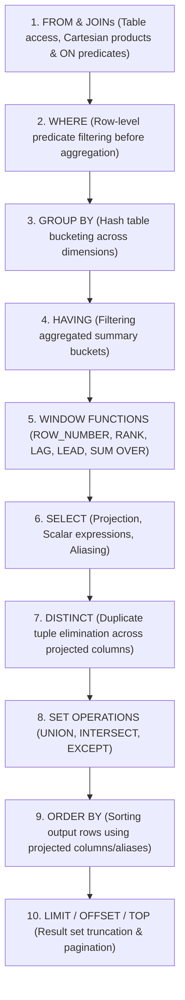
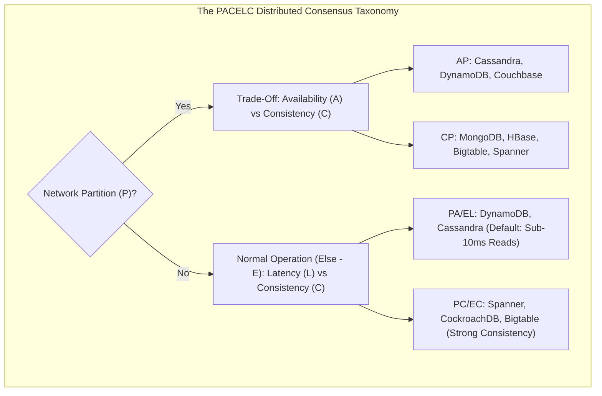
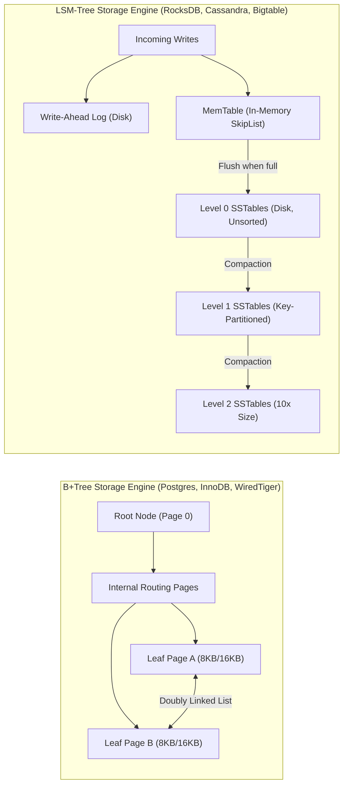
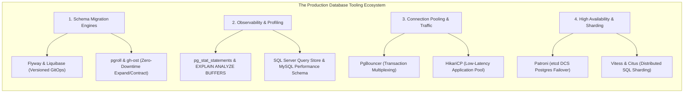
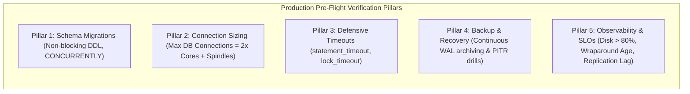
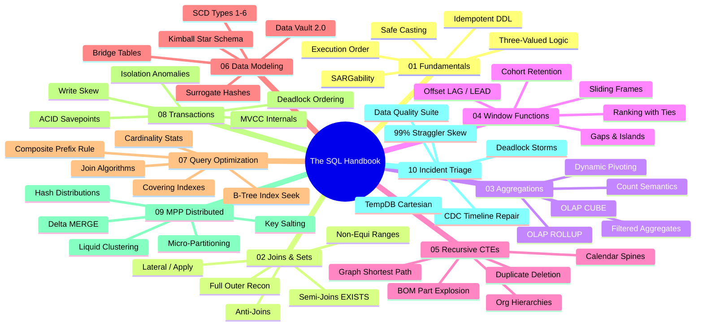
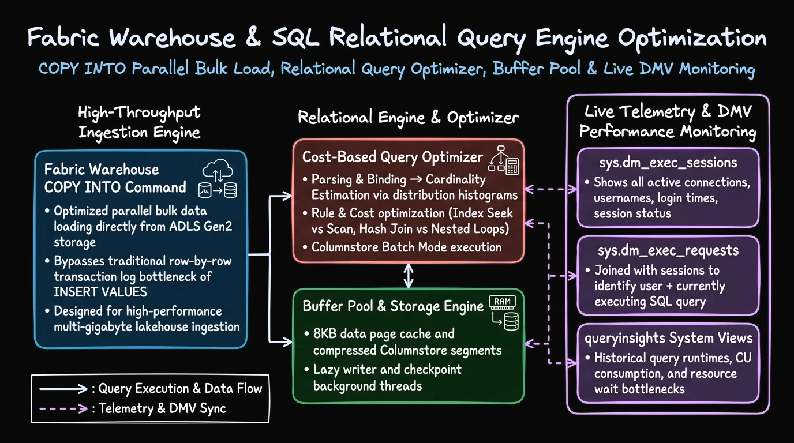
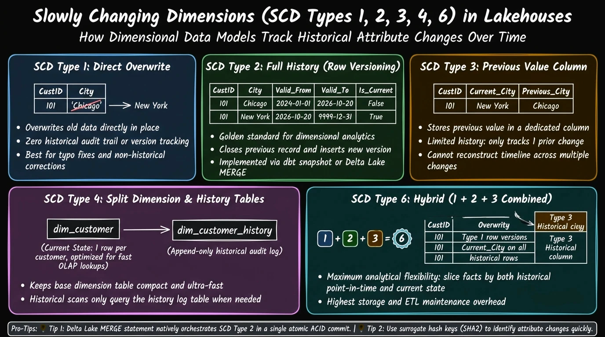
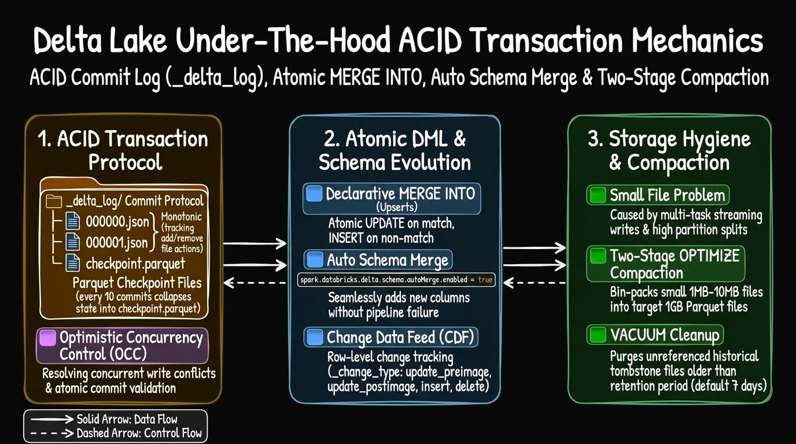

# ⚡ The SQL Handbook

**105 Production Coding Use Cases, Query Optimization Recipes, MPP Architectures & Incident Runbooks**

[](https://github.com/santoshjammi29/sql-handbook/actions) • [Core Concepts (170 Topics)](#-core-curriculum-concepts--topics)
[](https://www.iso.org/standard/76583.html)
[](https://www.postgresql.org/)
[](https://duckdb.org/)
[](https://www.databricks.com/)
[](https://www.snowflake.com/)
[](https://cloud.google.com/bigquery)
[](LICENSE)

*The definitive enterprise reference repository of 105 battle-tested SQL coding exercises, performance tuning recipes, and disaster recovery incident runbooks.*  
*Structured for instant local practice via Python's built-in `sqlite3` and `duckdb`, with zero external infrastructure required.*

[Curriculum Overview](#-curriculum-overview) • [Logical Query Architecture](#-logical-query-architecture) • [Quickstart & Sandbox](#-quickstart--interactive-sandbox) • [Interview Matrix](#-4-tier-interview-preparation-matrix) • [Production Runbooks](#-battle-tested-production-runbooks) • [Incident Postmortems](#-production-incident-postmortems)

---

## 🧠 Core Curriculum Concepts & Topics (170 Topics Covered)

> 💡 **Enterprise Knowledge Base Integration**: This repository implements **170 production topics** from the [Modern Data Engineering Systems Encyclopedia (921 Topics)](https://moderndataengineer.uk/concepts), arranged in increasing order of difficulty. Browse the full curriculum in [`topics/README.md`](topics/README.md).

### 📑 Topics Directory at a Glance

| Pillar / Module | Topic Count | Key Core Primitives Covered | Status |
|:---|:---:|:---|:---:|
| ⚡ **Relational SQL, Query Optimization & Transaction Engine** | **91** | Clustered Index, Common Table Expression (CTE), FOREIGN KEY, Non-Clustered Index, and 87 more | ✅ Fully Documented |
| 🏛️ **Database Architecture, Distributed Sharding & Cloud MPP** | **79** | Vitess Architecture & VSchema Declarative Sharding, Database Sharding Topologies & Live Dynamic Re-sharding, Database Backpressure & Concurrency Admission Control, Database Traffic Control: Read-After-Write Consistency & GTID Pinning, and 75 more | ✅ Fully Documented |

<details>
<summary><b>⚡ Relational SQL, Query Optimization & Transaction Engine (91 Topics)</b> — <i>Click to expand topic index (sorted by difficulty)</i></summary>

| # | Topic / Concept | Level | Architectural Definition & Core Principle |
|:---:|---|:---:|---|
| 1 | **Aggregate Semantics: COUNT(*) vs. COUNT(1)** | 🟢<br>Easy | Aggregate counting semantics define how the database engine evaluates relational cardinality across row counts, constant literals, and nullable column expressions. |
| 2 | **B-Tree Indexes & Leaf Node Traversal** | 🟢<br>Easy | Balanced multi-way search tree structures that maintain sorted key orders to facilitate logarithmic O(log N) point seeks and range scans. |
| 3 | **Clustered Index** | 🟢<br>Easy | A database index that determines the physical storage order of rows inside a table. |
| 4 | **Common Table Expression (CTE)** | 🟢<br>Easy | A temporary named result set defined within the execution scope of a single SELECT, INSERT, UPDATE, or DELETE query. |
| 5 | **CREATE TABLE: Schema Metadata & Page Slot Layout** | 🟢<br>Easy | The foundational DDL command that provisions table metadata in system catalogs and allocates initial extent/page structures on disk. |
| 6 | **CRUD Lifecycle & Write-Ahead Logging (WAL)** | 🟢<br>Easy | The end-to-end execution lifecycle of DML statements governed by ACID write-ahead logging protocols and buffer pool caching. |
| 7 | **FOREIGN KEY** | 🟢<br>Easy | A constraint that links key columns in one table to key columns in another, enforcing referential integrity. |
| 8 | **Foreign Keys: Referential Actions & Lock Cascades** | 🟢<br>Easy | Relational integrity constraints that enforce cross-table referential relationships and define automated cascade behaviors on mutations. |
| 9 | **GROUP BY: Stream Aggregate vs Hash Aggregate** | 🟢<br>Easy | A relational aggregation operator that collapses rows sharing identical key values into single summary rows via physical Stream or Hash algorithms. |
| 10 | **High-Throughput SQL Ingestion via COPY INTO** | 🟢<br>Easy | The standard high-performance T-SQL declarative command for parallel, distributed bulk ingestion from cloud storage into relational SQL tables. |
| 11 | **LIMIT & OFFSET Scanning Penalty** | 🟢<br>Easy | A common pagination pattern that suffers from linear performance degradation due to mandatory scanning and discarding of preceding offset rows. |
| 12 | **Logical Query Processing Order (S-F-W-G-H-O)** | 🟢<br>Easy | Logical Query Processing Order defines the strict conceptual sequence in which the relational database engine evaluates SQL clauses during query execution. |
| 13 | **NULL & Three-Valued Logic (3VL)** | 🟢<br>Easy | The foundational relational logic system where boolean expressions evaluate to TRUE, FALSE, or UNKNOWN (NULL). |
| 14 | **Object-Relational Mapping (ORM) & Impedance Mismatch** | 🟢<br>Easy | An abstraction layer that maps relational database tables and foreign keys to object-oriented domain classes and in-memory object graphs. |
| 15 | **ORDER BY: Quicksort vs External Merge Sort** | 🟢<br>Easy | The physical sorting operator applied to an intermediate rowset to guarantee deterministic ordering across returned records. |
| 16 | **PolyBase Distributed Query & External Tables** | 🟢<br>Easy | A database virtualization and scale-out ingestion technology that maps non-relational storage files into SQL relational external tables. |
| 17 | **Relational Data Types & Page Byte Alignment** | 🟢<br>Easy | The logical specifications (e.g. INT, VARCHAR, DECIMAL) and underlying physical byte packing schemes used to store column values on 8KB database data pages. |
| 18 | **Relational JOIN Algorithms: Nested Loops, Hash & Merge** | 🟢<br>Easy | The three fundamental physical algorithms employed by query engines to combine tuples from two distinct relational inputs. |
| 19 | **ROW_NUMBER() vs. RANK() vs. DENSE_RANK()** | 🟢<br>Easy | The three primary SQL ranking window functions that assign integer ordinals to rows based on an ORDER BY specification within a partition. |
| 20 | **T-SQL OPENROWSET Serverless Data Lake Querying** | 🟢<br>Easy | A built-in T-SQL table-valued function that enables instant, serverless querying of data lake files without provisioning managed tables. |
| 21 | **Always On Listener & Read Routing** | 🟡<br>Intermediate | A virtual network name and IP address that routes application client connections to the active primary replica or read-scale replicas. |
| 22 | **Common Table Expressions: Optimization Fences vs Inlining** | 🟡<br>Intermediate | Named temporary result sets defined via WITH clauses that act as logical subqueries, subject to engine-specific inlining or materialization fences. |
| 23 | **Computed Columns: Virtual vs Persisted** | 🟡<br>Intermediate | Columns defined via deterministic expressions whose values are either calculated on-the-fly during query evaluation or physically written to disk. |
| 24 | **Covering Indexes & Stored Columns (INCLUDE)** | 🟡<br>Intermediate | Non-key column payloads appended directly to the leaf nodes of a B-Tree index to satisfy queries without visiting the primary data table. |
| 25 | **Database Cursors: Row-by-Row Penalty & Tempdb Spooling** | 🟡<br>Intermediate | A database control structure that enables procedural, iterative traversal of individual query result set rows, incurring severe performance penalties. |
| 26 | **Database Statistics & Histograms** | 🟡<br>Intermediate | System tables storing data distribution histograms used by the query optimizer to estimate rows and build execution plans. |
| 27 | **Decimal Precision & Scale Mismatch Pitfalls** | 🟡<br>Intermediate | Incompatibilities between Spark/Parquet 128-bit decimal implementations and SQL relational decimal scale constraints. |
| 28 | **Ingestion Rejection Limits & Error File Quarantining** | 🟡<br>Intermediate | Error tolerance thresholds and automated bad-record logging mechanisms in SQL bulk loading commands. |
| 29 | **Keyset Pagination (Seek Method)** | 🟡<br>Intermediate | An optimal pagination strategy that uses the values of the last retrieved row within an inequality filter to seek directly to the next page via indexes. |
| 30 | **LATERAL Joins & CROSS APPLY** | 🟡<br>Intermediate | A correlated join mechanism that allows an inline subquery or table-valued function to reference column values provided by preceding outer rows. |
| 31 | **Logical Query Execution Order** | 🟡<br>Intermediate | The formal sequential order in which a relational database engine processes SQL query clauses, independent of written lexical order. |
| 32 | **Non-Clustered Index** | 🟡<br>Intermediate | A separate B-tree structure that maps index keys to clustered index keys or heap row identifiers. |
| 33 | **ORDER BY in Aggregates: Deterministic String & Array Folding** | 🟡<br>Intermediate | SQL syntax that enforces explicit internal sorting of values prior to reduction by array, JSON, or string accumulation functions. |
| 34 | **Outer Joins & Where Predicate Null-Suppression** | 🟡<br>Intermediate | Relational joins that preserve unmatched tuples from one or both relations by padding missing attributes with NULLs, and the pitfalls of downstream filtering. |
| 35 | **Query Store** | 🟡<br>Intermediate | A database feature that automatically captures history of queries, execution plans, and runtime statistics to simplify performance tuning. |
| 36 | **Read Replicas & Read-Scale Out** | 🟡<br>Intermediate | An availability group design that offloads read-only workloads (like reports or backups) to secondary database nodes. |
| 37 | **Recursive Common Table Expressions (WITH RECURSIVE)** | 🟡<br>Intermediate | A Recursive CTE is a Common Table Expression that references itself iteratively to traverse hierarchical structures, graph trees, or generate sequential interval series. |
| 38 | **Recursive CTEs: Anchor, Working Tables & Cycle Traps** | 🟡<br>Intermediate | A hierarchical query structure that repeatedly executes an iterative subquery over intermediate working tables until an empty rowset is returned. |
| 39 | **SARGable Predicates and Index Seek Optimization** | 🟡<br>Intermediate | SARGability refers to query predicates written in a structure that allows relational query optimizers to utilize B-tree index seeks rather than forcing full table or clustered index scans. |
| 40 | **Schema Drift & Type Coercion during SQL Loading** | 🟡<br>Intermediate | Structural and type discrepancies between source file formats and relational SQL target tables that cause ingest failures or data corruption. |
| 41 | **SQL Server Query Store Regressions** | 🟡<br>Intermediate | An internal flight recorder capturing execution plan history, runtime statistics, and forced plan pinning. |
| 42 | **Stored Procedures & Execution Plan Caching** | 🟡<br>Intermediate | Precompiled collections of procedural and relational statements stored in the database catalog that reuse cached execution plans. |
| 43 | **The QUALIFY Clause in Modern SQL** | 🟡<br>Intermediate | A specialized filtering clause in modern analytical engines (Snowflake, BigQuery, Databricks) that filters the results of window functions directly without wrapping queries in subqueries or CTEs. |
| 44 | **Three-Valued Logic & NULL Propagation** | 🟡<br>Intermediate | SQL evaluates boolean expressions using three-valued logic (3VL): TRUE, FALSE, and UNKNOWN, where any direct comparison against NULL yields UNKNOWN. |
| 45 | **Three-Valued Logic (3VL) & The NULL In NOT IN Trap** | 🟡<br>Intermediate | The SQL logic standard where boolean expressions evaluate to TRUE, FALSE, or UNKNOWN, and the critical failure pattern where subqueries containing NULL in NOT IN return zero rows. |
| 46 | **Transaction Isolation Levels** | 🟡<br>Intermediate | Database settings that control how data modifications are locked and isolated from concurrent transactions. |
| 47 | **Window Frame Specifications: ROWS vs RANGE** | 🟡<br>Intermediate | The explicit sliding boundary configuration (e.g. ROWS vs RANGE) that dictates which partition rows are included in a window function's accumulator. |
| 48 | **Window Functions** | 🟡<br>Intermediate | Analytical functions that perform calculations across a partition of rows relative to the current row, without collapsing them. |
| 49 | **Always On Availability Groups** | 🔴<br>Advanced | A high-availability and disaster recovery solution providing multi-database failover capabilities. |
| 50 | **Azure SQL Optimized Locking** | 🔴<br>Advanced | Optimized Locking is a database engine capability in Azure SQL that replaces traditional multi-granularity page/row locks with Transaction-ID (XACT) locking and Lock-After-Qualification (LAQ). |
| 51 | **Clustered vs. Non-Clustered B-Tree Indexes** | 🔴<br>Advanced | The two fundamental indexing physical storage structures in relational database engines that govern how data rows are stored and retrieved. |
| 52 | **Columnstore Indexes** | 🔴<br>Advanced | An index technology that stores and compresses data in a column-oriented format on disk. |
| 53 | **COUNT(*) vs COUNT(1): Optimizer Equivalence & Semantics** | 🔴<br>Advanced | The comparison between full-table tuple counting and scalar expression counting in SQL query engines. |
| 54 | **Covering Indexes & Included Columns (INCLUDE)** | 🔴<br>Advanced | An indexing design pattern where a non-clustered index contains all columns referenced by a query, completely eliminating Key/Bookmark Lookups. |
| 55 | **Database Triggers & Hidden Transaction Side Effects** | 🔴<br>Advanced | Event-driven procedural routines executed automatically by the database engine in response to DML operations on a table. |
| 56 | **Deadlocks** | 🔴<br>Advanced | A locking contention scenario where two transactions block each other by holding locks on resources the other requires. |
| 57 | **Deadlocks, Blocking & Concurrency Control** | 🔴<br>Advanced | A concurrency collision where two or more database sessions hold locks on separate resources while each requests an exclusive lock on the resource held by the other, forming a cyclic dependency. |
| 58 | **Gaps & Islands Consecutive Sequence Analysis** | 🔴<br>Advanced | The Gaps and Islands problem is a classical SQL analytical challenge that involves identifying contiguous sequences of records (islands) and missing intervals (gaps) in sequential data. |
| 59 | **GROUPING SETS, CUBE & ROLLUP Multidimensional Aggregations** | 🔴<br>Advanced | Advanced aggregation extensions that compute multiple distinct group-by sub-aggregations across multiple dimensional levels in a single scan of the source data. |
| 60 | **MERGE Statement Concurrency Pitfalls & Atomic Upserts** | 🔴<br>Advanced | A standard SQL DML command that synchronizes target tables with source data by combining INSERT, UPDATE, and DELETE logic into a single statement. |
| 61 | **Non-Splittable Compression & Multiline Record Bottlenecks** | 🔴<br>Advanced | The serialization choke point where compressed text files cannot be split, forcing a distributed cluster down to a single core. |
| 62 | **NULLs in CHECK Constraints Are Truthy** | 🔴<br>Advanced | The surprising relational behavior where a CHECK constraint allows an insert or update if the constraint expression evaluates to UNKNOWN (NULL). |
| 63 | **Parameter Sniffing** | 🔴<br>Advanced | A database engine compilation behavior where a query plan is optimized based on the parameters passed during first execution. |
| 64 | **Parameter Sniffing & OPTIMIZE FOR Query Hints** | 🔴<br>Advanced | Query plan cache degradation where a plan compiled for an outlier parameter value causes catastrophic performance on normal values. |
| 65 | **Parameter Sniffing & Query Plan Cache Mechanics** | 🔴<br>Advanced | A database optimizer behavior where a query plan is compiled and cached using parameter values from its initial invocation, leading to severe performance degradation on subsequent runs with different data distributions. |
| 66 | **Partial & Filtered Indexes** | 🔴<br>Advanced | A B-Tree index built over a subset of a table's rows defined by an explicit predicate (e.g. WHERE active = true or WHERE status != 'ARCHIVED'). |
| 67 | **Query Optimizer Plan Hints: Force Order & Index Directives** | 🔴<br>Advanced | Explicit syntax directives embedded in SQL queries that override cost-based optimizer choices regarding joins, indexes, or parallelism. |
| 68 | **Read Committed Snapshot Isolation** | 🔴<br>Advanced | A database setting that uses row versioning in TempDB to prevent read operations from blocking write operations. |
| 69 | **Read Committed Snapshot Isolation (RCSI)** | 🔴<br>Advanced | RCSI is an optimistic concurrency model in Microsoft SQL Server that uses row versioning in TempDB to allow readers to access committed row versions without acquiring shared locks. |
| 70 | **Sargability & Search Argument Able Predicates** | 🔴<br>Advanced | The property of a query predicate that allows the query optimizer to utilize a B-Tree index seek rather than an index scan or table scan. |
| 71 | **SARGability (Search Argument Able)** | 🔴<br>Advanced | The property of a query predicate that enables the optimizer to execute an index seek across a B-Tree rather than falling back to an exhaustive index or table scan. |
| 72 | **SELECT FOR UPDATE & Concurrency Control (SKIP LOCKED / NOWAIT)** | 🔴<br>Advanced | A pessimistic locking clause that acquires exclusive or update row locks on selected records to prevent concurrent modification until transaction commit. |
| 73 | **SQL Dynamic Management Views: sys.dm_exec_sessions and queryinsights** | 🔴<br>Advanced | Real-time system catalog views and Fabric performance schemas used by DBAs and data architects to isolate active user sessions, running query statements, and resource bottlenecks. |
| 74 | **SQL Server Columnstore Batch Mode Execution** | 🔴<br>Advanced | A relational database execution engine that processes rows in columnar batches of ~900 rows at a time using CPU hardware registers rather than row-by-row iteration. |
| 75 | **SQL Server Error 1205 Deadlock Resolution** | 🔴<br>Advanced | A SQL Server Error 1205 deadlock occurs when two or more concurrent transactions hold locks on separate resources and each requests a lock on the other's resource, creating a cyclic dependency. |
| 76 | **SQL Window Frame Specifications (ROWS vs. RANGE)** | 🔴<br>Advanced | Window frame specifications define the exact subset of rows within a partition evaluated by an analytic or aggregate window function using physical row counts (ROWS) or logical value offsets (RANGE). |
| 77 | **Synapse MPP Resource Classes & Columnstore Compression RAM** | 🔴<br>Advanced | Workload management memory allocations required to prevent Clustered Columnstore row group spilling to TempDB during bulk loads. |
| 78 | **TempDB Allocation Map Contention** | 🔴<br>Advanced | Concurrency bottlenecks on PFS and SGAM pages in TempDB caused by simultaneous table creation across multiple threads. |
| 79 | **TempDB Contention** | 🔴<br>Advanced | A performance bottleneck caused by allocation page concurrency bottlenecks inside the TempDB database files. |
| 80 | **UTF-8 Byte Order Mark (BOM) & Header Alignment Corruption** | 🔴<br>Advanced | Hidden 3-byte prefixes (0xEF, 0xBB, 0xBF) in Windows-generated text files that break column 1 mapping in relational bulk loaders. |
| 81 | **Window Frame Specification: ROWS vs. RANGE** | 🔴<br>Advanced | The sub-clause within OVER() that defines the physical or logical boundary of rows evaluated relative to the current row. |
| 82 | **Always On Availability Groups Multi-Subnet Disaster Recovery** | 🟣<br>Architect | Enterprise database clustering architecture providing zero-data-loss synchronous local commit and cross-region asynchronous disaster recovery with automated client failover. |
| 83 | **Always On Availability Groups Quorum** | 🟣<br>Architect | High-availability and disaster recovery architecture using Windows Server Failover Clustering quorum and synchronous replication. |
| 84 | **Cardinality Estimation Feedback & IQP** | 🟣<br>Architect | Cardinality Estimation (CE) Feedback is an Intelligent Query Processing (IQP) mechanism in SQL Server 2022 that automatically identifies and corrects plan regressions caused by modern CE assumptions. |
| 85 | **Columnstore Segment Elimination & Memory Grant Governance** | 🟣<br>Architect | Low-level columnar storage engine optimization governing rowgroup health, min/max metadata dictionary pruning, and query memory grants. |
| 86 | **Fabric Direct Lake Mode: Zero-ETL VertiPaq Paging** | 🟣<br>Architect | A semantic layer breakthrough where Power BI's in-memory VertiPaq engine directly memory-maps Delta Parquet columns from OneLake. |
| 87 | **Partition Switching & Staging Architecture for High-Volume Ingestion** | 🟣<br>Architect | Metadata-only table partition modification enabling millions of ingested rows to be swapped into a production table in under 10 milliseconds with zero write locks. |
| 88 | **Petabyte-Scale Staged Ingestion & Partition Switching** | 🟣<br>Architect | An enterprise MPP ingestion architecture utilizing unindexed round-robin heap staging, CTAS, and atomic partition metadata swaps. |
| 89 | **Physical Join Algorithms: Nested Loops, Merge, and Hash Joins** | 🟣<br>Architect | The three physical execution operators employed by cost-based query optimizers to combine two data streams. |
| 90 | **Temporal Tables & Point-In-Time Bi-Temporal Auditing** | 🟣<br>Architect | System-versioned relational table architecture automatically recording the full history of data modifications with UTC period start/end timestamps. |
| 91 | **The Halloween Problem & Mutation Spooling** | 🟣<br>Architect | The Halloween Problem is a relational engine anomaly where an UPDATE operation modifies an indexed column used to locate qualifying rows, causing the query to repeatedly visit and update the same rows. |

</details>

<details>
<summary><b>🏛️ Database Architecture, Distributed Sharding & Cloud MPP (79 Topics)</b> — <i>Click to expand topic index (sorted by difficulty)</i></summary>

| # | Topic / Concept | Level | Architectural Definition & Core Principle |
|:---:|---|:---:|---|
| 1 | **Database Sharding Topologies & Live Dynamic Re-sharding** | 🟢<br>Easy | Techniques for horizontally partitioning database tables across independent physical nodes and dynamically splitting shards in production with zero application downtime. |
| 2 | **High Cardinality** | 🟢<br>Easy | Column with many distinct values (like CustomerID with millions of unique customers). |
| 3 | **Low Cardinality** | 🟢<br>Easy | Column with few distinct values (like ProductCategory with only 15 categories). |
| 4 | **OLAP (Online Analytical Processing)** | 🟢<br>Easy | Workload pattern focused on complex queries, aggregations, and read-heavy analytics. |
| 5 | **OLTP (Online Transaction Processing)** | 🟢<br>Easy | Workload pattern focused on transactional operations with frequent inserts, updates, and deletes. |
| 6 | **Rowstore Index** | 🟢<br>Easy | Traditional row-based storage optimized for OLTP workloads with frequent inserts, updates, and single-row lookups. |
| 7 | **ACID Properties & Physical Engine Enforcements** | 🟡<br>Intermediate | The four foundational guarantees—Atomicity, Consistency, Isolation, and Durability—enforced via low-level engine subsystems. |
| 8 | **Attribute-Based Dynamic Column Masking (ABAC)** | 🟡<br>Intermediate | A runtime security policy engine that evaluates user attributes (role, department, clearance) to conditionally mask, hash, or redact sensitive column values without duplicating tables. |
| 9 | **Columnstore Index** | 🟡<br>Intermediate | A storage structure that organizes data by columns rather than rows, optimized for analytical queries that scan large datasets. |
| 10 | **Connection Pools & Thread/Process Multiplexing** | 🟡<br>Intermediate | A persistent cache of open database connections that multiplexes high-volume client application requests over a fixed pool of server backends. |
| 11 | **Database Backpressure & Concurrency Admission Control** | 🟡<br>Intermediate | Flow-control and overload-shedding mechanisms that regulate query ingress, enforcing Little's Law to prevent database CPU thrashing, memory exhaustion, and cascading collapse. |
| 12 | **Database Branching & Copy-on-Write CoW Virtual Forks** | 🟡<br>Intermediate | A Git-like database lifecycle capability that instantly provisions isolated, fully functional database clones in seconds using Copy-on-Write pointer manipulation without duplicating physical data. |
| 13 | **Database Connection Pooling (PgBouncer)** | 🟡<br>Intermediate | Maintaining an in-memory pool of reusable database connections to eliminate per-request connection handshake latency. |
| 14 | **Database Transactions & Two-Phase Commit (2PC)** | 🟡<br>Intermediate | A consensus protocol ensuring atomic commit or rollback across multiple distributed database instances or heterogeneous resources. |
| 15 | **Dictionary Encoding** | 🟡<br>Intermediate | Compression technique that replaces repeating values with smaller numeric identifiers and stores a lookup dictionary. |
| 16 | **Inverted Indexes (GIN & Full-Text Search)** | 🟡<br>Intermediate | An indexing structure that maps discrete elements (such as tokens, tags, or JSON keys) to sorted posting lists of containing document/row IDs. |
| 17 | **ORM Query Degradation & N+1 Cascade Problem** | 🟡<br>Intermediate | The systemic performance degradation that occurs when object-relational mapping frameworks generate chatty, unindexed, or Cartesian queries. |
| 18 | **Query Plans & EXPLAIN ANALYZE Mechanics** | 🟡<br>Intermediate | The tree of relational operators generated by the cost-based optimizer detailing physical access paths, join algorithms, and actual execution metrics. |
| 19 | **Relational Normal Forms (1NF through 5NF & BCNF)** | 🟡<br>Intermediate | A mathematical progression of design rules based on functional dependencies designed to eliminate data redundancy and update anomalies. |
| 20 | **Run-Length Encoding (RLE)** | 🟡<br>Intermediate | Compression method that stores consecutive identical values as a single value with a count. |
| 21 | **Segment Elimination** | 🟡<br>Intermediate | Performance optimization where columnstore skips reading irrelevant data segments based on min/max statistics. |
| 22 | **Storage Engine Trade-offs: LSM-Trees vs B+Trees & Compaction Dynamics** | 🟡<br>Intermediate | The foundational architectural trade-offs between write-optimized Log-Structured Merge Trees (LSM) and read-optimized B+Tree storage engines in modern database design. |
| 23 | **The DUAL Table & Relational Projection Semantics** | 🟡<br>Intermediate | A special single-row dummy table used in SQL engines (historically Oracle and MySQL) to evaluate scalar expressions within relational SELECT syntax. |
| 24 | **Ambiguous Network Errors & Two-Generals Commit Dilemma** | 🔴<br>Advanced | The distributed systems dilemma where a network socket drops during a COMMIT operation, leaving the client in an indeterminate transactional state. |
| 25 | **Ascending Key Problem in B-Trees** | 🔴<br>Advanced | The severe concurrency and optimizer degradation that occurs when high-volume inserts target monotonically increasing primary keys. |
| 26 | **Batch Mode Processing** | 🔴<br>Advanced | Query execution method that processes multiple rows simultaneously, available with columnstore indexes. |
| 27 | **Bit-Packing** | 🔴<br>Advanced | Compression technique that uses minimum number of bits required to represent numerical values. |
| 28 | **Cost-Based Optimizers & Table Statistics Histograms** | 🔴<br>Advanced | Statistical metadata describing column value distributions, null fractions, and density vectors used by optimizers to estimate query plan costs. |
| 29 | **Database Sharding & Distributed Hash Routing** | 🔴<br>Advanced | A shared-nothing horizontal scaling architecture where a large relational dataset is partitioned across independent physical database instances via a shard key. |
| 30 | **Database Traffic Control: Read-After-Write Consistency & GTID Pinning** | 🔴<br>Advanced | Routing architectures that decouple reads and writes across replicas while tracking Global Transaction Identifiers (GTIDs) to eliminate replication lag anomalies. |
| 31 | **Deploy Requests & Zero-Downtime Online Schema Migrations with gh-ost** | 🔴<br>Advanced | An asynchronous schema migration methodology that modifies large tables without locking DDL, using shadow tables, continuous CDC binlog stream catchup, and atomic cutovers. |
| 32 | **MVCC Garbage Collection & Table Bloat (VACUUM / Undo Purge)** | 🔴<br>Advanced | The internal storage engine processes responsible for reclaiming physical disk space occupied by obsolete, dead row versions under MVCC. |
| 33 | **MySQL utf8 Truncation Bug vs utf8mb4** | 🔴<br>Advanced | The notorious legacy encoding issue in MySQL where the 'utf8' charset supported only 3 bytes, causing silent data truncation on modern 4-byte Unicode characters. |
| 34 | **PAGE Compression** | 🔴<br>Advanced | Row-level compression technique that removes repetitive data within database pages, used in rowstore scenarios. |
| 35 | **Phantom Reads & Next-Key Locking** | 🔴<br>Advanced | A concurrency anomaly where a transaction reads a set of rows satisfying a predicate, but a concurrent committed transaction inserts a new row matching that predicate. |
| 36 | **PostgreSQL BRIN (Block Range Index)** | 🔴<br>Advanced | An index storing minimum and maximum values for physical disk block ranges, delivering compact indexing on ordered tables. |
| 37 | **PostgreSQL MVCC Table Bloat & VACUUM** | 🔴<br>Advanced | Multi-Version Concurrency Control dead tuple accumulation and automated background vacuuming mechanics. |
| 38 | **Quorum Consensus & Redundancy: Multi-Raft, Paxos & Witness Nodes** | 🔴<br>Advanced | Distributed consensus algorithms that guarantee fault-tolerant state machine replication across independent nodes through majority voting quorums. |
| 39 | **Read-Replica Replication Lag Mitigation** | 🔴<br>Advanced | Architectural patterns preventing stale reads when distributing read traffic across asynchronous database replicas. |
| 40 | **Relational Denormalization Strategies** | 🔴<br>Advanced | The intentional reintroduction of redundant data into a relational schema to optimize read latency and eliminate expensive multi-table joins. |
| 41 | **Serializable Restarts & SQLSTATE 40001 Retry Loops** | 🔴<br>Advanced | The architectural requirement that applications executing under Serializable Snapshot Isolation must wrap all transactions in retry loops to handle serialization failures. |
| 42 | **Set-Returning Generator Functions & Cross Join Alignment** | 🔴<br>Advanced | The distinct behavior of set-returning functions (SRFs) in SQL engines, contrasting row-wise zipping with Cartesian expansion. |
| 43 | **Star Schema vs Normalized 3NF Relational Engines** | 🔴<br>Advanced | The architectural contrast between highly normalized 3NF schemas optimized for transactional write isolation and denormalized star schemas optimized for analytical OLAP scans. |
| 44 | **There Are No Non-Nullable Types in SQL** | 🔴<br>Advanced | The relational truth that column-level NOT NULL constraints do not guarantee non-nullability across expressions, outer joins, and aggregations. |
| 45 | **TIMESTAMPTZ Does Not Store a Time Zone** | 🔴<br>Advanced | The common misconception in PostgreSQL and relational standards regarding how timezone-aware timestamps are physically stored on disk. |
| 46 | **Transaction Contention, Latch Waits & Hotspots** | 🔴<br>Advanced | The serialization bottleneck caused by concurrent sessions competing for identical logical row locks or physical in-memory page latches. |
| 47 | **Transaction Isolation Levels & Concurrency Anomalies** | 🔴<br>Advanced | The formal ANSI/ISO standards defining transaction boundary guarantees and the specific concurrency anomalies each level permits or prohibits. |
| 48 | **Write Skew Anomaly in Snapshot Isolation** | 🔴<br>Advanced | A subtle concurrency anomaly occurring under Snapshot Isolation where two concurrent transactions read overlapping data but modify disjoint rows, violating an invariant. |
| 49 | **Zigzag Join (Multi-Index Merge Intersection)** | 🔴<br>Advanced | An advanced physical query optimization algorithm that finds matching rows across multiple B-Tree indexes by jumping back and forth across sorted leaf keys. |
| 50 | **'null'::jsonb IS NULL Evaluates to False** | 🟣<br>Architect | The semantic distinction in PostgreSQL between a JSON-encoded null primitive and a relational SQL NULL value. |
| 51 | **Azure Data Explorer (ADX) vs Azure Synapse Analytics Workload Selection** | 🟣<br>Architect | Architectural decision criteria for selecting between indexing-optimized real-time telemetry exploration (ADX/KQL) and massively parallel relational data warehousing (Synapse/Fabric Warehouse). |
| 52 | **Azure Synapse Resource Classes (Static vs. Dynamic)** | 🟣<br>Architect | Pre-determined resource limits and memory allocation governance profiles assigned to database roles in Azure Synapse to control query memory grants and concurrency. |
| 53 | **Azure Synapse Table Distributions (Hash, Round-Robin, Replicated)** | 🟣<br>Architect | The architectural data distribution strategies across 60 fixed storage buckets that govern data movement and query parallelization in Azure Synapse dedicated SQL pools. |
| 54 | **Causal Reverse Anomaly in Asynchronous Replication** | 🟣<br>Architect | A distributed consistency anomaly where an effect appears to precede its cause in replica read logs due to asynchronous replication delays or clock skew. |
| 55 | **Compute & Storage Decoupling: Log-is-the-Database Paradigm** | 🟣<br>Architect | A cloud-native database architecture where stateless SQL execution engines are separated from a distributed, purpose-built write-ahead log (WAL) storage tier. |
| 56 | **Cost Models vs Physical Hardware Reality** | 🟣<br>Architect | The systemic divergence between static relational query optimizer cost formulas and the physical realities of modern hardware (NVMe SSDs, tiered memory, and CPU caches). |
| 57 | **Database Cracking & Self-Organizing Adaptive Indexing** | 🟣<br>Architect | An autonomous physical indexing architecture where queries adaptively partition and sort columns on-the-fly as a side-effect of query execution. |
| 58 | **DEFERRABLE INITIALLY IMMEDIATE Constraints** | 🟣<br>Architect | A relational constraint configuration that allows integrity checks (such as foreign keys or unique constraints) to be postponed until transaction commit. |
| 59 | **Distributed Two-Phase Commit & Cross-Shard Transaction Latency** | 🟣<br>Architect | The distributed consensus protocol used to guarantee atomic transactions across multiple database shards, and the inherent latency and locking bottlenecks it introduces. |
| 60 | **Every SQL Operator as a Relational Join** | 🟣<br>Architect | The theoretical mathematical proof in relational algebra demonstrating that Selection, Projection, Union, and Intersection can be expressed as joins. |
| 61 | **EXPLAIN Catalog Approximations for Row Counts** | 🟣<br>Architect | A technique that retrieves sub-millisecond approximate table row counts by inspecting system catalog metadata instead of executing full table scans. |
| 62 | **Fsyncgate: Linux Kernel Page Cache Error Dropping** | 🟣<br>Architect | The critical 2018 discovery where the Linux kernel cleared dirty page flags upon writeback I/O error, causing subsequent fsync calls to falsely report success. |
| 63 | **Join Ordering Complexity (NP-Hard Search Space)** | 🟣<br>Architect | The combinatorial explosion of possible join order permutations that makes finding the mathematically optimal query plan an NP-hard problem. |
| 64 | **Learned Index Structures (Recursive Model Indexes / RMI)** | 🟣<br>Architect | The machine learning paradigm pioneered by Kraska et al. that replaces traditional B-Trees with recursive functional regression models to predict key positions. |
| 65 | **MATCH PARTIAL Composite Foreign Key Semantics** | 🟣<br>Architect | An esoteric SQL standard rule for composite foreign keys that specifies validation behavior when only a subset of composite key columns contain NULL. |
| 66 | **NULL Equality in DISTINCT vs UNIQUE Constraints** | 🟣<br>Architect | The formal divergence in SQL standard specifications where DISTINCT treats NULLs as identical duplicates, while UNIQUE constraints treat them as distinct. |
| 67 | **Relational NULL & Codd's Missing Information Foundations** | 🟣<br>Architect | The formal mathematical critique of NULL in relational theory and E.F. Codd's distinction between 'Value Unknown' and 'Value Inapplicable'. |
| 68 | **SERIAL & Sequence Generation Non-Transactional Gaps** | 🟣<br>Architect | The deliberate non-transactional design of database sequence generators (SERIAL, IDENTITY, SEQUENCE) that produce permanent gaps upon rollback. |
| 69 | **Slowly Changing Dimension (SCD) Type 2 in Microsoft Fabric** | 🟣<br>Architect | The dimensional modeling pattern that maintains a complete history of attribute modifications by creating versioned records with validity timestamps and active flags using Delta Lake MERGE. |
| 70 | **TABLE_DEE and TABLE_DUM Relational Identities** | 🟣<br>Architect | The two fundamental identity relations in formal relational theory (Date & Darwen) possessing zero attributes, representing boolean TRUE and FALSE. |
| 71 | **The 'allballs' Time Literal in PostgreSQL** | 🟣<br>Architect | A historical, quirky reserved string literal in PostgreSQL that parses into '00:00:00.00' UTC time (all zeroes). |
| 72 | **The Halloween Problem & Update Mutation Scanning** | 🟣<br>Architect | A database mutation phenomenon where an UPDATE operation modifies an indexed column, causing modified rows to advance forward and be mutated repeatedly. |
| 73 | **TPC-C Benchmark Specification & Artificial Keying Times** | 🟣<br>Architect | The mandatory simulation of human interactive delay (keying and think times) codified in the TPC-C benchmark standard. |
| 74 | **Transaction ID (XTID) Exhaustion & Wraparound Emergency** | 🟣<br>Architect | The catastrophic scenario in 32-bit MVCC engines where transaction counter limits threaten to treat all historical data as invisible, forcing database shutdown. |
| 75 | **Transaction Isolation Levels: Snapshot Isolation, SSI & Linearizability** | 🟣<br>Architect | The spectrum of transactional safety guarantees in distributed databases, spanning Read Committed, Snapshot Isolation, Serializable SSI, and External Consistency (Linearizability). |
| 76 | **Vectorized Execution vs Hardware SIMD Vectorization** | 🟣<br>Architect | The distinction between block-oriented tuple-at-a-time engine pipelines and hardware-level CPU SIMD vector register instructions. |
| 77 | **Vitess Architecture & VSchema Declarative Sharding** | 🟣<br>Architect | A cloud-native horizontal database scaling engine for MySQL that abstracts sharded storage behind stateless query proxies (VTGate) governed by declarative JSON schemas (VSchema). |
| 78 | **Volcano Iterator Execution Model & Cache Misses** | 🟣<br>Architect | The classical demand-driven query execution model where operators implement an open()-next()-close() iterator interface pulling one tuple at a time. |
| 79 | **Worst-Case Optimal Joins (WCOJ) & Leapfrog Triejoin** | 🟣<br>Architect | A class of multiway join algorithms whose runtime is asymptotically bounded by the Atserias-Grohe-Marx (AGM) bound, bypassing binary join bottlenecks. |

</details>

---

## 🎯 Overview & Mission

Modern data engineering and analytics engineering demand far more than basic `SELECT * FROM table WHERE condition`.

Enterprise workloads operate on high-concurrency transactional databases (PostgreSQL, Aurora, SQL Server) and distributed lakehouse MPP engines (Snowflake, Databricks Spark SQL, Google BigQuery) where a single non-SARGable predicate, missing index, or skewed join key can exhaust cluster memory, trigger multi-hour straggler tasks, or cause 10,000 USD cloud billing surprises.

This repository provides **105 end-to-end, runnable, modular SQL coding use cases** covering:
- **Core & Advanced Relational Fundamentals:** Logical execution order, Three-Valued Logic (3VL), SARGability, cascading integrity, and safe numeric precision.
- **Complex Joins & Aggregations:** Semi-joins (`EXISTS`), anti-joins, full outer reconciliations, non-equi joins, multidimensional `ROLLUP`/`CUBE`, and dynamic pivoting.
- **Analytical Window Functions Mastery:** Ranking with ties, lead/lag offsets, sliding frames (`ROWS` vs. `RANGE`), Gaps and Islands (consecutive streaks & sessionization), and portfolio drawdowns.
- **Hierarchical Trees & Graph Traversal:** Recursive Common Table Expressions (`WITH RECURSIVE`) for organizational charts, Bill of Materials (BOM) part explosions, flight path cycle detection, and calendar spines.
- **Data Modeling & Lakehouse Formats:** Kimball star schemas, Slowly Changing Dimensions (SCD Types 1, 2, 3, 4, 6), Data Vault 2.0 (Hubs/Links/Satellites), and deterministic hash surrogate keys.
- **Storage Engines & Physical Optimization:** B-Tree index traversal, composite index left-prefix rule, covering indexes, partial/filtered indexes, join algorithms, and cardinality estimation tuning.
- **Transactions, MVCC & Concurrency Control:** ACID savepoints, isolation levels (Read Committed, Repeatable Read, Serializable), write skew anomalies, MVCC tuple lifecycles, and deadlock-free canonical resource ordering.
- **MPP Distributed Engines & Big Data SQL:** Snowflake micro-partition pruning, table distributions (Hash/Replicated), Liquid Clustering (`CLUSTER BY`), two-phase key salting for join skew, and multi-condition `MERGE INTO`.
- **Production Incidents & Disaster Postmortems:** 10 real-world production postmortems with forensic analysis and surgical recovery queries (the 99% straggler task, deadlock storms, out-of-order CDC corruption, and automated data quality test suites).

---

## 🏛️ Logical Query Architecture

Understanding the discrepancy between **syntax order** and **logical execution order** is the foundation of SQL mastery:



---

## ⚖️ Database Systems: Relational SQL vs. NoSQL Architecture Taxonomy

Modern enterprise data architectures bridge the gap between strongly consistent relational systems (ACID) and horizontally scalable distributed NoSQL systems (BASE). Choosing the correct storage engine and data model requires balancing the **CAP theorem**, the **PACELC theorem**, and the physical mechanics of disk I/O.

### 1. The CAP & PACELC Theoretical Foundations



- **The CAP Theorem (Brewer, 2000)**: Under a network partition ($P$), a distributed system must choose between **Consistency ($C$)** (every read receives the latest write or an error) or **Availability ($A$)** (every non-failing node returns a response, without guaranteeing the latest write).
- **The PACELC Theorem (Abadi, 2012)**: Extends CAP to normal (unpartitioned) operation:
  $$\text{If Partition (P)} \implies \text{Trade Availability (A) vs Consistency (C)}; \quad \text{Else (E)} \implies \text{Trade Latency (L) vs Consistency (C)}$$

| Database Engine | Partition Mode | Normal Operation | PACELC Classification | Primary Storage & Concurrency Architecture |
| :--- | :---: | :---: | :---: | :--- |
| **PostgreSQL** | Single Node / CP | Consistency | **PC/EC** | Slotted Pages B+Tree, MVCC (`xmin`/`xmax`), WAL |
| **MySQL (InnoDB)** | Single Node / CP | Consistency | **PC/EC** | Clustered Primary B+Tree, Undo Logs, Redo Logs |
| **MongoDB** | Consistency | Consistency | **PC/EC** | WiredTiger B-Tree & MVCC, Raft-like Replica Set Oplog |
| **Apache Cassandra** | Availability | Latency | **PA/EL** | Masterless Dynamo Ring, LSM-Tree, Tunable Quorum ($R + W > N$) |
| **AWS DynamoDB** | Availability | Latency | **PA/EL** | Paxos Leader per Partition, SSD B-Tree/LSM, Token Bucket RCU/WCU |
| **Redis (Cluster)** | Availability | Latency | **PA/EL** | In-Memory Single-Thread Event Loop, 16,384 Hash Slots |
| **Neo4j** | Consistency | Consistency | **PC/EC** | Native Graph Engine, Index-Free Adjacency (IFA), Raft Consensus |
| **Google Spanner** | Consistency | Consistency | **PC/EC** | TrueTime GPS/Atomic Clocks, Multi-Paxos per Split, 2PC |

---

### 2. Storage Engine Mechanics: B+Tree vs. Log-Structured Merge-Tree (LSM)

The foundational trade-off in database storage engines is **In-Place Updates (Random I/O)** versus **Append-Only Logs (Sequential I/O)**.



#### Storage Amplification Metrics:
1. **Write Amplification Factor (WAF)**:
   $$\text{WAF} = \frac{\text{Bytes Written to Physical Storage}}{\text{Bytes Written by Application}}$$
   - *B+Tree*: High WAF ($10\times - 100\times$). Mutating a single 32-byte column requires dirtying and flushing an entire 8KB page to disk, plus WAL overhead.
   - *LSM-Tree*: Moderate initial WAF (sequential append to WAL + Memtable), but increases ($10\times - 30\times$) during multi-level background compaction merges.
2. **Read Amplification Factor (RAF)**:
   $$\text{RAF} = \frac{\text{Bytes Read from Physical Storage}}{\text{Bytes Requested by Application}}$$
   - *B+Tree*: Low RAF ($\mathcal{O}(\log_B N)$). Point lookups traverse $3-4$ indexed levels directly to the exact target leaf page.
   - *LSM-Tree*: Higher RAF. Must check Memtable, followed by Bloom Filters, and potentially multiple SSTable levels on disk until the key or deletion tombstone is discovered.
3. **Space Amplification Factor (SAF)**:
   $$\text{SAF} = \frac{\text{Disk Space Occupied by Database}}{\text{Uncompressed Logical Data Size}}$$
   - *B+Tree*: Suffers from internal page fragmentation and 50/50 page split slack ($30\% - 50\%$ overhead).
   - *LSM-Tree*: Highly compact due to immutability and prefix block compression, but temporarily spikes during major compactions ($2\times$ temporary footprint).

---

### 3. The 7 NoSQL Categories & Workload Selection Matrix

| Category | Representative Engines | Primary Data Structure | Ideal Workload & Sweet Spot | Catastrophic Anti-Pattern / Gotcha |
| :--- | :--- | :--- | :--- | :--- |
| **Document Stores** | MongoDB, Couchbase | BSON / JSON Hierarchical Documents | CMS, User Profiles, Product Catalogs with polymorphous attributes. | **Unbounded Array Growth**: Embedding arrays inside documents that breach the 16MB BSON limit. |
| **Key-Value / In-Memory** | Redis, RocksDB, DynamoDB | In-Memory Hash, SkipList, LSM-Tree | Caching, Rate Limiters, Session State, Real-time Leaderboards. | **Single-Thread Blocking**: Executing `KEYS *` or large `HGETALL` freezing the Redis event loop. |
| **Wide-Column / Partitioned** | Apache Cassandra, ScyllaDB, Bigtable | Sparse Multidimensional Sorted Map | High-throughput IoT telemetry, Event Logging, Messaging feeds. | **Tombstone Read Storms**: Scanning $>100,000$ deleted rows triggering `ReadFailureException`. |
| **Graph Databases** | Neo4j, AWS Neptune, Memgraph | Double-Linked Nodes & Edges (Index-Free Adjacency) | Fraud detection networks, Social Graphs, Identity Resolution, Knowledge Graphs. | **Supernodes**: Traversing nodes with millions of incident edges causing pointer-chasing CPU spikes. |
| **Vector Databases** | pgvector, Milvus, Pinecone, Qdrant | High-Dimensional Proximity Graphs (HNSW, IVFFlat) | Retrieval-Augmented Generation (RAG), Semantic Search, Facial Recognition. | **Memory Exhaustion (OOM)**: Building HNSW graphs on tens of millions of vectors without dedicated RAM. |
| **Time-Series Databases** | TimescaleDB, InfluxDB | Hypertables with Automated Time/Space Chunking | Server APM Telemetry, Financial Tick Feeds, Industrial Sensor Streams. | **Unbounded Chunks**: Retaining uncompressed historical chunks in active memory without columnar policies. |
| **Search Engines** | Elasticsearch, OpenSearch | Inverted Index & Lucene Segment Trees | Full-text search, Log aggregation (ELK), Fuzzy text matching, Faceted navigation. | **Mapping Explosions**: Ingesting dynamic JSON with thousands of arbitrary keys causing JVM Heap OOM. |

> 📖 *For comprehensive architecture diagrams, PACELC mathematical proofs, and engine internals, consult [Architecture Deep Dive 05: NoSQL Systems, Storage Engines & Trade-Offs](architectures/05_nosql_systems_storage_engines_and_tradeoffs.md).*

---

## ⚙️ Core Database Technologies & Engine Internals

Understanding the physical internals of dominant database engines separates novice query authors from Staff Database Architects:

### 1. Relational Transactional Engines (OLTP)
- **PostgreSQL**:
  - *MVCC Tuple Lifecycle*: Rows are immutable tuples. Updates execute as an `INSERT` of a new tuple followed by an expiration of the old tuple. Each tuple header contains `xmin` (creating transaction ID), `xmax` (expiring transaction ID), and hint bits.
  - *Dead Tuple Bloat & VACUUM*: Dead tuples remain on disk until background `autovacuum` sweeps the page and marks space reusable.
  - *The 32-Bit TXID Wraparound*: Postgres uses 32-bit transaction IDs. If `VACUUM FREEZE` does not advance `relfrozenxid` within 2 billion transactions, the database forcibly enters read-only shutdown.
  - *TOAST (The Oversized-Attribute Storage Technique)*: Values exceeding 2KB are compressed and split into 2KB chunks stored in a separate hidden TOAST table.
- **MySQL / InnoDB**:
  - *Clustered Primary B+Tree*: Tables are physically organized by their Primary Key. Secondary indexes do not point directly to disk offsets; they store the Primary Key value, requiring a secondary lookup (bookmark lookup) to fetch row columns.
  - *Undo Logs & Purge Threads*: Unlike Postgres, InnoDB performs in-place row updates and writes previous versions to an **Undo Log** in the rollback segment. Purge threads asynchronously deallocate undo log pages once older read views complete.
  - *Gap Locking & Next-Key Locking*: Under Repeatable Read, InnoDB locks not just existing rows, but the "gaps" between index keys to prevent concurrent insertions (eliminating phantom reads).
- **Microsoft SQL Server**:
  - *Physical Organization*: Clustered Index (B-Tree data leaf pages) or Heap (unordered pages linked by PFS/IAM).
  - *Tempdb Contention*: High-frequency temporary table creation triggers severe latch contention on allocation bitmap pages: **PFS** (Page Free Space), **GAM** (Global Allocation Map), and **SGAM** (Shared Global Allocation Map).
  - *Query Store*: An automated flight recorder built into the database engine capturing query runtime stats, wait categories, and execution plan regressions with 1-click plan forcing (`sp_query_store_force_plan`).
  - *Lock Escalation*: Automatically converts $>5,000$ row-level locks on a table into an exclusive Table Lock (`X`), causing severe application blocking.
- **Oracle Database**:
  - *Redo & Undo Architecture*: Uses dedicated Redo Log groups for durability and rollback segments in Undo Tablespaces for read consistency governed by System Commit Numbers (SCN).
  - *AWR & ASH Diagnostics*: Automatic Workload Repository (AWR) and Active Session History (ASH) sample active sessions every second for deep forensic wait-event analysis (`db file sequential read`, `enq: TX - row lock contention`).
- **SQLite**:
  - *In-Process Serverless SQL*: Compiles directly into the host application process with zero network IPC overhead.
  - *WAL Mode*: Write-Ahead Logging allows concurrent readers to operate without blocking a single writer thread (`PRAGMA journal_mode=WAL;`).

### 2. Columnar & Massively Parallel Analytical Engines (OLAP)
- **DuckDB**:
  - *Vectorized In-Process Execution*: Executes vectorized morsels (batches of 2,048 tuples) using CPU SIMD registers, executing analytical queries orders of magnitude faster than row engines.
  - *Zero-Copy Interop*: Integrates directly with Apache Arrow, Polars, and Pandas memory buffers without serialization.
  - *Direct Parquet Scanning*: Uses HTTP byte-range requests to read columnar projection slices directly from cloud object stores.
- **ClickHouse**:
  - *MergeTree Engine Family*: Append-only storage organized into sorted, immutable parts merged asynchronously.
  - *Sparse Primary Index*: Indexes only 1 row every 8,192 rows (1 mark), enabling index tables for billions of records to fit entirely inside RAM.
- **Snowflake**:
  - *Micro-Partitioning*: Automatically divides tables into 50MB–500MB compressed columnar micro-partitions. Central cloud services prune unneeded partitions using min/max metadata without touching compute nodes.
- **Google BigQuery**:
  - *Serverless Capacities & Slots*: Decouples execution into dynamic worker slots running on the Borg cluster querying Capacitor columnar format stored on Colossus distributed file system.
- **Databricks SQL**:
  - *Photon Vectorized Engine*: A native C++ execution engine that accelerates Spark SQL queries with SIMD vectorization.
  - *Liquid Clustering (`CLUSTER BY`)*: Space-filling Z-order curves that dynamically cluster Delta Lake tables without rigid Hive directory partitioning.

---

## 🧰 Use-Case Specific Tooling Suite: Migrations, Profiling, Pooling & HA

Production database reliability requires a specialized tooling ecosystem spanning schema migrations, telemetry, pooling, and clustering:



### 1. Zero-Downtime Schema Evolution
- **Flyway & Liquibase**: Version-controlled migrations running inside CI/CD deployment pipelines. Enforce strict single-process locks using metadata tables (`flyway_schema_history` and `DATABASECHANGELOGLOCK`).
- **pgroll (PostgreSQL)**: Implements zero-downtime schema evolution natively using PostgreSQL views. Maintains Version 1 and Version 2 schema contracts simultaneously with real-time bidirectional trigger synchronization until the cutover is finalized.
- **gh-ost (GitHub Online Schema Migrations for MySQL)**: Triggerless migration tool. Replicates existing tables into a shadow table, tails the MySQL binary log (binlog) asynchronously, and completes cutover via an atomic two-table rename:
  ```sql
  RENAME TABLE users TO _users_old, _users_gho TO users;
  ```

### 2. Query Profiling & Observability
- **PostgreSQL `pg_stat_statements` & `EXPLAIN (ANALYZE, BUFFERS)`**: Discloses cumulative runtime, execution counts, shared buffer cache hits, disk reads, and memory allocations.
- **MySQL Performance Schema & `OPTIMIZER_TRACE`**: Provides internal visibility into the cost-based optimizer's evaluation of candidate execution plans and index selectivity.
- **SQL Server Query Store & Extended Events**: Captures historical runtime profiles and detects plan regressions caused by parameter sniffing or stale statistics.

### 3. Connection Pooling & Traffic Governance
- **PgBouncer (PostgreSQL)**:
  - *Transaction Pooling (Production Standard)*: Assigns physical server connections only for the duration of a transaction, returning them immediately upon `COMMIT` or `ROLLBACK`.
  - *The Formula*: Never configure database `max_connections` to thousands of connections. Size the dedicated pool using:
    $$\text{Max DB Connections} \approx (\text{CPU Cores} \times 2) + \text{Effective Spindle Count}$$
  - *Gotcha*: Transaction pooling breaks named prepared statements (`PREPARE stmt`). Configure unnamed/anonymous prepared statements or use PgBouncer 1.21+ with `max_prepared_statements`.
- **HikariCP**: Fastest JVM connection pool. Features zero-allocation collections (`FastList`), micro-optimized lock-free primitives, and aggressive connection leak detection.

### 4. Distributed Engines & High Availability
- **Patroni**: Provides high availability and automated failover for PostgreSQL using distributed consensus stores (etcd, Consul, ZooKeeper). Prevents split-brain incidents via watchdog fencing (STONITH).
- **Vitess**: Scales MySQL horizontally to millions of queries per second. Uses stateless **VTGate** query routers, **VTTablets**, and declarative **VSchema** sharding keys.
- **Citus**: PostgreSQL extension that shards tables across a cluster using distributed foreign keys, hash-distribution columns, and co-located joins.

> 📖 *For end-to-end configuration templates, pool sizing math, and architecture blueprints, consult [Architecture Deep Dive 06: Database Tooling — Migrations, Profiling, Pooling & Distributed Engines](architectures/06_database_tooling_migrations_profiling_and_pooling.md).*

---

## 🚀 Query Optimization, SARGability & Performance Anti-Patterns

A single non-SARGable predicate or unindexed foreign key can force an in-memory B-Tree index seek ($\mathcal{O}(\log N)$) down into a full table scan ($\mathcal{O}(N)$), consuming gigabytes of I/O and exhausting database worker threads.

### 1. The SARGable Predicate Remediation Matrix

A predicate is **SARGable** (*Search Argument Able*) if the query engine can traverse the B-Tree index structure via an **Index Seek** rather than scanning every page in the table.

| Anti-Pattern (Non-SARGable) | Root Cause of Failure | Production Surgical Fix (SARGable) |
| :--- | :--- | :--- |
| `WHERE YEAR(created_at) = 2024` | Scalar function wraps column; cannot traverse B-Tree index. | `WHERE created_at >= '2024-01-01' AND created_at < '2025-01-01'` |
| `WHERE DATE(transaction_ts) = '2024-05-15'` | Truncation function strips index seek capability. | `WHERE transaction_ts >= '2024-05-15 00:00:00' AND transaction_ts < '2024-05-16 00:00:00'` |
| `WHERE LOWER(email) = 'user@corp.com'` | String casing transformation evaluated row-by-row. | Functional Index: `CREATE INDEX idx_user_email_lower ON users (LOWER(email));` |
| `WHERE phone_number = 1234567890` | Column is `VARCHAR`. Integer literal forces implicit `CAST(phone_number AS INT)` on every row. | Pass matching type literal: `WHERE phone_number = '1234567890'` |
| `WHERE amount + 15 > 100` | Arithmetic expression on column prevents index seek. | Isolate column on LHS: `WHERE amount > 85` |
| `WHERE phone LIKE '%5551234'` | Leading wildcard (`%`) cannot seek sorted B-Tree prefix. | Use Trigram Index (`pg_trgm`) or Reverse String Index: `WHERE reverse_phone LIKE '4321555%'` |
| `WHERE ISNULL(status, 'NEW') = 'NEW'` | Wrapper function forces full table evaluation. | SARGable Disjunction: `WHERE status = 'NEW' OR status IS NULL` |

---

### 2. Keyset / Seek Pagination vs. The Offset Pagination Death Spiral

#### The Offset Pagination Problem:
```sql
-- Catastrophic performance on deep pages:
SELECT id, transaction_date, amount
FROM ledger_transactions
ORDER BY transaction_date DESC, id DESC
LIMIT 50 OFFSET 10000000;
```
The database engine must read, sort, and discard **10,000,000 preceding rows** in memory before returning 50 rows. Response times degrade linearly ($\mathcal{O}(N)$), resulting in multi-minute queries and buffer pool churn.

#### The Keyset / Seek Pagination Solution ($\mathcal{O}(1)$):
```sql
-- Sub-millisecond index seek regardless of page depth:
SELECT id, transaction_date, amount
FROM ledger_transactions
WHERE (transaction_date, id) < (:last_seen_date, :last_seen_id)
ORDER BY transaction_date DESC, id DESC
LIMIT 50;
```
Because `(transaction_date, id)` is backed by a composite index, the database executes an exact logarithmic B-Tree seek directly to the 50 desired rows!

---

### 3. The N+1 Query Problem & Cascade Lock Storms
- **The N+1 Anti-Pattern**: An application ORM queries 100 users (`SELECT * FROM users LIMIT 100;`), and then iterates over each user in application code to fire 100 separate queries: `SELECT * FROM orders WHERE user_id = :id;`. Transforms 1 network trip into 101 round trips.
  - *Remediation*: Eager-load via `JOIN`, batch fetch using `WHERE user_id IN (...)`, or leverage `LATERAL / CROSS APPLY`.
- **Unindexed Foreign Keys**: Deleting a parent customer row requires validating or cascading deletes on child `orders` tables. Without an index on `orders(customer_id)`, the engine acquires an exclusive table lock and performs a full sequential scan on the child table, causing cluster-wide deadlock storms.

---

## 📋 Production Database Pre-Flight Checklist

Before applying any migration, DDL change, or parameter update in production, verify each of the following 5 operational pillars:



1. **Pillar 1: Schema Migrations & Non-Blocking DDL**
   - [ ] All new indexes created using `CONCURRENTLY` (PostgreSQL) or `ONLINE = ON` (SQL Server / MySQL).
   - [ ] New columns added with non-volatile defaults (avoiding full table rewrites).
   - [ ] Foreign keys and CHECK constraints added with `NOT VALID`, followed by non-blocking `VALIDATE CONSTRAINT`.
2. **Pillar 2: Connection Pooling & Concurrency Sizing**
   - [ ] Database `max_connections` sized conservatively ($\approx (\text{Cores} \times 2) + \text{Spindles}$).
   - [ ] PgBouncer or HikariCP multiplexes thousands of application threads into a small pool (30–60) of fast connections.
   - [ ] Client drivers configured for anonymous/unnamed prepared statements in transaction pooling mode.
3. **Pillar 3: Defensive Timeouts**
   - [ ] OLTP APIs enforce `statement_timeout = '15s'` to prevent rogue runaway queries.
   - [ ] Migrations enforce `lock_timeout = '3s'` to fail fast rather than queuing behind locks.
   - [ ] Applications enforce `idle_in_transaction_session_timeout = '30s'` to kill hanging client transactions.
4. **Pillar 4: Backup, PITR & Disaster Recovery**
   - [ ] Write-Ahead Logs (WAL) / Redo logs continuously streamed to immutable cloud storage.
   - [ ] Automated monthly Point-In-Time-Recovery (PITR) test drills into an isolated staging VPC with automated assertions.
   - [ ] Verified Recovery Point Objective ($\text{RPO} < 5\text{ min}$) and Recovery Time Objective ($\text{RTO} < 30\text{ min}$).
5. **Pillar 5: Observability & Saturation Alerts**
   - [ ] Alert on replication lag $> 10\text{ seconds}$ on read replicas.
   - [ ] Alert when disk utilization exceeds $80\%$ (fail-safe emergency at $85\%$).
   - [ ] Alert on PostgreSQL transaction wraparound age: `max(age(datfrozenxid)) > 500,000,000`.

---

## 💥 Top 25 Catastrophic Production Database Gotchas & Postmortems

The 25 most frequent, catastrophic database design traps and runtime failures encountered in production environments:

| # | Catastrophic Gotcha | Affected Systems | Root Cause & Failure Mechanism | Immediate Surgical Mitigation |
| :---: | :--- | :--- | :--- | :--- |
| **01** | **TXID Wraparound Emergency** | PostgreSQL | 32-bit transaction counter reaches 2 billion limit; Postgres initiates forced read-only shutdown. | Start in single-user mode (`postgres --single`) and run emergency `VACUUM FREEZE ANALYZE;`. |
| **02** | **Unindexed Foreign Keys Deadlock Storm** | PostgreSQL, Oracle | Parent row updates/deletes lock entire child table; concurrent parent deletes form cyclic deadlocks. | Add index concurrently: `CREATE INDEX CONCURRENTLY idx_orders_customer ON orders(customer_id);`. |
| **03** | **Offset Pagination Death Spiral** | All SQL Engines | `OFFSET 10000000` scans and discards 10 million rows in memory, driving CPU to 100%. | Switch to Keyset/Seek pagination: `WHERE (created_at, id) < (:last_ts, :last_id) LIMIT 50;`. |
| **04** | **Implicit Type Conversion Index Loss** | MySQL, SQL Server, PG | Querying string column with integer literal forces `CAST(col AS INT)`, dropping B-Tree index. | Pass exact matching type literal: `WHERE phone_number = '1234567890'`. |
| **05** | **`NOT IN (subquery with NULL)` Trap** | All SQL Engines | If subquery returns a single `NULL`, Three-Valued Logic evaluates whole filter to UNKNOWN, returning 0 rows. | Replace with `NOT EXISTS (SELECT 1 FROM ...)`. |
| **06** | **Lock Escalation to Table Lock** | SQL Server | A single statement acquiring $>5,000$ row locks escalates to exclusive Table Lock (`X`), blocking all traffic. | Batch mutations in loops of $\le 2,000$ rows: `DELETE TOP (2000) FROM logs WHERE ...`. |
| **07** | **Missing Transaction Timeouts** | PostgreSQL, MySQL | Client app opens transaction, hangs on external HTTP call, holding locks and exhausting database connections. | Enforce `idle_in_transaction_session_timeout = '30s'` and `statement_timeout = '15s'`. |
| **08** | **MongoDB 16MB Document Cap** | MongoDB | Pushing events into an unbounded array inside a document hits 16MB BSON limit, failing all writes. | Implement the **Bucket Pattern** (separate collection with 500 events per document). |
| **09** | **Cassandra Tombstone Read Dropouts** | Cassandra, ScyllaDB | Deleting rows writes tombstones; queries scanning $>100,000$ tombstones crash with `ReadFailureException`. | Run `nodetool flush` and `nodetool compact`, or refactor into Time Window Compaction (TWCS). |
| **10** | **Redis Single-Thread Blocking Calls** | Redis | Running `KEYS *`, `FLUSHALL`, or large `HGETALL` blocks Redis single-threaded event loop, timing out all apps. | Replace `KEYS` with `SCAN`, rename dangerous commands in `redis.conf`, use `UNLINK` instead of `DEL`. |
| **11** | **Autovacuum Starvation from Analytics** | PostgreSQL | Long-running analytic query blocks autovacuum from freeing dead tuples, causing severe table bloat. | Terminate idle transactions with timeouts; tune `vacuum_failsafe_age` and cost limits. |
| **12** | **MySQL Gap Lock Phantom Deadlocks** | MySQL (InnoDB) | Concurrent `INSERT ... ON DUPLICATE KEY UPDATE` acquires adjacent gap locks, causing deadlocks. | Switch transaction isolation to **Read Committed** (`SET SESSION TX ISOLATION READ COMMITTED;`). |
| **13** | **Prepared Statements & Pooler Mismatch** | PostgreSQL + PgBouncer | Drivers cache named prepared statements; PgBouncer transaction pooling routes exec to different connection. | Configure client driver for anonymous prepared statements or use PgBouncer 1.21+ `max_prepared_statements`. |
| **14** | **Parameter Sniffing Bad Plan Caching** | SQL Server, PG | Stored proc compiles plan for outlier parameter (table scan), forcing slow plan on selective parameters. | Use query hints: `OPTION (RECOMPILE)` / `OPTION (OPTIMIZE FOR UNKNOWN)`. |
| **15** | **UUIDv4 Random Key B-Tree Fragmentation** | PostgreSQL, MySQL | Inserting random UUIDv4 keys splits B-Tree leaf pages (50/50 split), doubling table size and evicting cache. | Standardize on sequentially ordered, time-sortable **UUIDv7** or **ULID**. |
| **16** | **The Halloween Problem** | All Relational Engines | `UPDATE` modifies indexed column, advancing row forward into the cursor and mutating it repeatedly. | Modern engines insert spools/materialization fences; avoid in-flight mutating scans. |
| **17** | **Distributed 2PC Coordinator Failure** | Citus, Distributed SQL | Coordinator crashes after `PREPARE` but before `COMMIT`, leaving in-doubt locks hanging indefinitely. | Implement modern **Raft** or **Paxos** distributed consensus protocols to replace 2PC. |
| **18** | **Stale Cardinality Statistics Disaster** | All SQL Engines | Bulk insert of 10M rows without `ANALYZE` causes optimizer to pick Nested Loop Join, freezing query. | Run `ANALYZE table_name;` immediately after bulk ingestion; tune autovacuum analyze scale factor. |
| **19** | **DynamoDB Partition Key Hotspotting** | AWS DynamoDB | Low-cardinality partition key (e.g. `status = 'ACTIVE'`) funnels traffic to 1 partition, generating 429 errors. | Implement synthetic key salting: `PK = "ACTIVE#" + random(0, 10)` and scatter-gather queries. |
| **20** | **Sequence / SERIAL Exhaustion** | PostgreSQL, MySQL | Primary key defined as `SERIAL` / `INT4` (max $+2.14\text{B}$). Reaching ceiling fails all subsequent inserts. | Proactively migrate primary and foreign keys to `BIGINT` ($9.22 \times 10^{18}$ ceiling). |
| **21** | **Unlogged Tables Crash Data Loss** | PostgreSQL | `UNLOGGED` tables bypass WAL for speed. On system crash or power outage, table is truncated to empty. | Never use `UNLOGGED` tables for persistent production data; restrict strictly to disposable caches. |
| **22** | **Multi-Region Replication Overwrite** | DynamoDB, Couchbase | Multi-master replication resolves writes via Last-Write-Wins (LWW); clock skew causes silent data loss. | Use Conflict-Free Replicated Data Types (CRDTs) or route customer writes to designated primary region. |
| **23** | **Elasticsearch Mapping Explosion** | Elasticsearch | Dynamic JSON with thousands of arbitrary keys causes Lucene field proliferation and JVM heap OOM. | Set `index.mapping.total_fields.limit = 1000` and disable dynamic mapping on payload fields. |
| **24** | **DECIMAL Rounding Precision Loss** | All SQL Engines | Financial values defined with inadequate scale (`DECIMAL(10,2)`); compound math causes cumulative drift. | Standardize on high-precision fixed point (`DECIMAL(28,8)`) or store micro-units (integer cents). |
| **25** | **Vector Search Index HNSW OOM Killer** | PostgreSQL (`pgvector`) | Building HNSW index on 10M vectors consumes 30GB RAM, exhausting `maintenance_work_mem` and OOMing host. | Size memory correctly ($\approx \text{Vectors} \times \text{Dims} \times 4\text{B} \times 1.5$), or use dedicated vector engines (Milvus). |

> 📖 *For complete forensic postmortems, root causes, and reproduction code, consult [Production Runbook 08: Pre-Flight Checklist & Top 25 Production Database Gotchas](runbooks/08_production_database_preflight_checklist_and_gotchas.md).*

---

## 🚀 Quickstart & Interactive Sandbox

All 105 exercises are **100% self-contained** and executable locally using Python's standard library with zero external dependencies!

### 1. Clone & Verify Installation
```bash
git clone https://github.com/santoshjammi29/sql-handbook.git
cd sql-handbook
```

### 2. Run the Full Automated Test Suite (105 Exercises in < 1 Second)
```bash
python scripts/run_all_exercises.py
```

### 3. Open Any Problem in the Interactive SQL REPL
Practice queries against pre-seeded in-memory databases with instant feedback:

```bash
# Load Exercise 038: Gaps and Islands Login Streaks
python scripts/interactive_shell.py 038

# Load Exercise 090: Distributed Key Salting for Skewed Joins
python scripts/interactive_shell.py 090
```

Inside the interactive shell:
- Inspect schemas and test datasets with standard SQL queries (`SELECT * FROM player_logins;`).
- Type `.solution` to inspect the battle-tested reference answer.
- Type `exit` to return to your terminal.

---

## 📚 Master Curriculum Map

This curriculum spans **10 structured modules** encompassing foundational syntax through Staff Data Architect production triage:



---

## 📂 Detailed Exercises & Code Matrix

> **Dialect Portability**: All 105 exercises are written in standard ANSI SQL and verified to execute natively on **PostgreSQL**, **DuckDB**, **Databricks Spark SQL**, **Snowflake**, **Google BigQuery**, and **SQLite**.

### 🗺️ Curriculum Track Overview

| Track & Module | Range | Level | Core Architecture & Skills |
| :--- | :---: | :---: | :--- |
| 📦 **[01. Core SQL Fundamentals](#module-01-core-sql-fundamentals)** | `001 – 010` | 🟢<br>Beginner | Execution order, Three-Valued Logic, SARGability, type casting, idempotent DDL |
| 🔗 **[02. Joins & Set Operations](#module-02-joins-and-set-operations)** | `011 – 020` | 🟡<br>Intermediate | Semi-joins (EXISTS), anti-joins, full outer reconciliations, non-equi joins, set ops |
| 📊 **[03. Aggregations & Grouping](#module-03-aggregations-and-grouping)** | `021 – 030` | 🟡<br>Intermediate | COUNT semantics, conditional sums, multidimensional ROLLUP/CUBE, dynamic pivoting |
| 🪟 **[04. Window Functions Mastery](#module-04-window-functions-mastery)** | `031 – 045` | 🔴<br>Advanced | Ranking ties, value offsets (LAG/LEAD), sliding frames, Gaps & Islands, retention |
| 🌲 **[05. Subqueries & Recursive CTEs](#module-05-subqueries-and-recursive-ctes)** | `046 – 055` | 🔴<br>Advanced | Recursive hierarchies, Bill of Materials (BOM), flight paths, calendar spines, deduplication |
| 📐 **[06. Data Modeling & SCD](#module-06-data-modeling-and-scd)** | `056 – 065` | 🔴<br>Advanced | Kimball star schemas, SCD Types 1-6, Data Vault 2.0, bridge tables, surrogate hashing |
| ⚡ **[07. Indexing & Query Optimization](#module-07-indexing-and-query-optimization)** | `066 – 075` | 🔴<br>Advanced | B-Tree seek vs scan, composite prefix rule, covering indexes, join algorithms, stats |
| 🔒 **[08. Transactions, Concurrency & Locks](#module-08-transactions-concurrency-and-locks)** | `076 – 085` | 🔴<br>Advanced | ACID savepoints, isolation anomalies, write skew, MVCC internals, deadlock ordering |
| ☁️ **[09. MPP & Cloud Warehouses](#module-09-mpp-and-cloud-warehouses)** | `086 – 095` | 🟣<br>Architect | Snowflake micro-partitions, hash distributions, Liquid Clustering, key salting, MERGE |
| 🚨 **[10. Production Incidents & Triage](#module-10-production-incidents-and-triage)** | `096 – 105` | 🟣<br>Architect | 99% straggler skew, deadlock storms, out-of-order CDC recovery, data quality suites |

---

<a id="module-01-core-sql-fundamentals"></a>
### 📦 Module: 01. Core SQL Fundamentals

| # | Exercise Topic & Code | Level | Practical Scenario |
| :---: | :--- | :---: | :--- |
| `001` | [Logical Query Execution Order](exercises/01_core_sql_fundamentals/001_logical_query_execution_order.sql) | 🟢<br>Beginner | Enterprise Multi-Tenant SaaS Billing & Margin Reconciliation Engine. |
| `002` | [Three Valued Logic & NULL Traps](exercises/01_core_sql_fundamentals/002_three_valued_logic_and_null_traps.sql) | 🟢<br>Beginner | Enterprise Compliance & Multi-Jurisdiction Privacy Consent Engine (GDPR & CCPA). |
| `003` | [SARGability & Predicate Rewriting](exercises/01_core_sql_fundamentals/003_sargability_and_predicate_rewriting.sql) | 🟡<br>Intermediate | An auditing job queries an invoice table with 20 million rows daily to find all invoices generated during the year 2024. |
| `004` | [Relational Constraints & Cascade Rules](exercises/01_core_sql_fundamentals/004_relational_constraints_and_cascade_rules.sql) | 🟢<br>Beginner | Multi-Tenant Identity & Access Management (IAM) and RBAC Security Boundary. |
| `005` | [Safe Type Casting & Numeric Precision](exercises/01_core_sql_fundamentals/005_safe_type_casting_and_numeric_precision.sql) | 🟡<br>Intermediate | Cross-Border Foreign Exchange & Digital Asset Settlement Clearinghouse. |
| `006` | [String Manipulation & Pattern Extraction](exercises/01_core_sql_fundamentals/006_string_manipulation_and_pattern_extraction.sql) | 🟢<br>Beginner | Security Information & Event Management (SIEM) Ingress Pipeline. |
| `007` | [Temporal & Timestamp Arithmetic](exercises/01_core_sql_fundamentals/007_temporal_and_timestamp_arithmetic.sql) | 🟡<br>Intermediate | Global Supply Chain & Freight Consignment Tracking Engine. |
| `008` | [Conditional CASE Logic & NULLIF COALESCE](exercises/01_core_sql_fundamentals/008_conditional_case_logic_and_nullif_coalesce.sql) | 🟢<br>Beginner | Direct-to-Consumer (D2C) E-Commerce Promotional Waterfall & Return Analytics. |
| `009` | [Filtering Edge Cases NOT EXISTS vs NOT IN](exercises/01_core_sql_fundamentals/009_filtering_edge_cases_not_exists_vs_not_in.sql) | 🟢<br>Beginner | International Wire Transfer Anti-Money Laundering (AML) Compliance Engine. |
| `010` | [Idempotent DDL & Safe Schema Migrations](exercises/01_core_sql_fundamentals/010_idempotent_ddl_and_safe_schema_migrations.sql) | 🟢<br>Beginner | Zero-Downtime Blue/Green Database Schema Migration Engine. |

<a id="module-02-joins-and-set-operations"></a>
### 🔗 Module: 02. Joins & Set Operations

| # | Exercise Topic & Code | Level | Practical Scenario |
| :---: | :--- | :---: | :--- |
| `011` | [Inner Left Right Full Outer Joins](exercises/02_joins_and_set_operations/011_inner_left_right_full_outer_joins.sql) | 🟡<br>Intermediate | Enterprise CRM & Revenue Attribution Mart (Salesforce & ERP Integration). |
| `012` | [Semi Joins & Duplicate Multiplier Prevention](exercises/02_joins_and_set_operations/012_semi_joins_and_duplicate_multiplier_prevention.sql) | 🟡<br>Intermediate | E-Commerce Order Management & Fulfillment Reconciliation Mart. |
| `013` | [Anti Joins For Missing Record Detection](exercises/02_joins_and_set_operations/013_anti_joins_for_missing_record_detection.sql) | 🟡<br>Intermediate | Enterprise Lakehouse Reconciliation & Pipeline Data Loss Sentinel. |
| `014` | [Full Outer Joins For Reconciliation](exercises/02_joins_and_set_operations/014_full_outer_joins_for_reconciliation.sql) | 🟡<br>Intermediate | Automated Financial General Ledger & Bank Settlement Reconciliation Engine. |
| `015` | [Cross Joins & Cartesian Grid Generation](exercises/02_joins_and_set_operations/015_cross_joins_and_cartesian_grid_generation.sql) | 🟢<br>Beginner | Retail Machine Learning Demand Forecasting Feature Store. |
| `016` | [Non Equi Joins & Effective Date Matching](exercises/02_joins_and_set_operations/016_non_equi_joins_and_effective_date_matching.sql) | 🔴<br>Advanced | Multi-Currency Algorithmic Trading & As-Of Rate Conversion Engine. |
| `017` | [Lateral Joins & Cross Apply Expansions](exercises/02_joins_and_set_operations/017_lateral_joins_and_cross_apply_expansions.sql) | 🔴<br>Advanced | Customer 360 & Top-N Recent Purchase Attribution Engine. |
| `018` | [UNION vs UNION ALL Internals](exercises/02_joins_and_set_operations/018_union_vs_union_all_internals.sql) | 🟢<br>Beginner | Omnichannel Event Stream Consolidation (Web, Mobile App & IoT Gateways). |
| `019` | [INTERSECT & EXCEPT Data Audits](exercises/02_joins_and_set_operations/019_intersect_and_except_data_audits.sql) | 🟡<br>Intermediate | Legacy On-Prem Data Warehouse to Modern Cloud Lakehouse Migration. |
| `020` | [Self Joins For Sequential Event Pairs](exercises/02_joins_and_set_operations/020_self_joins_for_sequential_event_pairs.sql) | 🔴<br>Advanced | User Clickstream Funnel Pathing & Checkout Drop-Off Velocity Analytics. |

<a id="module-03-aggregations-and-grouping"></a>
### 📊 Module: 03. Aggregations & Grouping

| # | Exercise Topic & Code | Level | Practical Scenario |
| :---: | :--- | :---: | :--- |
| `021` | [COUNT Semantics Star One Column](exercises/03_aggregations_and_grouping/021_count_semantics_star_one_column.sql) | 🟢<br>Beginner | Enterprise Customer Master Data Management (MDM) & KYC Profiling Engine. |
| `022` | [Multi Column Group By & Grain Integrity](exercises/03_aggregations_and_grouping/022_multi_column_group_by_and_grain_integrity.sql) | 🟡<br>Intermediate | Multi-Entity Global General Ledger Financial Consolidation. |
| `023` | [Where Pre Filtering vs Having Post Aggregation](exercises/03_aggregations_and_grouping/023_where_pre_filtering_vs_having_post_aggregation.sql) | 🟢<br>Beginner | Multi-Cloud FinOps Infrastructure Spend Attribution & Outlier Detection. |
| `024` | [Conditional Aggregation Filtered Metrics](exercises/03_aggregations_and_grouping/024_conditional_aggregation_filtered_metrics.sql) | 🟡<br>Intermediate | Executive B2B SaaS Recurring Revenue & Retention Metrics Engine. |
| `025` | [Multidimensional Olap ROLLUP Subtotals](exercises/03_aggregations_and_grouping/025_multidimensional_olap_rollup_subtotals.sql) | 🟡<br>Intermediate | Enterprise Retail Executive Reporting & Hierarchical Rollup Engine. |
| `026` | [Multidimensional Olap CUBE Combinations](exercises/03_aggregations_and_grouping/026_multidimensional_olap_cube_combinations.sql) | 🟡<br>Intermediate | Multi-Dimensional Inventory Position & Warehouse Logistics Matrix. |
| `027` | [GROUPING SETS For Targeted Cubes](exercises/03_aggregations_and_grouping/027_grouping_sets_for_targeted_cubes.sql) | 🔴<br>Advanced | High-Performance BI Cube Materialization & Pre-Aggregation Pipeline. |
| `028` | [Relational Pivoting Rows To Columns](exercises/03_aggregations_and_grouping/028_relational_pivoting_rows_to_columns.sql) | 🟡<br>Intermediate | Quarterly Executive Income Statement & Financial P&L Matrix. |
| `029` | [Relational Unpivoting Columns To Rows](exercises/03_aggregations_and_grouping/029_relational_unpivoting_columns_to_rows.sql) | 🟡<br>Intermediate | Enterprise Financial Planning & Analysis (FP&A) Ingestion Mart. |
| `030` | [Statistical Aggregations Median & Percentiles](exercises/03_aggregations_and_grouping/030_statistical_aggregations_median_and_percentiles.sql) | 🔴<br>Advanced | Microservice API Gateway SLA & Latency Percentile Benchmarking. |

<a id="module-04-window-functions-mastery"></a>
### 🪟 Module: 04. Window Functions Mastery

| # | Exercise Topic & Code | Level | Practical Scenario |
| :---: | :--- | :---: | :--- |
| `031` | [Ranking Functions ROW_NUMBER RANK DENSE_RANK](exercises/04_window_functions_mastery/031_ranking_functions_row_number_rank_dense_rank.sql) | 🔴<br>Advanced | Enterprise Performance Bonus & Sales Commission Allocation Engine. |
| `032` | [Quantile Distribution NTILE Bucketing](exercises/04_window_functions_mastery/032_quantile_distribution_ntile_bucketing.sql) | 🔴<br>Advanced | Automated Consumer Lending Underwriting & Risk Decile Segmentation. |
| `033` | [Value Offsets LAG LEAD Period Over Period](exercises/04_window_functions_mastery/033_value_offsets_lag_lead_period_over_period.sql) | 🔴<br>Advanced | SaaS Monthly Recurring Revenue (MRR) Period-over-Period Variance Engine. |
| `034` | [Navigation Functions FIRST_VALUE, LAST_VALUE & NTH_VALUE](exercises/04_window_functions_mastery/034_navigation_functions_first_last_nth_value.sql) | 🔴<br>Advanced | Intensive Care Unit (ICU) Patient Vital Signs & Sepsis Progression Monitoring. |
| `035` | [Cumulative & Running Totals](exercises/04_window_functions_mastery/035_cumulative_and_running_totals.sql) | 🔴<br>Advanced | Core Banking General Ledger & Real-Time Balance Tracker. |
| `036` | [Moving Averages & Rolling Windows](exercises/04_window_functions_mastery/036_moving_averages_and_rolling_windows.sql) | 🟡<br>Intermediate | Telemetry anomaly detection requires computing a 3-day trailing moving average of server CPU load to filter out transient micro-spikes. |
| `037` | [Physical vs Logical Frames ROWS vs RANGE](exercises/04_window_functions_mastery/037_physical_vs_logical_frames_rows_vs_range.sql) | 🔴<br>Advanced | When computing running totals over duplicate order dates, the default frame RANGE BETWEEN UNBOUNDED PRECEDING AND CURRENT ROW groups peer rows together, producing duplicate running totals on the same date!. |
| `038` | [Gaps & Islands Consecutive Streaks](exercises/04_window_functions_mastery/038_gaps_and_islands_consecutive_streaks.sql) | 🔴<br>Advanced | SaaS & Gaming Daily Active User (DAU) Engagement Streak Engine. |
| `039` | [Gaps & Islands Threshold Sessionization](exercises/04_window_functions_mastery/039_gaps_and_islands_threshold_sessionization.sql) | 🔴<br>Advanced | Web & Mobile Clickstream User Sessionization Engine. |
| `040` | [Gaps & Islands Overlapping Interval Merging](exercises/04_window_functions_mastery/040_gaps_and_islands_overlapping_interval_merging.sql) | 🔴<br>Advanced | Multi-Node Virtual Machine Active Uptime Consolidation. |
| `041` | [Running Peak & Maximum Drawdown](exercises/04_window_functions_mastery/041_running_peak_and_maximum_drawdown.sql) | 🔴<br>Advanced | Quantitative Hedge Fund Portfolio Risk & Peak Drawdown Engine. |
| `042` | [Year Over Year & Month Over Month Growth](exercises/04_window_functions_mastery/042_year_over_year_and_month_over_month_growth.sql) | 🔴<br>Advanced | Enterprise Multi-Year Seasonal Revenue Comparison Engine. |
| `043` | [Customer Retention Cohort Curves](exercises/04_window_functions_mastery/043_customer_retention_cohort_curves.sql) | 🔴<br>Advanced | SaaS Customer Retention Cohort Triangle Engine. |
| `044` | [Top-N Per Category Deterministic Ties](exercises/04_window_functions_mastery/044_top_n_per_category_deterministic_ties.sql) | 🔴<br>Advanced | Top-N per Category with Strict Determinism & Tie-Breaking. |
| `045` | [Windowed Aggregates Without Group By](exercises/04_window_functions_mastery/045_windowed_aggregates_without_group_by.sql) | 🟢<br>Beginner | Executive Compensation Transparency & Departmental Proportion Distribution. |

<a id="module-05-subqueries-and-recursive-ctes"></a>
### 🌲 Module: 05. Subqueries & Recursive CTEs

| # | Exercise Topic & Code | Level | Practical Scenario |
| :---: | :--- | :---: | :--- |
| `046` | [Scalar & Multi Row Subqueries](exercises/05_subqueries_and_recursive_ctes/046_scalar_and_multi_row_subqueries.sql) | 🟢<br>Beginner | Executive Compensation Governance & Equity Benchmarking Mart. |
| `047` | [Correlated Subqueries & Decorrelation](exercises/05_subqueries_and_recursive_ctes/047_correlated_subqueries_and_decorrelation.sql) | 🟡<br>Intermediate | E-Commerce Customer Lifetime Value & Order Frequency Engine. |
| `048` | [CTEs vs Temp Tables vs Subqueries](exercises/05_subqueries_and_recursive_ctes/048_ctes_vs_temp_tables_vs_subqueries.sql) | 🟡<br>Intermediate | Multi-Stage ETL Data Pipeline Architecture. |
| `049` | [Recursive CTE Organizational Hierarchy](exercises/05_subqueries_and_recursive_ctes/049_recursive_cte_organizational_hierarchy.sql) | 🔴<br>Advanced | Enterprise Human Resources Management (HCM) Management Hierarchy Tree. |
| `050` | [Recursive CTE Bill Of Materials Explosion](exercises/05_subqueries_and_recursive_ctes/050_recursive_cte_bill_of_materials_explosion.sql) | 🔴<br>Advanced | Automotive & High-Tech Manufacturing Bill of Materials (BOM) Parts Explosion. |
| `051` | [Recursive CTE Graph Shortest Path Cycle Detection](exercises/05_subqueries_and_recursive_ctes/051_recursive_cte_graph_shortest_path_cycle_detection.sql) | 🔴<br>Advanced | Airline Route Network & Shortest Connection Path Finder with Cycle Detection. |
| `052` | [Recursive CTE Calendar Dimension Spine](exercises/05_subqueries_and_recursive_ctes/052_recursive_cte_calendar_dimension_spine.sql) | 🔴<br>Advanced | Enterprise Fiscal Calendar Dimension Spine Generation. |
| `053` | [Binary Tree Node Classification](exercises/05_subqueries_and_recursive_ctes/053_binary_tree_node_classification.sql) | 🔴<br>Advanced | Binary Tree Node Structural Classification. |
| `054` | [Materialized vs Inlined CTEs](exercises/05_subqueries_and_recursive_ctes/054_materialized_vs_inlined_ctes.sql) | 🔴<br>Advanced | CTE Materialization vs Inlining Optimization. |
| `055` | [Deterministic Duplicate Deletion](exercises/05_subqueries_and_recursive_ctes/055_deterministic_duplicate_deletion.sql) | 🔴<br>Advanced | Production Streaming Deduplication & Table Cleaning. |

<a id="module-06-data-modeling-and-scd"></a>
### 📐 Module: 06. Data Modeling & SCD

| # | Exercise Topic & Code | Level | Practical Scenario |
| :---: | :--- | :---: | :--- |
| `056` | [Kimball Star Schema Fact Dimension Design](exercises/06_data_modeling_and_scd/056_kimball_star_schema_fact_dimension_design.sql) | 🟢<br>Beginner | Enterprise Retail Omnichannel Sales Data Mart. |
| `057` | [Slowly Changing Dimension Type 1 Overwrite](exercises/06_data_modeling_and_scd/057_slowly_changing_dimension_type_1_overwrite.sql) | 🟡<br>Intermediate | SCD Type 1 (In-Place Overwrite): When correcting spelling errors or non-historical attributes (e.g. |
| `058` | [Slowly Changing Dimension Type 2 Historical](exercises/06_data_modeling_and_scd/058_slowly_changing_dimension_type_2_historical.sql) | 🔴<br>Advanced | SCD Type 2 (Historical Tracking): When customer address changes, previous address must be preserved for historical sales tax audit compliance. |
| `059` | [Slowly Changing Dimension Type 3 Previous Value](exercises/06_data_modeling_and_scd/059_slowly_changing_dimension_type_3_previous_value.sql) | 🟡<br>Intermediate | SCD Type 3 (Prior Value Column): Sales territory realignment requires tracking both the Current Sales Territory and the Previous Sales Territory side-by-side without adding new table rows. |
| `060` | [Slowly Changing Dimension Type 4 Mini Dimensions](exercises/06_data_modeling_and_scd/060_slowly_changing_dimension_type_4_mini_dimensions.sql) | 🔴<br>Advanced | SCD Type 4 (Mini-Dimensions): High-frequency changing customer attributes (credit score band, annual income tier, age group) would cause an SCD Type 2 table to explode to billions of rows. |
| `061` | [Slowly Changing Dimension Type 6 Hybrid Implementation](exercises/06_data_modeling_and_scd/061_slowly_changing_dimension_type_6_hybrid_implementation.sql) | 🔴<br>Advanced | SCD Type 6 Hybrid Implementation (Type 1 + Type 2 + Type 3). |
| `062` | [Data Vault 2 0 Hubs Links Satellites](exercises/06_data_modeling_and_scd/062_data_vault_2_0_hubs_links_satellites.sql) | 🔴<br>Advanced | Data Vault 2.0 Core Banking Enterprise Raw Vault. |
| `063` | [Bridge Tables For Many To Many Relationships](exercises/06_data_modeling_and_scd/063_bridge_tables_for_many_to_many_relationships.sql) | 🔴<br>Advanced | Healthcare & Clinical Outcomes Many-to-Many Bridge Table Architecture. |
| `064` | [Accumulating Snapshot Fact Tables](exercises/06_data_modeling_and_scd/064_accumulating_snapshot_fact_tables.sql) | 🔴<br>Advanced | E-Commerce Order Fulfillment Accumulating Snapshot Fact Table. |
| `065` | [Deterministic Surrogate Key Generation](exercises/06_data_modeling_and_scd/065_deterministic_surrogate_key_generation.sql) | 🔴<br>Advanced | Distributed Lakehouse Hash-Based Surrogate Key Generation. |

<a id="module-07-indexing-and-query-optimization"></a>
### ⚡ Module: 07. Indexing & Query Optimization

| # | Exercise Topic & Code | Level | Practical Scenario |
| :---: | :--- | :---: | :--- |
| `066` | [B-Tree Index Seek vs Index Scan](exercises/07_indexing_and_query_optimization/066_btree_index_seek_vs_index_scan.sql) | 🔴<br>Advanced | High-Throughput Order Ingestion Engine & Execution Plan Optimization. |
| `067` | [Composite Index Column Ordering Left Prefix](exercises/07_indexing_and_query_optimization/067_composite_index_column_ordering_left_prefix.sql) | 🔴<br>Advanced | Composite Index Design & The Left-Prefix Rule. |
| `068` | [Covering Indexes & Index Only Scans](exercises/07_indexing_and_query_optimization/068_covering_indexes_and_index_only_scans.sql) | 🔴<br>Advanced | Microservice High-Throughput Read Path & Index-Only Scans. |
| `069` | [Filtered & Partial Indexes](exercises/07_indexing_and_query_optimization/069_filtered_and_partial_indexes.sql) | 🔴<br>Advanced | High-Scale Asynchronous Task Dispatch Queue. |
| `070` | [Cardinality Estimation & Statistics](exercises/07_indexing_and_query_optimization/070_cardinality_estimation_and_statistics.sql) | 🔴<br>Advanced | Cost-Based Optimizer (CBO) Cardinality Estimation & Statistics Drift. |
| `071` | [Clustered vs Non Clustered Index Layout](exercises/07_indexing_and_query_optimization/071_clustered_vs_non_clustered_index_layout.sql) | 🔴<br>Advanced | Physical Storage Layout: Clustered vs Non-Clustered Indexes. |
| `072` | [Join Algorithms Nested Loop Hash Merge](exercises/07_indexing_and_query_optimization/072_join_algorithms_nested_loop_hash_merge.sql) | 🔴<br>Advanced | Relational Join Algorithms Deep Dive: 1. |
| `073` | [Preventing Accidental Cartesian Products](exercises/07_indexing_and_query_optimization/073_preventing_accidental_cartesian_products.sql) | 🟢<br>Beginner | Accidental Cartesian Product Prevention & TempDB Protection. |
| `074` | [Sargable Date Range Predicates](exercises/07_indexing_and_query_optimization/074_sargable_date_range_predicates.sql) | 🔴<br>Advanced | High-Volume Log Auditing SARGable Date Range Predicates. |
| `075` | [Index Bloat & Fragmentation Maintenance](exercises/07_indexing_and_query_optimization/075_index_bloat_and_fragmentation_maintenance.sql) | 🔴<br>Advanced | B-Tree Index Page Fragmentation & Bloat Maintenance. |

<a id="module-08-transactions-concurrency-and-locks"></a>
### 🔒 Module: 08. Transactions, Concurrency & Locks

| # | Exercise Topic & Code | Level | Practical Scenario |
| :---: | :--- | :---: | :--- |
| `076` | [Acid Atomicity & Savepoints](exercises/08_transactions_concurrency_and_locks/076_acid_atomicity_and_savepoints.sql) | 🟡<br>Intermediate | Distributed E-Commerce Checkout Pipeline & Transaction Boundaries. |
| `077` | [Dirty Read Anomaly Read Uncommitted](exercises/08_transactions_concurrency_and_locks/077_dirty_read_anomaly_read_uncommitted.sql) | 🔴<br>Advanced | Core Banking Settlement Ledger & ANSI SQL Transaction Isolation Levels. |
| `078` | [Non Repeatable Read Anomaly](exercises/08_transactions_concurrency_and_locks/078_non_repeatable_read_anomaly.sql) | 🔴<br>Advanced | Multi-Tier Inventory Rebalancing & Warehouse Allocation Service. |
| `079` | [Phantom Read Anomaly Range Locks](exercises/08_transactions_concurrency_and_locks/079_phantom_read_anomaly_range_locks.sql) | 🔴<br>Advanced | Commercial Underwriting Exposure Management & Range Lock Semantics. |
| `080` | [Write Skew Anomaly Under Snapshot Isolation](exercises/08_transactions_concurrency_and_locks/080_write_skew_anomaly_under_snapshot_isolation.sql) | 🟣<br>Architect | Hospital Emergency Room On-Call Roster & Snapshot Isolation Invariants. |
| `081` | [MVCC Internals & Version Visibility](exercises/08_transactions_concurrency_and_locks/081_mvcc_internals_and_version_visibility.sql) | 🔴<br>Advanced | PostgreSQL & Distributed Storage Engine MVCC Internals. |
| `082` | [Optimistic Concurrency Control Version Checks](exercises/08_transactions_concurrency_and_locks/082_optimistic_concurrency_control_version_checks.sql) | 🟡<br>Intermediate | High-Concurrency Flash-Sale Inventory Engine & Compare-And-Swap (CAS). |
| `083` | [Deadlock Reproduction & Inverse Locking](exercises/08_transactions_concurrency_and_locks/083_deadlock_reproduction_and_inverse_locking.sql) | 🔴<br>Advanced | Core Banking Multi-Account Wire Settlement & Distributed Lock Graphs. |
| `084` | [Pessimistic Locking FOR UPDATE](exercises/08_transactions_concurrency_and_locks/084_pessimistic_locking_for_update.sql) | 🔴<br>Advanced | High-Throughput Distributed Task Processing Queue & Pessimistic Locks. |
| `085` | [Double Entry Ledger Atomic Transfer](exercises/08_transactions_concurrency_and_locks/085_double_entry_ledger_atomic_transfer.sql) | 🟣<br>Architect | Core Banking General Ledger (GL) & Financial Invariant Enforcement. |

<a id="module-09-mpp-and-cloud-warehouses"></a>
### ☁️ Module: 09. MPP & Cloud Warehouses

| # | Exercise Topic & Code | Level | Practical Scenario |
| :---: | :--- | :---: | :--- |
| `086` | [Snowflake Micropartition Pruning](exercises/09_mpp_and_cloud_warehouses/086_snowflake_micropartition_pruning.sql) | 🔴<br>Advanced | Petabyte-Scale Cloud Data Warehouse & Micro-Partition Metadata Pruning. |
| `087` | [MPP Table Distribution Hash Replicated Roundrobin](exercises/09_mpp_and_cloud_warehouses/087_mpp_table_distribution_hash_replicated_roundrobin.sql) | 🟣<br>Architect | Massively Parallel Processing (MPP) Architecture & Storage Topologies. |
| `088` | [Liquid Clustering vs Hive Partitioning](exercises/09_mpp_and_cloud_warehouses/088_liquid_clustering_vs_hive_partitioning.sql) | 🔴<br>Advanced | Modern Delta Lake Liquid Clustering vs Legacy Hive Physical Directory Layouts. |
| `089` | [Detecting Distribution Skew In Parallel Shards](exercises/09_mpp_and_cloud_warehouses/089_detecting_distribution_skew_in_parallel_shards.sql) | 🔴<br>Advanced | Distributed Data Shard Telemetry & Straggler Task Diagnostics. |
| `090` | [Distributed Key Salting For Skewed Joins](exercises/09_mpp_and_cloud_warehouses/090_distributed_key_salting_for_skewed_joins.sql) | 🟣<br>Architect | Distributed Join Skew Mitigation & Two-Phase Key Salting Pattern. |
| `091` | [Broadcast vs Shuffle Join Thresholds](exercises/09_mpp_and_cloud_warehouses/091_broadcast_vs_shuffle_join_thresholds.sql) | 🟡<br>Intermediate | Distributed Query Planner & Physical Join Strategy Selection. |
| `092` | [Partition Pruning & Dynamic Partition Elimination](exercises/09_mpp_and_cloud_warehouses/092_partition_pruning_and_dynamic_partition_elimination.sql) | 🔴<br>Advanced | Dynamic Partition Pruning (DPP) & Runtime Partition Elimination in MPP Engines. |
| `093` | [Delta MERGE INTO Multi Condition Matching](exercises/09_mpp_and_cloud_warehouses/093_delta_merge_into_multi_condition_matching.sql) | 🔴<br>Advanced | Modern Lakehouse ACID Ingestion & ANSI SQL MERGE INTO Mechanics. |
| `094` | [Query Memory Spill Mitigation](exercises/09_mpp_and_cloud_warehouses/094_query_memory_spill_mitigation.sql) | 🟡<br>Intermediate | Apache Spark Project Tungsten & Cloud DW Memory Management. |
| `095` | [Serverless Sql Querying External Files](exercises/09_mpp_and_cloud_warehouses/095_serverless_sql_querying_external_files.sql) | 🟡<br>Intermediate | Zero-Copy External Lake Querying & Serverless SQL Query Engines. |

<a id="module-10-production-incidents-and-triage"></a>
### 🚨 Module: 10. Production Incidents & Triage

| # | Exercise Topic & Code | Level | Practical Scenario |
| :---: | :--- | :---: | :--- |
| `096` | [Incident: The 99 Percent Straggler Task Disaster](exercises/10_production_incidents_and_triage/096_incident_the_99_percent_straggler_task_disaster.sql) | 🟣<br>Architect | PRODUCTION INCIDENT POSTMORTEM: The 99% Complete Straggler Task Disaster. |
| `097` | [Incident: Payment Gateway Deadlock Storm](exercises/10_production_incidents_and_triage/097_incident_payment_gateway_deadlock_storm.sql) | 🔴<br>Advanced | PRODUCTION INCIDENT POSTMORTEM: Deadlock Storm in Payment Clearing. |
| `098` | [Incident: Out Of Order CDC Timeline Corruption](exercises/10_production_incidents_and_triage/098_incident_out_of_order_cdc_timeline_corruption.sql) | 🟣<br>Architect | PRODUCTION INCIDENT POSTMORTEM: Out-of-Order CDC Timeline Corruption. |
| `099` | [Incident: Accidental Cartesian TempDB Exhaustion](exercises/10_production_incidents_and_triage/099_incident_accidental_cartesian_tempdb_exhaustion.sql) | 🔴<br>Advanced | PRODUCTION INCIDENT POSTMORTEM: Accidental Cartesian TempDB Storage Exhaustion. |
| `100` | [Incident: Silent Schema Drift BI Refresh Failure](exercises/10_production_incidents_and_triage/100_incident_silent_schema_drift_bi_refresh_failure.sql) | 🟡<br>Intermediate | PRODUCTION INCIDENT POSTMORTEM: Silent Schema Drift Breaking Executive BI Dashboards. |
| `101` | [Incident: Parameter Sniffing Query Timeout](exercises/10_production_incidents_and_triage/101_incident_parameter_sniffing_query_timeout.sql) | 🔴<br>Advanced | PRODUCTION INCIDENT POSTMORTEM: Parameter Sniffing Sudden Query Timeouts. |
| `102` | [Incident: Phantom Read Financial Ledger Double Spend](exercises/10_production_incidents_and_triage/102_incident_phantom_read_financial_ledger_double_spend.sql) | 🔴<br>Advanced | PRODUCTION INCIDENT POSTMORTEM: Financial Ledger Double-Spend Breach Under Read Committed. |
| `103` | [Incident: Unindexed Foreign Key Table Lock Cascade](exercises/10_production_incidents_and_triage/103_incident_unindexed_foreign_key_table_lock_cascade.sql) | 🔴<br>Advanced | PRODUCTION INCIDENT POSTMORTEM: Unindexed Foreign Key Table-Lock Cascade. |
| `104` | [Incident: Delta Lake Concurrent Append Conflict](exercises/10_production_incidents_and_triage/104_incident_delta_lake_concurrent_append_conflict.sql) | 🔴<br>Advanced | PRODUCTION INCIDENT POSTMORTEM: Delta Lake Concurrent Append Write Conflict. |
| `105` | [Master Enterprise Data Quality Reconciliation Suite](exercises/10_production_incidents_and_triage/105_master_enterprise_data_quality_reconciliation_suite.sql) | 🟣<br>Architect | Enterprise Data Quality & Automated CI/CD Production Gatekeeper. |

---

## 🚨 Battle-Tested Production Runbooks

The repository includes enterprise-grade operational runbooks for production incident response:

| Runbook | Title | Critical Failure Mode Addressed |
| :--- | :--- | :--- |
| **[Runbook 01](runbooks/01_deadlock_and_lock_contention_triage.md)** | **Deadlock & Lock Contention Emergency Triage** | Application 504 pool exhaustion, Error 1205, locking tree identification, canonical key ordering. |
| **[Runbook 02](runbooks/02_query_performance_and_execution_plan_tuning.md)** | **Query Performance & Execution Plan Tuning** | Non-SARGable functions, index scan vs seek, cardinality estimation drift, parameter sniffing. |
| **[Runbook 03](runbooks/03_mpp_skew_spill_and_broadcast_failures.md)** | **MPP Skew, Memory Spill & Broadcast Failures** | 99% straggler tasks, Tungsten disk spill, Snowflake remote storage spill, two-phase key salting. |
| **[Runbook 04](runbooks/04_scd_and_cdc_reconciliation_disaster_recovery.md)** | **SCD Type 2 & CDC Reconciliation Disaster Recovery** | Out-of-order Kafka CDC events, duplicate active records (`is_current = true`), self-healing queries. |
| **[Runbook 05](runbooks/05_cross_engine_rosetta_stone.md)** | **Cross-Engine SQL Rosetta Stone** | Syntax comparison across PostgreSQL, DuckDB, Spark SQL, Snowflake, BigQuery, and T-SQL. |
| **[Runbook 06](runbooks/06_finops_and_warehouse_cost_optimization.md)** | **FinOps & Cloud Warehouse Cost Optimization** | Snowflake auto-suspend, BigQuery scan reduction (6.25 USD per TB), Databricks serverless rightsizing. |
| **[Runbook 07](runbooks/07_nosql_triage_and_sharding_runbooks.md)** | **NoSQL Triage & Sharding Incidents** | Redis OOM/blocking commands, Cassandra tombstone storms, MongoDB 16MB document cap, DynamoDB hot partition throttling. |
| **[Runbook 08](runbooks/08_production_database_preflight_checklist_and_gotchas.md)** | **Pre-Flight Checklist & Top 25 Production Database Gotchas** | Pre-flight deployment audit, PITR recovery drills, connection pool sizing, and forensic postmortems for 25 catastrophic traps. |

---

## 🎓 4-Tier Interview Preparation Matrix

Prepare for technical coding screens from Junior Analyst to Principal Lakehouse Architect:

1. **[Tier 1: Junior Analyst & Data Engineer (Foundations)](interview/01_junior_analyst_and_data_engineer.md)**: Execution order, `COUNT` semantics, `WHERE` vs `HAVING`, 3VL logic, `UNION` vs `UNION ALL`.
2. **[Tier 2: Mid-Level Data Engineer (Analytical Mastery)](interview/02_mid_level_data_engineer.md)**: Ranking functions, Gaps & Islands streaks, duplicate deletion, binary tree node classification, query SARGability.
3. **[Tier 3: Senior Distributed Data Engineer (Distributed Systems & Performance)](interview/03_senior_distributed_data_engineer.md)**: The 5 S's of Spark SQL tuning, SCD Types 1-6, Snowflake micro-partitions, two-phase key salting, deadlock prevention.
4. **[Tier 4: Staff & Lakehouse Architect (System Design & Governance)](interview/04_staff_and_lakehouse_architect.md)**: Kimball vs Data Vault 2.0, Liquid Clustering internals, Delta Lake transaction log, Power BI Direct Lake mode.
5. **[50-Card Rapid-Fire Technical Flashcard Deck](interview/05_flashcards_deck_50.md)**: Rapid-fire revision covering core SQL, analytical windows, indexes, and distributed engines.

---

## 🖼️ Master Whiteboard Architecture Blueprints

The repository includes **52 publication-grade architectural whiteboard blueprints** mirrored under [`assets/whiteboards/`](assets/whiteboards) and cataloged with comprehensive multi-persona breakdowns, failure modes, and engine internals in [`docs/whiteboard_diagrams/README.md`](docs/whiteboard_diagrams/README.md).

- 🖼️ **[Master Whiteboard Blueprints Hub](docs/whiteboard_diagrams/handbook_whiteboard_blueprints.md)**: Complete whiteboard architecture blueprints with storage vs. compute, control vs. data planes, memory tiers, and failure modes.
- 📊 **[Spark Architecture & Tuning Cheatsheet](assets/whiteboards/spark_architecture_catalyst_cheatsheet.jpg)**: High-resolution visual cheatsheet covering cluster topology, Catalyst compiler phases, and memory tiers.
- 🔀 **[Join Strategies Decision Matrix](assets/whiteboards/spark_join_strategies_decision_matrix.jpg)**: Visual flowchart and decision tree for distributed joins and broadcast thresholds.
- ⚡ **[Skew & Memory Spill Triage](assets/whiteboards/spark_performance_skew_spill_triage.jpg)**: Step-by-step diagnostic workflow for data skew, spill to disk, and OOM triage.

### 📐 Visual Blueprints Showcase

<table>
  <tr>
    <td width="50%" valign="top">
      <a href="docs/whiteboard_diagrams/README.md#sql-server-query-engine-optimization">
        
      </a>
      <br><strong>SQL Server & Relational Query Engine Architecture</strong><br>
      <em>Query compilation, Cardinality Estimator, memo space search, and execution operators.</em>
    </td>
    <td width="50%" valign="top">
      <a href="docs/whiteboard_diagrams/README.md#spark-catalyst-photon-engine">
        
      </a>
      <br><strong>Databricks Compute: Catalyst Optimizer, AQE & Photon</strong><br>
      <em>Multi-stage relational optimization from parsed AST to native machine instructions.</em>
    </td>
  </tr>
  <tr>
    <td width="50%" valign="top">
      <a href="docs/whiteboard_diagrams/README.md#spark-shuffle-memory-execution">
        
      </a>
      <br><strong>Apache Spark Memory Architecture & Shuffle Mechanics</strong><br>
      <em>Distributed hash partitioning, Tungsten binary serialization, and memory buffer management.</em>
    </td>
    <td width="50%" valign="top">
      <a href="docs/whiteboard_diagrams/README.md#spark-join-decision-tree">
        
      </a>
      <br><strong>Apache Spark Join Strategy Selection Decision Tree</strong><br>
      <em>Join algorithm selection heuristics based on table size, hints, and equivalence predicates.</em>
    </td>
  </tr>
  <tr>
    <td width="50%" valign="top">
      <a href="docs/whiteboard_diagrams/README.md#open-table-formats-lakehouse">
        
      </a>
      <br><strong>Open Table Formats Blueprint: Lakehouse Storage Engines</strong><br>
      <em>Comparative architecture of Delta Lake, Apache Iceberg, and Apache Hudi storage layers.</em>
    </td>
    <td width="50%" valign="top">
      <a href="docs/whiteboard_diagrams/README.md#lakehouse-acid-concurrency">
        
      </a>
      <br><strong>Lakehouse ACID Concurrency & Write Conflict Resolution Matrix</strong><br>
      <em>Optimistic concurrency control, commit conflict detection, and write serialization protocols.</em>
    </td>
  </tr>
  <tr>
    <td width="50%" valign="top">
      <a href="docs/whiteboard_diagrams/README.md#scd-types-lakehouse">
        
      </a>
      <br><strong>Slowly Changing Dimensions (SCD Types 1, 2, 3, 4, 6) in SQL</strong><br>
      <em>Complete SQL DDL and MERGE patterns for historical dimension tracking.</em>
    </td>
    <td width="50%" valign="top">
      <a href="docs/whiteboard_diagrams/README.md#delta-lake-under-the-hood">
        
      </a>
      <br><strong>How Delta Lake Works Under the Hood</strong><br>
      <em>Append-only JSON commit log, snapshot isolation, checkpoints, and time travel mechanisms.</em>
    </td>
  </tr>
</table>

> 🔍 **Explore all 52 blueprints with 5-persona breakdowns, failure modes, and engine internals in [docs/whiteboard_diagrams/README.md](docs/whiteboard_diagrams/README.md)**.

## 💻 Interactive CLI Explorer

Explore exercises, run SQL queries in an in-memory database sandbox, inspect incident runbooks, and study interview guides directly from your terminal:

```bash
# Run interactive in-memory SQL sandbox REPL
python scripts/interactive_shell.py

# Benchmark and validate all 105 exercises
python scripts/run_all_exercises.py

# Run complete test suite
python scripts/run_tests.py
```

---

## 🏛️ Architectural Deep Dives

In-depth technical architecture whitepapers:

- **[01. Logical vs. Physical Query Execution](architectures/01_logical_vs_physical_query_execution.md)**: Relational algebra, AST parsing, predicate pushdown, and Cost-Based Optimizer physical join selection.
- **[02. MPP Distributed SQL & Data Movement](architectures/02_mpp_distributed_sql_and_data_movement.md)**: Shared-nothing architecture, Colocated vs Broadcast vs Shuffle joins, and network interconnect bottlenecks.
- **[03. Storage Engines — Row-Store, Columnar & Lakehouse Formats](architectures/03_storage_engines_row_columnar_and_lakehouse.md)**: 8KB B-Tree pages vs Parquet columnar row groups, dictionary encoding, Delta Lake ACID logs, and Liquid Clustering.
- **[04. Concurrency Control, MVCC & Distributed Consensus](architectures/04_concurrency_control_mvcc_and_distributed_consensus.md)**: The 5 concurrency anomalies, PostgreSQL tuple visibility (`xmin`/`xmax`), Two-Phase Locking, and Google Spanner TrueTime / HLC consensus.
- **[05. NoSQL Systems, Storage Engines & Trade-Offs](architectures/05_nosql_systems_storage_engines_and_tradeoffs.md)**: CAP & PACELC theorems, B+Tree vs LSM storage amplification (WAF/RAF/SAF), Document, Key-Value, Wide-Column, Graph, Vector, and Time-Series paradigms.
- **[06. Database Tooling — Migrations, Profiling, Pooling & Distributed Engines](architectures/06_database_tooling_migrations_profiling_and_pooling.md)**: Zero-downtime schema evolution (Flyway, Liquibase, pgroll, gh-ost), query profiling (`pg_stat_statements`, Query Store), connection pooling (PgBouncer, HikariCP), and distributed SQL engines (Citus, Vitess, DuckDB, ClickHouse).

---

## 🛠️ Repository Structure

```
sql-handbook/
├── README.md                                  # Master repository documentation
├── LICENSE                                    # MIT Open Source License
├── pyproject.toml                             # Python package & pytest configuration
├── requirements.txt                           # Optional development dependencies
├── .github/
│   └── workflows/
│       └── ci.yml                             # Automated GitHub Actions test runner
├── tests/
│   ├── test_sql_integrity.py                 # File structure & metadata assertion tests
│   ├── test_sql_execution.py                 # In-memory SQL execution & validation runner
│   └── conftest.py                            # Pytest configuration
├── scripts/
│   ├── run_all_exercises.py                  # CLI runner benchmarking all 105 exercises
│   ├── interactive_shell.py                  # Interactive in-memory SQL sandbox REPL
│   └── generate_readme_matrix.py             # Dynamic curriculum matrix generator
├── exercises/                                 # 105 Runnable SQL Coding Exercises
│   ├── 01_core_sql_fundamentals/             # 001 - 010 (Execution order, 3VL, SARGability)
│   ├── 02_joins_and_set_operations/          # 011 - 020 (Semi-joins, Anti-joins, Lateral)
│   ├── 03_aggregations_and_grouping/         # 021 - 030 (Conditional sums, ROLLUP, CUBE)
│   ├── 04_window_functions_mastery/          # 031 - 045 (Offsets, Frames, Gaps & Islands)
│   ├── 05_subqueries_and_recursive_ctes/     # 046 - 055 (Hierarchies, BOM, Graph paths)
│   ├── 06_data_modeling_and_scd/             # 056 - 065 (Kimball, SCD 1-6, Data Vault 2.0)
│   ├── 07_indexing_and_query_optimization/   # 066 - 075 (B-Tree, Covering, Join algorithms)
│   ├── 08_transactions_concurrency_and_locks/# 076 - 085 (ACID, MVCC, Deadlocks, Ledgers)
│   ├── 09_mpp_and_cloud_warehouses/          # 086 - 095 (Snowflake, BigQuery, Spark SQL)
│   └── 10_production_incidents_and_triage/   # 096 - 105 (Real-world incident postmortems)
├── runbooks/                                  # 8 Battle-tested production incident playbooks
├── interview/                                 # 4-Tier interview question bank & flashcards
└── architectures/                             # 6 Deep-dive architectural whitepapers
```

---

## 🌐 Ecosystem Interlinking & Sister Repositories

The Modern Data Engineering Lakehouse Ecosystem is an integrated suite of 14 production-grade, specialized repositories anchored by the **[Modern Data Engineer Platform (`moderndataengineer.uk`)](https://github.com/santoshjammi29/moderndataengineer)**. Use this cross-reference matrix to navigate directly between complementary implementations across our repositories:

| Repository | Focus & Domain | Tightly Coupled Cross-Reference & Integration Points |
| :--- | :--- | :--- |
| **[The PySpark Handbook](https://github.com/santoshjammi29/pyspark-handbook)** | Apache Spark 3.5+, Catalyst & Arrow UDFs | • **Cross-Engine Rosetta Stone**: Translating complex ANSI SQL queries into high-performance PySpark DataFrames.<br>• **Catalyst vs Relational Plans**: Comparing Spark Catalyst AST planning with relational query engine optimizers. |
| **[The Databricks Handbook](https://github.com/santoshjammi29/databricks-handbook)** | 105 Databricks Production Recipes & Unity Catalog | • **Databricks SQL Warehouse Tuning**: Serverless DBSQL execution, Query Profile visual plan triage, and Photon vectorization.<br>• **Liquid Clustering**: Space-filling curve layout replacing traditional relational partition schemes. |
| **[The dbt Handbook](https://github.com/santoshjammi29/dbt-handbook)** | Analytics Engineering, dbt Mesh & Contracts | • **Modular SQL Modeling**: Staging, intermediate, and marts layering with Jinja macros and reusable SQL snippets.<br>• **Dimensional Modeling**: Implementing Kimball Star Schema and SCD Type 2 dimensions in SQL. |
| **[Spark Experiments](https://github.com/santoshjammi29/spark-experiments)** | Empirical Skew, Salting & Spill Laboratory | • **Execution Plan Verification**: Comparing Spark Sort-Merge Joins with relational Hash Match joins under heavy skew.<br>• **Spill Metrics**: Benchmarking execution memory spills on relational and distributed workloads. |
| **[Azure Databricks Blueprints](https://github.com/santoshjammi29/azure-databricks-project-blueprints)** | 3 Enterprise Reference Architectures | • **Warehouse Modernization Parity**: SQL migration scripts, MPP table distribution mapping, and query plan comparisons.<br>• **Serverless SQL Tuning**: DBSQL warehouse auto-scaling and caching in retail lakehouses. |
| **[Banking Risk Lakehouse](https://github.com/santoshjammi29/enterprise-banking-risk-alm-lakehouse)** | Regulated Financial Lakehouse (BCBS 239 & IFRS 9) | • **Financial Ledger SQL**: Window functions, recursive balance calculations, and SQL Server analytical query optimization.<br>• **Transaction Isolation**: Deep dive into ACID guarantees, MVCC mechanics, and audit ledgers. |
| **[Streaming Handbook](https://github.com/santoshjammi29/streaming-handbook)** | Kafka KRaft, Apache Flink & Event Architecture | • **Streaming SQL**: Continuous queries, tumbling and sliding event-time windows, and stream-to-table joins.<br>• **CDC Debezium Ingestion**: Mining relational transaction logs and streaming to analytical targets. |
| **[DataOps & CI/CD Handbook](https://github.com/santoshjammi29/dataops-cicd-handbook)** | GitOps, DABs, Airflow & Platform Engineering | • **SQLFluff Automated Linting**: Pre-commit hooks enforcing SQL standards and anti-pattern prevention in CI/CD.<br>• **Data-Diff Testing**: Verifying schema regressions and statistical parity between database branches. |
| **[System Design Handbook](https://github.com/santoshjammi29/data-system-design-handbook)** | Distributed Storage, Table Formats & BCDR | • **Storage Engine Internals**: B-Tree vs LSM-Tree amplification, MVCC snapshot isolation, and ARIES crash recovery.<br>• **Table Formats**: Delta Lake vs Apache Iceberg transactional metadata mechanics. |
| **[Azure Cheat Sheet](https://github.com/santoshjammi29/azure-cheat-sheet)** | Fabric OneLake, Synapse & Azure Infrastructure | • **Synapse Dedicated SQL vs Fabric DW**: Comparing distributed MPP hash distributions with Fabric OneLake columnar tables.<br>• **Direct Lake T-SQL**: Querying Delta tables directly without provisioning dedicated compute clusters. |
| **[Interview Handbook](https://github.com/santoshjammi29/data-engineering-interview-handbook)** | Architectural Defense Playbooks & Concepts | • **Pillars 09 & 10 Defense**: Relational database storage engine mechanics, B-Tree vs LSM, and Columnstore rowgroups.<br>• **Playbook 01 Defense**: SQL & PySpark internals defense scenarios covering 125 core questions. |
| **[The Security Handbook](https://github.com/santoshjammi29/security-handbook)** | Enterprise Cloud Security, Zero Trust & Lakehouse Governance | • **Zero Trust Lakehouse Perimeter**: Private endpoints, NSGs, and Azure Key Vault envelope encryption.<br>• **Workload Identity Federation**: Keyless GitHub Actions OIDC and Azure Managed Identities. |
| **[Modern Data Engineer Hub](https://github.com/santoshjammi29/moderndataengineer)** | Central Edge Presentation Platform | • **Interactive Whiteboard Viewer**: Pan, zoom, and inspect all 52 blueprints at [moderndataengineer.uk/whiteboards](https://moderndataengineer.uk/whiteboards).<br>• **Concept Encyclopedia**: 921 verified topics across relational databases and distributed data systems. |

## 🤝 Contributing & License

Contributions, new production incident postmortems, and dialect optimizations are welcome! Please ensure all submissions include:
1. Standard exercise metadata header.
2. Complete schema DDL and test seed data.
3. Solution query with `-- ASSERT: ROW_COUNT = ...` verification comments.
4. Pass all automated tests: `python scripts/run_all_exercises.py`.

Distributed under the **MIT License**. See [`LICENSE`](LICENSE) for details.  
Created and maintained with ❤️ by [Santosh Jammi](https://github.com/santoshjammi29).
