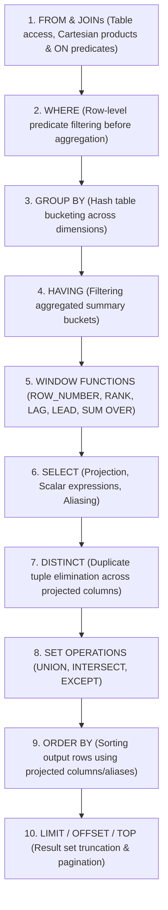
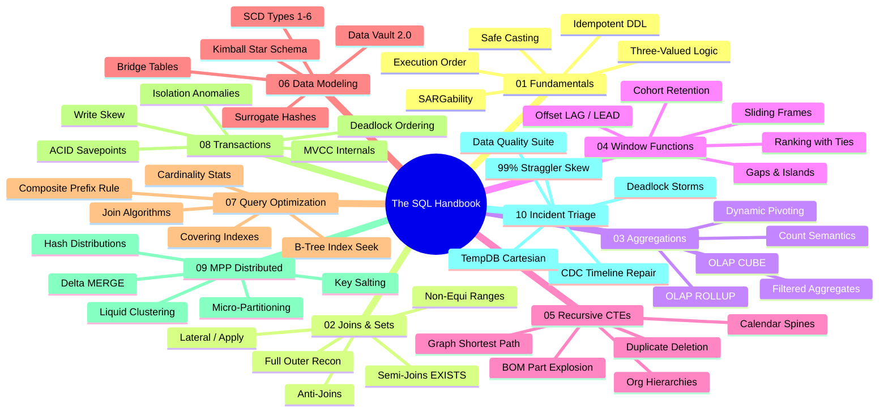

# ⚡ The SQL Handbook

**105 Production Coding Use Cases, Query Optimization Recipes, MPP Architectures & Incident Runbooks**

[](https://github.com/santoshjammi29/sql-handbook/actions)
[](https://www.iso.org/standard/76583.html)
[](https://www.postgresql.org/)
[](https://duckdb.org/)
[](https://www.databricks.com/)
[](https://www.snowflake.com/)
[](https://cloud.google.com/bigquery)
[](LICENSE)

*The definitive enterprise reference repository of 105 battle-tested SQL coding exercises, performance tuning recipes, and disaster recovery incident runbooks.*  
*Structured for instant local practice via Python's built-in `sqlite3` and `duckdb`, with zero external infrastructure required.*

[Curriculum Overview](#-curriculum-overview) • [Logical Query Architecture](#-logical-query-architecture) • [Quickstart & Sandbox](#-quickstart--interactive-sandbox) • [Interview Matrix](#-4-tier-interview-preparation-matrix) • [Production Runbooks](#-battle-tested-production-runbooks) • [Incident Postmortems](#-production-incident-postmortems)

---

## 🎯 Overview & Mission

Modern data engineering and analytics engineering demand far more than basic `SELECT * FROM table WHERE condition`. 

Enterprise workloads operate on high-concurrency transactional databases (PostgreSQL, Aurora, SQL Server) and distributed lakehouse MPP engines (Snowflake, Databricks Spark SQL, Google BigQuery) where a single non-SARGable predicate, missing index, or skewed join key can exhaust cluster memory, trigger multi-hour straggler tasks, or cause 10,000 USD cloud billing surprises.

This repository provides **105 end-to-end, runnable, modular SQL coding use cases** covering:
- **Core & Advanced Relational Fundamentals:** Logical execution order, Three-Valued Logic (3VL), SARGability, cascading integrity, and safe numeric precision.
- **Complex Joins & Aggregations:** Semi-joins (`EXISTS`), anti-joins, full outer reconciliations, non-equi joins, multidimensional `ROLLUP`/`CUBE`, and dynamic pivoting.
- **Analytical Window Functions Mastery:** Ranking with ties, lead/lag offsets, sliding frames (`ROWS` vs. `RANGE`), Gaps and Islands (consecutive streaks & sessionization), and portfolio drawdowns.
- **Hierarchical Trees & Graph Traversal:** Recursive Common Table Expressions (`WITH RECURSIVE`) for organizational charts, Bill of Materials (BOM) part explosions, flight path cycle detection, and calendar spines.
- **Data Modeling & Lakehouse Formats:** Kimball star schemas, Slowly Changing Dimensions (SCD Types 1, 2, 3, 4, 6), Data Vault 2.0 (Hubs/Links/Satellites), and deterministic hash surrogate keys.
- **Storage Engines & Physical Optimization:** B-Tree index traversal, composite index left-prefix rule, covering indexes, partial/filtered indexes, join algorithms, and cardinality estimation tuning.
- **Transactions, MVCC & Concurrency Control:** ACID savepoints, isolation levels (Read Committed, Repeatable Read, Serializable), write skew anomalies, MVCC tuple lifecycles, and deadlock-free canonical resource ordering.
- **MPP Distributed Engines & Big Data SQL:** Snowflake micro-partition pruning, table distributions (Hash/Replicated), Liquid Clustering (`CLUSTER BY`), two-phase key salting for join skew, and multi-condition `MERGE INTO`.
- **Production Incidents & Disaster Postmortems:** 10 real-world production postmortems with forensic analysis and surgical recovery queries (the 99% straggler task, deadlock storms, out-of-order CDC corruption, and automated data quality test suites).

---

## 🏛️ Logical Query Architecture

Understanding the discrepancy between **syntax order** and **logical execution order** is the foundation of SQL mastery:



---

## 🚀 Quickstart & Interactive Sandbox

All 105 exercises are **100% self-contained** and executable locally using Python's standard library with zero external dependencies!

### 1. Clone & Verify Installation
```bash
git clone https://github.com/santoshjammi29/sql-handbook.git
cd sql-handbook
```

### 2. Run the Full Automated Test Suite (105 Exercises in < 1 Second)
```bash
python scripts/run_all_exercises.py
```

### 3. Open Any Problem in the Interactive SQL REPL
Practice queries against pre-seeded in-memory databases with instant feedback:

```bash
# Load Exercise 038: Gaps and Islands Login Streaks
python scripts/interactive_shell.py 038

# Load Exercise 090: Distributed Key Salting for Skewed Joins
python scripts/interactive_shell.py 090
```

Inside the interactive shell:
- Inspect schemas and test datasets with standard SQL queries (`SELECT * FROM player_logins;`).
- Type `.solution` to inspect the battle-tested reference answer.
- Type `exit` to return to your terminal.

---

## 📚 Master Curriculum Map

This curriculum spans **10 structured modules** encompassing foundational syntax through Staff Data Architect production triage:



---

## 📂 Detailed Exercises & Code Matrix

> **Dialect Portability**: All 105 exercises are written in standard ANSI SQL and verified to execute natively on **PostgreSQL**, **DuckDB**, **Databricks Spark SQL**, **Snowflake**, **Google BigQuery**, and **SQLite**.

### 🗺️ Curriculum Track Overview

| Track & Module | Range | Level | Core Architecture & Skills |
| :--- | :---: | :---: | :--- |
| 📦 **[01. Core SQL Fundamentals](#module-01-core-sql-fundamentals)** | `001 – 010` | 🟢<br>Beginner | Execution order, Three-Valued Logic, SARGability, type casting, idempotent DDL |
| 🔗 **[02. Joins & Set Operations](#module-02-joins-and-set-operations)** | `011 – 020` | 🟡<br>Intermediate | Semi-joins (EXISTS), anti-joins, full outer reconciliations, non-equi joins, set ops |
| 📊 **[03. Aggregations & Grouping](#module-03-aggregations-and-grouping)** | `021 – 030` | 🟡<br>Intermediate | COUNT semantics, conditional sums, multidimensional ROLLUP/CUBE, dynamic pivoting |
| 🪟 **[04. Window Functions Mastery](#module-04-window-functions-mastery)** | `031 – 045` | 🔴<br>Advanced | Ranking ties, value offsets (LAG/LEAD), sliding frames, Gaps & Islands, retention |
| 🌲 **[05. Subqueries & Recursive CTEs](#module-05-subqueries-and-recursive-ctes)** | `046 – 055` | 🔴<br>Advanced | Recursive hierarchies, Bill of Materials (BOM), flight paths, calendar spines, deduplication |
| 📐 **[06. Data Modeling & SCD](#module-06-data-modeling-and-scd)** | `056 – 065` | 🔴<br>Advanced | Kimball star schemas, SCD Types 1-6, Data Vault 2.0, bridge tables, surrogate hashing |
| ⚡ **[07. Indexing & Query Optimization](#module-07-indexing-and-query-optimization)** | `066 – 075` | 🔴<br>Advanced | B-Tree seek vs scan, composite prefix rule, covering indexes, join algorithms, stats |
| 🔒 **[08. Transactions, Concurrency & Locks](#module-08-transactions-concurrency-and-locks)** | `076 – 085` | 🔴<br>Advanced | ACID savepoints, isolation anomalies, write skew, MVCC internals, deadlock ordering |
| ☁️ **[09. MPP & Cloud Warehouses](#module-09-mpp-and-cloud-warehouses)** | `086 – 095` | 🟣<br>Architect | Snowflake micro-partitions, hash distributions, Liquid Clustering, key salting, MERGE |
| 🚨 **[10. Production Incidents & Triage](#module-10-production-incidents-and-triage)** | `096 – 105` | 🟣<br>Architect | 99% straggler skew, deadlock storms, out-of-order CDC recovery, data quality suites |

---


<a id="module-01-core-sql-fundamentals"></a>
### 📦 Module: 01. Core SQL Fundamentals

| # | Exercise Topic & Code | Level | Practical Scenario |
| :---: | :--- | :---: | :--- |
| `001` | [Logical Query Execution Order](exercises/01_core_sql_fundamentals/001_logical_query_execution_order.sql) | 🟢<br>Beginner | An e-commerce finance team needs to calculate gross transaction margins and filter out transactions with margins below USD 50. |
| `002` | [Three Valued Logic & NULL Traps](exercises/01_core_sql_fundamentals/002_three_valued_logic_and_null_traps.sql) | 🟢<br>Beginner | A marketing operations system needs to identify customer leads that have NOT unsubscribed from communication. |
| `003` | [SARGability & Predicate Rewriting](exercises/01_core_sql_fundamentals/003_sargability_and_predicate_rewriting.sql) | 🟡<br>Intermediate | An auditing job queries an invoice table with 20 million rows daily to find all invoices generated during the year 2024. |
| `004` | [Relational Constraints & Cascade Rules](exercises/01_core_sql_fundamentals/004_relational_constraints_and_cascade_rules.sql) | 🟢<br>Beginner | In a SaaS multi-tenant application, tenants can be deactivated or deleted. |
| `005` | [Safe Type Casting & Numeric Precision](exercises/01_core_sql_fundamentals/005_safe_type_casting_and_numeric_precision.sql) | 🟡<br>Intermediate | A financial reporting service computes portfolio performance percentages. |
| `006` | [String Manipulation & Pattern Extraction](exercises/01_core_sql_fundamentals/006_string_manipulation_and_pattern_extraction.sql) | 🟢<br>Beginner | User identity management records email addresses in mixed casing with leading and trailing whitespace. |
| `007` | [Temporal & Timestamp Arithmetic](exercises/01_core_sql_fundamentals/007_temporal_and_timestamp_arithmetic.sql) | 🟡<br>Intermediate | A subscription platform charges monthly recurring subscriptions. |
| `008` | [Conditional CASE Logic & NULLIF COALESCE](exercises/01_core_sql_fundamentals/008_conditional_case_logic_and_nullif_coalesce.sql) | 🟢<br>Beginner | E-commerce return rate analytics require calculating the ratio of returned items to total sold items. |
| `009` | [Filtering Edge Cases NOT EXISTS vs NOT IN](exercises/01_core_sql_fundamentals/009_filtering_edge_cases_not_exists_vs_not_in.sql) | 🟡<br>Intermediate | A security audit must locate all internal employee badges that have NEVER accessed secure server facilities. |
| `010` | [Idempotent DDL & Safe Schema Migrations](exercises/01_core_sql_fundamentals/010_idempotent_ddl_and_safe_schema_migrations.sql) | 🟢<br>Beginner | Continuous deployment CI/CD pipelines run database migration scripts on every deployment. |

<a id="module-02-joins-and-set-operations"></a>
### 🔗 Module: 02. Joins & Set Operations

| # | Exercise Topic & Code | Level | Practical Scenario |
| :---: | :--- | :---: | :--- |
| `011` | [Inner Left Right Full Outer Joins](exercises/02_joins_and_set_operations/011_inner_left_right_full_outer_joins.sql) | 🟡<br>Intermediate | Sales management wants a complete list of all registered sales reps and their deals closed this quarter. |
| `012` | [Semi Joins & Duplicate Multiplier Prevention](exercises/02_joins_and_set_operations/012_semi_joins_and_duplicate_multiplier_prevention.sql) | 🟡<br>Intermediate | Finance needs to calculate the total credit limit of customers who placed at least one high-value order (> USD 1,000). |
| `013` | [Anti Joins For Missing Record Detection](exercises/02_joins_and_set_operations/013_anti_joins_for_missing_record_detection.sql) | 🟡<br>Intermediate | Customer Success needs a report of all accounts that signed up over 90 days ago but have never created an active project. |
| `014` | [Full Outer Joins For Reconciliation](exercises/02_joins_and_set_operations/014_full_outer_joins_for_reconciliation.sql) | 🟡<br>Intermediate | Daily reconciliation between internal payment ledger and Stripe settlement files. |
| `015` | [Cross Joins & Cartesian Grid Generation](exercises/02_joins_and_set_operations/015_cross_joins_and_cartesian_grid_generation.sql) | 🟢<br>Beginner | Retail store analytics requires generating a continuous reporting grid of all stores for all dates in a promo week, even if a store recorded 0 sales. |
| `016` | [Non Equi Joins & Effective Date Matching](exercises/02_joins_and_set_operations/016_non_equi_joins_and_effective_date_matching.sql) | 🟡<br>Intermediate | Product pricing changes over time. |
| `017` | [Lateral Joins & Cross Apply Expansions](exercises/02_joins_and_set_operations/017_lateral_joins_and_cross_apply_expansions.sql) | 🔴<br>Advanced | For an executive summary, retrieve each customer along with their top 2 most expensive orders. |
| `018` | [UNION vs UNION ALL Internals](exercises/02_joins_and_set_operations/018_union_vs_union_all_internals.sql) | 🟢<br>Beginner | Consolidating transactional logs across web and mobile channels. |
| `019` | [INTERSECT & EXCEPT Data Audits](exercises/02_joins_and_set_operations/019_intersect_and_except_data_audits.sql) | 🟡<br>Intermediate | Data migration verification between Legacy Oracle EDW and Modern Snowflake Lakehouse. |
| `020` | [Self Joins For Sequential Event Pairs](exercises/02_joins_and_set_operations/020_self_joins_for_sequential_event_pairs.sql) | 🟡<br>Intermediate | User session flow analysis requires calculating how many seconds a user spent on Step 1 before transitioning to Step 2 in a checkout funnel. |

<a id="module-03-aggregations-and-grouping"></a>
### 📊 Module: 03. Aggregations & Grouping

| # | Exercise Topic & Code | Level | Practical Scenario |
| :---: | :--- | :---: | :--- |
| `021` | [COUNT Semantics Star One Column](exercises/03_aggregations_and_grouping/021_count_semantics_star_one_column.sql) | 🟢<br>Beginner | A data quality dashboard needs to report total rows, populated rows, missing values, and unique counts across a customer transactions table. |
| `022` | [Multi Column Group By & Grain Integrity](exercises/03_aggregations_and_grouping/022_multi_column_group_by_and_grain_integrity.sql) | 🟡<br>Intermediate | A SaaS company bills customers based on product tier across multiple geographic regions. |
| `023` | [Where Pre Filtering vs Having Post Aggregation](exercises/03_aggregations_and_grouping/023_where_pre_filtering_vs_having_post_aggregation.sql) | 🟢<br>Beginner | Finance needs to audit departments whose total verified expense claims exceed USD 1,000. |
| `024` | [Conditional Aggregation Filtered Metrics](exercises/03_aggregations_and_grouping/024_conditional_aggregation_filtered_metrics.sql) | 🟡<br>Intermediate | An operations dashboard needs to report total transactions, total completed revenue, total refunded amount, and refund rate in a SINGLE TABLE SCAN. |
| `025` | [Multidimensional Olap ROLLUP Subtotals](exercises/03_aggregations_and_grouping/025_multidimensional_olap_rollup_subtotals.sql) | 🔴<br>Advanced | Financial quarterly reporting requires displaying sales subtotals by Year, subtotals by Year and Quarter, and the Grand Total for all records. |
| `026` | [Multidimensional Olap CUBE Combinations](exercises/03_aggregations_and_grouping/026_multidimensional_olap_cube_combinations.sql) | 🔴<br>Advanced | Merchandise inventory analytics requires examining revenue across all cross-combinations of Product Category and Store Channel. |
| `027` | [GROUPING SETS For Targeted Cubes](exercises/03_aggregations_and_grouping/027_grouping_sets_for_targeted_cubes.sql) | 🔴<br>Advanced | Management requires sales reporting at the Brand level, and at the (Country, Region) level, but explicitly does NOT want a full CUBE. |
| `028` | [Relational Pivoting Rows To Columns](exercises/03_aggregations_and_grouping/028_relational_pivoting_rows_to_columns.sql) | 🟡<br>Intermediate | Monthly financial summary tables store sales vertically by month. |
| `029` | [Relational Unpivoting Columns To Rows](exercises/03_aggregations_and_grouping/029_relational_unpivoting_columns_to_rows.sql) | 🟡<br>Intermediate | A legacy spreadsheet ingest landed data with quarters as columns (q1_sales, q2_sales, q3_sales). |
| `030` | [Statistical Aggregations Median & Percentiles](exercises/03_aggregations_and_grouping/030_statistical_aggregations_median_and_percentiles.sql) | 🔴<br>Advanced | Compensation benchmarking requires computing median salary per department. |

<a id="module-04-window-functions-mastery"></a>
### 🪟 Module: 04. Window Functions Mastery

| # | Exercise Topic & Code | Level | Practical Scenario |
| :---: | :--- | :---: | :--- |
| `031` | [Ranking Functions ROW_NUMBER RANK DENSE_RANK](exercises/04_window_functions_mastery/031_ranking_functions_row_number_rank_dense_rank.sql) | 🟡<br>Intermediate | Sales leaderboard computation requires rewarding top performers. |
| `032` | [Quantile Distribution NTILE Bucketing](exercises/04_window_functions_mastery/032_quantile_distribution_ntile_bucketing.sql) | 🟡<br>Intermediate | Marketing customer segmentation divides customers into 4 spending quartiles (Top 25% VIP, Upper Middle, Lower Middle, Bottom 25% Low Engagement). |
| `033` | [Value Offsets LAG LEAD Period Over Period](exercises/04_window_functions_mastery/033_value_offsets_lag_lead_period_over_period.sql) | 🟡<br>Intermediate | Financial health tracking requires comparing this month's revenue to the previous month to calculate Month-over-Month (MoM) growth rates. |
| `034` | [Navigation Functions FIRST_VALUE, LAST_VALUE & NTH_VALUE](exercises/04_window_functions_mastery/034_navigation_functions_first_last_nth_value.sql) | 🔴<br>Advanced | Customer journey attribution requires comparing each touchpoint order amount against both the customer's very first order amount and their latest order amount. |
| `035` | [Cumulative & Running Totals](exercises/04_window_functions_mastery/035_cumulative_and_running_totals.sql) | 🟡<br>Intermediate | Cashflow forecasting requires calculating a running bank account balance across chronological credits and debits. |
| `036` | [Moving Averages & Rolling Windows](exercises/04_window_functions_mastery/036_moving_averages_and_rolling_windows.sql) | 🟡<br>Intermediate | Telemetry anomaly detection requires computing a 3-day trailing moving average of server CPU load to filter out transient micro-spikes. |
| `037` | [Physical vs Logical Frames ROWS vs RANGE](exercises/04_window_functions_mastery/037_physical_vs_logical_frames_rows_vs_range.sql) | 🔴<br>Advanced | When computing running totals over duplicate order dates, the default frame RANGE BETWEEN UNBOUNDED PRECEDING AND CURRENT ROW groups peer rows together, producing duplicate running totals on the same date!. |
| `038` | [Gaps & Islands Consecutive Streaks](exercises/04_window_functions_mastery/038_gaps_and_islands_consecutive_streaks.sql) | 🔴<br>Advanced | Gaming engagement systems reward players who maintain consecutive daily login streaks of 3 or more days. |
| `039` | [Gaps & Islands Threshold Sessionization](exercises/04_window_functions_mastery/039_gaps_and_islands_threshold_sessionization.sql) | 🔴<br>Advanced | Web traffic analytics sessionizer: consecutive page clicks separated by less than 30 minutes (1800 seconds) belong to the same session. |
| `040` | [Gaps & Islands Overlapping Interval Merging](exercises/04_window_functions_mastery/040_gaps_and_islands_overlapping_interval_merging.sql) | 🔴<br>Advanced | Hotel room booking intervals or fleet vehicle maintenance reservations can overlap. |
| `041` | [Running Peak & Maximum Drawdown](exercises/04_window_functions_mastery/041_running_peak_and_maximum_drawdown.sql) | 🔴<br>Advanced | Hedge fund risk systems calculate Maximum Drawdown (MDD) — the maximum peak-to-trough percentage drop in asset portfolio value before a new peak is reached. |
| `042` | [Year Over Year & Month Over Month Growth](exercises/04_window_functions_mastery/042_year_over_year_and_month_over_month_growth.sql) | 🟡<br>Intermediate | Annual financial reporting requires comparing monthly sales against the exact same calendar month from the prior year (YoY Growth). |
| `043` | [Customer Retention Cohort Curves](exercises/04_window_functions_mastery/043_customer_retention_cohort_curves.sql) | 🔴<br>Advanced | Product analytics cohorts: Group users by acquisition month and calculate the retention rate in subsequent activity months (Month 0, Month 1, Month 2). |
| `044` | [Top-N Per Category Deterministic Ties](exercises/04_window_functions_mastery/044_top_n_per_category_deterministic_ties.sql) | 🟡<br>Intermediate | E-commerce homepage display: show top 2 bestselling items per category. |
| `045` | [Windowed Aggregates Without Group By](exercises/04_window_functions_mastery/045_windowed_aggregates_without_group_by.sql) | 🟢<br>Beginner | Payroll transparency analysis: Show each employee's salary alongside their department total payroll and their personal percentage contribution, without collapsing the individual employee rows. |

<a id="module-05-subqueries-and-recursive-ctes"></a>
### 🌲 Module: 05. Subqueries & Recursive CTEs

| # | Exercise Topic & Code | Level | Practical Scenario |
| :---: | :--- | :---: | :--- |
| `046` | [Scalar & Multi Row Subqueries](exercises/05_subqueries_and_recursive_ctes/046_scalar_and_multi_row_subqueries.sql) | 🟢<br>Beginner | Compensation equity review: identify all employees whose salary is above their department's average salary, and calculate the exact dollar variance. |
| `047` | [Correlated Subqueries & Decorrelation](exercises/05_subqueries_and_recursive_ctes/047_correlated_subqueries_and_decorrelation.sql) | 🟡<br>Intermediate | E-commerce fraud detection: Identify customers who placed an order with an amount greater than 3 times their historical average order value. |
| `048` | [CTEs vs Temp Tables vs Subqueries](exercises/05_subqueries_and_recursive_ctes/048_ctes_vs_temp_tables_vs_subqueries.sql) | 🟡<br>Intermediate | ETL pipeline clean-up: Transform raw event streams into parsed JSON attributes, filter invalid records, and aggregate summary metrics in a clean multi-CTE pipeline. |
| `049` | [Recursive CTE Organizational Hierarchy](exercises/05_subqueries_and_recursive_ctes/049_recursive_cte_organizational_hierarchy.sql) | 🔴<br>Advanced | HR organizational reporting: generate the complete reporting tree starting from the CEO down to individual contributors, calculating employee hierarchy depth level and full management breadcrumb path. |
| `050` | [Recursive CTE Bill Of Materials Explosion](exercises/05_subqueries_and_recursive_ctes/050_recursive_cte_bill_of_materials_explosion.sql) | 🔴<br>Advanced | Manufacturing supply chain: A Laptop consists of sub-assemblies (Chassis, Motherboard), which themselves contain raw components (Chips, Screws). |
| `051` | [Recursive CTE Graph Shortest Path Cycle Detection](exercises/05_subqueries_and_recursive_ctes/051_recursive_cte_graph_shortest_path_cycle_detection.sql) | 🔴<br>Advanced | Flight route network optimizer: Find all possible flight itineraries between London (LHR) and Tokyo (HND) with maximum 2 layovers, preventing infinite loops in cyclic graph networks. |
| `052` | [Recursive CTE Calendar Dimension Spine](exercises/05_subqueries_and_recursive_ctes/052_recursive_cte_calendar_dimension_spine.sql) | 🟡<br>Intermediate | Sales fact tables are sparse: if no sales occur on a weekend, no row exists. |
| `053` | [Binary Tree Node Classification](exercises/05_subqueries_and_recursive_ctes/053_binary_tree_node_classification.sql) | 🟡<br>Intermediate | LeetCode 608: Tree Node Classification. |
| `054` | [Materialized vs Inlined CTEs](exercises/05_subqueries_and_recursive_ctes/054_materialized_vs_inlined_ctes.sql) | 🔴<br>Advanced | Query optimizer fences: In PostgreSQL and SQLite, an un-materialized CTE is inlined into the main query, allowing predicate pushdown. |
| `055` | [Deterministic Duplicate Deletion](exercises/05_subqueries_and_recursive_ctes/055_deterministic_duplicate_deletion.sql) | 🟡<br>Intermediate | A buggy webhook created multiple duplicate records for the same customer email. |

<a id="module-06-data-modeling-and-scd"></a>
### 📐 Module: 06. Data Modeling & SCD

| # | Exercise Topic & Code | Level | Practical Scenario |
| :---: | :--- | :---: | :--- |
| `056` | [Kimball Star Schema Fact Dimension Design](exercises/06_data_modeling_and_scd/056_kimball_star_schema_fact_dimension_design.sql) | 🟢<br>Beginner | Enterprise retail reporting uses Kimball Dimensional Modeling: a central Fact table containing numeric additive facts and foreign surrogate keys, surrounded by conformed Dimension tables containing descriptive attributes. |
| `057` | [Slowly Changing Dimension Type 1 Overwrite](exercises/06_data_modeling_and_scd/057_slowly_changing_dimension_type_1_overwrite.sql) | 🟡<br>Intermediate | SCD Type 1 (In-Place Overwrite): When correcting spelling errors or non-historical attributes (e. |
| `058` | [Slowly Changing Dimension Type 2 Historical](exercises/06_data_modeling_and_scd/058_slowly_changing_dimension_type_2_historical.sql) | 🔴<br>Advanced | SCD Type 2 (Historical Tracking): When customer address changes, previous address must be preserved for historical sales tax audit compliance. |
| `059` | [Slowly Changing Dimension Type 3 Previous Value](exercises/06_data_modeling_and_scd/059_slowly_changing_dimension_type_3_previous_value.sql) | 🟡<br>Intermediate | SCD Type 3 (Prior Value Column): Sales territory realignment requires tracking both the Current Sales Territory and the Previous Sales Territory side-by-side without adding new table rows. |
| `060` | [Slowly Changing Dimension Type 4 Mini Dimensions](exercises/06_data_modeling_and_scd/060_slowly_changing_dimension_type_4_mini_dimensions.sql) | 🔴<br>Advanced | SCD Type 4 (Mini-Dimensions): High-frequency changing customer attributes (credit score band, annual income tier, age group) would cause an SCD Type 2 table to explode to billions of rows. |
| `061` | [Slowly Changing Dimension Type 6 Hybrid Implementation](exercises/06_data_modeling_and_scd/061_slowly_changing_dimension_type_6_hybrid_implementation.sql) | 🔴<br>Advanced | SCD Type 6 (1 + 2 + 3): Combines full row history (Type 2) with an in-place current attribute column (Type 1) populated across ALL historical rows for that entity. |
| `062` | [Data Vault 2 0 Hubs Links Satellites](exercises/06_data_modeling_and_scd/062_data_vault_2_0_hubs_links_satellites.sql) | 🔴<br>Advanced | Data Vault 2. |
| `063` | [Bridge Tables For Many To Many Relationships](exercises/06_data_modeling_and_scd/063_bridge_tables_for_many_to_many_relationships.sql) | 🔴<br>Advanced | Joint bank accounts: A bank account can have multiple owners (Alice 60%, Bob 40%), and an owner can hold multiple accounts. |
| `064` | [Accumulating Snapshot Fact Tables](exercises/06_data_modeling_and_scd/064_accumulating_snapshot_fact_tables.sql) | 🟡<br>Intermediate | Order fulfillment lifecycle: An e-commerce order moves through sequential milestones (Placed -> Paid -> Shipped -> Delivered). |
| `065` | [Deterministic Surrogate Key Generation](exercises/06_data_modeling_and_scd/065_deterministic_surrogate_key_generation.sql) | 🟡<br>Intermediate | Distributed Lakehouse architectures (Spark, Snowflake, BigQuery) cannot efficiently generate sequential auto-incrementing integers without serializing across all compute workers. |

<a id="module-07-indexing-and-query-optimization"></a>
### ⚡ Module: 07. Indexing & Query Optimization

| # | Exercise Topic & Code | Level | Practical Scenario |
| :---: | :--- | :---: | :--- |
| `066` | [B-Tree Index Seek vs Index Scan](exercises/07_indexing_and_query_optimization/066_btree_index_seek_vs_index_scan.sql) | 🟡<br>Intermediate | A user authentication service queries accounts table by email. |
| `067` | [Composite Index Column Ordering Left Prefix](exercises/07_indexing_and_query_optimization/067_composite_index_column_ordering_left_prefix.sql) | 🔴<br>Advanced | Multi-tenant SaaS databases partition customer data by tenant_id. |
| `068` | [Covering Indexes & Index Only Scans](exercises/07_indexing_and_query_optimization/068_covering_indexes_and_index_only_scans.sql) | 🔴<br>Advanced | High-frequency trading API: Point queries checking account balance must execute in under 1 millisecond. |
| `069` | [Filtered & Partial Indexes](exercises/07_indexing_and_query_optimization/069_filtered_and_partial_indexes.sql) | 🔴<br>Advanced | Message queue processing: A table holds 50 million processed messages and 500 unprocessed messages. |
| `070` | [Cardinality Estimation & Statistics](exercises/07_indexing_and_query_optimization/070_cardinality_estimation_and_statistics.sql) | 🟡<br>Intermediate | Optimizer cost modeling: In relational engines, the Cost-Based Optimizer estimates cardinality (how many rows match a predicate) using table statistics. |
| `071` | [Clustered vs Non Clustered Index Layout](exercises/07_indexing_and_query_optimization/071_clustered_vs_non_clustered_index_layout.sql) | 🔴<br>Advanced | Clustered Index determines the physical order of rows on disk. |
| `072` | [Join Algorithms Nested Loop Hash Merge](exercises/07_indexing_and_query_optimization/072_join_algorithms_nested_loop_hash_merge.sql) | 🟡<br>Intermediate | Database join algorithms: 1. |
| `073` | [Preventing Accidental Cartesian Products](exercises/07_indexing_and_query_optimization/073_preventing_accidental_cartesian_products.sql) | 🟢<br>Beginner | A developer joined two tables without specifying an ON condition, or joined on non-unique keys, creating a catastrophic Cartesian Product that filled TempDB disk space and crashed the database instance. |
| `074` | [Sargable Date Range Predicates](exercises/07_indexing_and_query_optimization/074_sargable_date_range_predicates.sql) | 🟡<br>Intermediate | Auditing transactions created in May 2024: Bad: WHERE STRFTIME('%m', created_at) = '05' (Non-SARGable full table scan) Good: WHERE created_at >= '2024-05-01' AND created_at < '2024-06-01' (SARGable). |
| `075` | [Index Bloat & Fragmentation Maintenance](exercises/07_indexing_and_query_optimization/075_index_bloat_and_fragmentation_maintenance.sql) | 🔴<br>Advanced | High-frequency random inserts and deletes cause B-Tree page splits and table bloat. |

<a id="module-08-transactions-concurrency-and-locks"></a>
### 🔒 Module: 08. Transactions, Concurrency & Locks

| # | Exercise Topic & Code | Level | Practical Scenario |
| :---: | :--- | :---: | :--- |
| `076` | [Acid Atomicity & Savepoints](exercises/08_transactions_concurrency_and_locks/076_acid_atomicity_and_savepoints.sql) | 🟡<br>Intermediate | Multi-step order checkout: Customer places an order and applies a discount. |
| `077` | [Dirty Read Anomaly Read Uncommitted](exercises/08_transactions_concurrency_and_locks/077_dirty_read_anomaly_read_uncommitted.sql) | 🔴<br>Advanced | Dirty Read anomaly occurs under READ UNCOMMITTED: Transaction 1 mutates a row. |
| `078` | [Non Repeatable Read Anomaly](exercises/08_transactions_concurrency_and_locks/078_non_repeatable_read_anomaly.sql) | 🔴<br>Advanced | Non-Repeatable Read (Fuzzy Read): Under READ COMMITTED, Transaction 1 reads a row (USD 100). |
| `079` | [Phantom Read Anomaly Range Locks](exercises/08_transactions_concurrency_and_locks/079_phantom_read_anomaly_range_locks.sql) | 🔴<br>Advanced | Phantom Read anomaly: Transaction 1 queries COUNT(*) WHERE status = 'PENDING' (returns 2). |
| `080` | [Write Skew Anomaly Under Snapshot Isolation](exercises/08_transactions_concurrency_and_locks/080_write_skew_anomaly_under_snapshot_isolation.sql) | 🔴<br>Advanced | The Hospital On-Call Doctor Dilemma (Write Skew): A hospital requires at least 1 doctor on call. |
| `081` | [MVCC Internals & Version Visibility](exercises/08_transactions_concurrency_and_locks/081_mvcc_internals_and_version_visibility.sql) | 🔴<br>Advanced | MVCC Internals: In Multi-Version Concurrency Control, row updates do not overwrite disk blocks. |
| `082` | [Optimistic Concurrency Control Version Checks](exercises/08_transactions_concurrency_and_locks/082_optimistic_concurrency_control_version_checks.sql) | 🟡<br>Intermediate | Web e-commerce inventory: To avoid expensive long-lived database locks, applications use Optimistic Concurrency Control (OCC). |
| `083` | [Deadlock Reproduction & Inverse Locking](exercises/08_transactions_concurrency_and_locks/083_deadlock_reproduction_and_inverse_locking.sql) | 🔴<br>Advanced | Deadlock (Error 1205): Transaction 1 locks Account A then requests Account B. |
| `084` | [Pessimistic Locking FOR UPDATE](exercises/08_transactions_concurrency_and_locks/084_pessimistic_locking_for_update.sql) | 🟡<br>Intermediate | Concert ticket booking: Multiple users attempt to buy the last VIP seat. |
| `085` | [Double Entry Ledger Atomic Transfer](exercises/08_transactions_concurrency_and_locks/085_double_entry_ledger_atomic_transfer.sql) | 🔴<br>Advanced | Fintech Double-Entry Bookkeeping Invariant: Every financial transaction must have matching debit and credit entries. |

<a id="module-09-mpp-and-cloud-warehouses"></a>
### ☁️ Module: 09. MPP & Cloud Warehouses

| # | Exercise Topic & Code | Level | Practical Scenario |
| :---: | :--- | :---: | :--- |
| `086` | [Snowflake Micropartition Pruning](exercises/09_mpp_and_cloud_warehouses/086_snowflake_micropartition_pruning.sql) | 🔴<br>Advanced | Cloud data warehouses (Snowflake, BigQuery) divide multi-terabyte tables into immutable micro-partitions / row-groups. |
| `087` | [MPP Table Distribution Hash Replicated Roundrobin](exercises/09_mpp_and_cloud_warehouses/087_mpp_table_distribution_hash_replicated_roundrobin.sql) | 🔴<br>Advanced | MPP distribution strategies (Azure Synapse / Redshift): 1. |
| `088` | [Liquid Clustering vs Hive Partitioning](exercises/09_mpp_and_cloud_warehouses/088_liquid_clustering_vs_hive_partitioning.sql) | 🔴<br>Advanced | Legacy Hive physical directory partitioning (/year=2024/month=05/) creates the small file problem. |
| `089` | [Detecting Distribution Skew In Parallel Shards](exercises/09_mpp_and_cloud_warehouses/089_detecting_distribution_skew_in_parallel_shards.sql) | 🔴<br>Advanced | In MPP clusters, if rows are not uniformly distributed, one worker processes vastly more data than peers (Skew / Straggler node). |
| `090` | [Distributed Key Salting For Skewed Joins](exercises/09_mpp_and_cloud_warehouses/090_distributed_key_salting_for_skewed_joins.sql) | 🔴<br>Advanced | Distributed join skew: Joining fact orders on customer_id when customer 0 (Guest Checkout) represents 90% of all orders causes 1 executor to run for hours. |
| `091` | [Broadcast vs Shuffle Join Thresholds](exercises/09_mpp_and_cloud_warehouses/091_broadcast_vs_shuffle_join_thresholds.sql) | 🟡<br>Intermediate | Distributed join mechanics: If a table is below the broadcast threshold (e. |
| `092` | [Partition Pruning & Dynamic Partition Elimination](exercises/09_mpp_and_cloud_warehouses/092_partition_pruning_and_dynamic_partition_elimination.sql) | 🔴<br>Advanced | Dynamic Partition Elimination: When joining a partitioned fact table to a date dimension filtered on 'current fiscal quarter', the engine dynamically prunes unreferenced fact partitions during query execution. |
| `093` | [Delta MERGE INTO Multi Condition Matching](exercises/09_mpp_and_cloud_warehouses/093_delta_merge_into_multi_condition_matching.sql) | 🔴<br>Advanced | Modern Lakehouse Upsert: Incoming CDC stream contains new inserts, updates, and soft deletes. |
| `094` | [Query Memory Spill Mitigation](exercises/09_mpp_and_cloud_warehouses/094_query_memory_spill_mitigation.sql) | 🟡<br>Intermediate | Tungsten memory spill: In-memory hash aggregations spill to local disk when aggregating massive high-cardinality keys. |
| `095` | [Serverless Sql Querying External Files](exercises/09_mpp_and_cloud_warehouses/095_serverless_sql_querying_external_files.sql) | 🟡<br>Intermediate | Serverless SQL (DuckDB, Synapse Serverless, BigQuery Omni): Querying external Parquet and CSV files directly on object storage without provisioning dedicated clusters. |

<a id="module-10-production-incidents-and-triage"></a>
### 🚨 Module: 10. Production Incidents & Triage

| # | Exercise Topic & Code | Level | Practical Scenario |
| :---: | :--- | :---: | :--- |
| `096` | [Incident: The 99 Percent Straggler Task Disaster](exercises/10_production_incidents_and_triage/096_incident_the_99_percent_straggler_task_disaster.sql) | 🔴<br>Advanced | PRODUCTION INCIDENT POSTMORTEM: The 99% Complete Straggler Task Disaster. |
| `097` | [Incident: Payment Gateway Deadlock Storm](exercises/10_production_incidents_and_triage/097_incident_payment_gateway_deadlock_storm.sql) | 🔴<br>Advanced | PRODUCTION INCIDENT POSTMORTEM: Deadlock Storm in Payment Processing. |
| `098` | [Incident: Out Of Order CDC Timeline Corruption](exercises/10_production_incidents_and_triage/098_incident_out_of_order_cdc_timeline_corruption.sql) | 🔴<br>Advanced | PRODUCTION INCIDENT POSTMORTEM: Out-of-Order CDC Timeline Corruption. |
| `099` | [Incident: Accidental Cartesian TempDB Exhaustion](exercises/10_production_incidents_and_triage/099_incident_accidental_cartesian_tempdb_exhaustion.sql) | 🔴<br>Advanced | PRODUCTION INCIDENT POSTMORTEM: Accidental Cartesian TempDB Exhaustion. |
| `100` | [Incident: Silent Schema Drift BI Refresh Failure](exercises/10_production_incidents_and_triage/100_incident_silent_schema_drift_bi_refresh_failure.sql) | 🟡<br>Intermediate | PRODUCTION INCIDENT POSTMORTEM: Silent Schema Drift Breaking BI Dashboards. |
| `101` | [Incident: Parameter Sniffing Query Timeout](exercises/10_production_incidents_and_triage/101_incident_parameter_sniffing_query_timeout.sql) | 🔴<br>Advanced | PRODUCTION INCIDENT POSTMORTEM: Parameter Sniffing Sudden Query Timeouts. |
| `102` | [Incident: Phantom Read Financial Ledger Double Spend](exercises/10_production_incidents_and_triage/102_incident_phantom_read_financial_ledger_double_spend.sql) | 🔴<br>Advanced | PRODUCTION INCIDENT POSTMORTEM: Financial Ledger Double-Spend Breach. |
| `103` | [Incident: Unindexed Foreign Key Table Lock Cascade](exercises/10_production_incidents_and_triage/103_incident_unindexed_foreign_key_table_lock_cascade.sql) | 🔴<br>Advanced | PRODUCTION INCIDENT POSTMORTEM: Unindexed Foreign Key Table-Lock Cascade. |
| `104` | [Incident: Delta Lake Concurrent Append Conflict](exercises/10_production_incidents_and_triage/104_incident_delta_lake_concurrent_append_conflict.sql) | 🔴<br>Advanced | PRODUCTION INCIDENT POSTMORTEM: Concurrent Append Write Conflict. |
| `105` | [Master Enterprise Data Quality Reconciliation Suite](exercises/10_production_incidents_and_triage/105_master_enterprise_data_quality_reconciliation_suite.sql) | 🟣<br>Architect | MASTER ENTERPRISE DATA QUALITY AUDIT SUITE: Automated daily gatekeeper validating: 1. |

---

## 🚨 Battle-Tested Production Runbooks

The repository includes enterprise-grade operational runbooks for production incident response:

| Runbook | Title | Critical Failure Mode Addressed |
| :--- | :--- | :--- |
| **[Runbook 01](runbooks/01_deadlock_and_lock_contention_triage.md)** | **Deadlock & Lock Contention Emergency Triage** | Application 504 pool exhaustion, Error 1205, locking tree identification, canonical key ordering. |
| **[Runbook 02](runbooks/02_query_performance_and_execution_plan_tuning.md)** | **Query Performance & Execution Plan Tuning** | Non-SARGable functions, index scan vs seek, cardinality estimation drift, parameter sniffing. |
| **[Runbook 03](runbooks/03_mpp_skew_spill_and_broadcast_failures.md)** | **MPP Skew, Memory Spill & Broadcast Failures** | 99% straggler tasks, Tungsten disk spill, Snowflake remote storage spill, two-phase key salting. |
| **[Runbook 04](runbooks/04_scd_and_cdc_reconciliation_disaster_recovery.md)** | **SCD Type 2 & CDC Reconciliation Disaster Recovery** | Out-of-order Kafka CDC events, duplicate active records (`is_current = true`), self-healing queries. |
| **[Runbook 05](runbooks/05_cross_engine_rosetta_stone.md)** | **Cross-Engine SQL Rosetta Stone** | Syntax comparison across PostgreSQL, DuckDB, Spark SQL, Snowflake, BigQuery, and T-SQL. |
| **[Runbook 06](runbooks/06_finops_and_warehouse_cost_optimization.md)** | **FinOps & Cloud Warehouse Cost Optimization** | Snowflake auto-suspend, BigQuery scan reduction (6.25 USD per TB), Databricks serverless rightsizing. |

---

## 🎓 4-Tier Interview Preparation Matrix

Prepare for technical coding screens from Junior Analyst to Principal Lakehouse Architect:

1. **[Tier 1: Junior Analyst & Data Engineer (Foundations)](interview/01_junior_analyst_and_data_engineer.md)**: Execution order, `COUNT` semantics, `WHERE` vs `HAVING`, 3VL logic, `UNION` vs `UNION ALL`.
2. **[Tier 2: Mid-Level Data Engineer (Analytical Mastery)](interview/02_mid_level_data_engineer.md)**: Ranking functions, Gaps & Islands streaks, duplicate deletion, binary tree node classification, query SARGability.
3. **[Tier 3: Senior Distributed Data Engineer (Distributed Systems & Performance)](interview/03_senior_distributed_data_engineer.md)**: The 5 S's of Spark SQL tuning, SCD Types 1-6, Snowflake micro-partitions, two-phase key salting, deadlock prevention.
4. **[Tier 4: Staff & Lakehouse Architect (System Design & Governance)](interview/04_staff_and_lakehouse_architect.md)**: Kimball vs Data Vault 2.0, Liquid Clustering internals, Delta Lake transaction log, Power BI Direct Lake mode.
5. **[50-Card Rapid-Fire Technical Flashcard Deck](interview/05_flashcards_deck_50.md)**: Rapid-fire revision covering core SQL, analytical windows, indexes, and distributed engines.

---

## 🏛️ Architectural Deep Dives

In-depth technical architecture whitepapers:

- **[01. Logical vs. Physical Query Execution](architectures/01_logical_vs_physical_query_execution.md)**: Relational algebra, AST parsing, predicate pushdown, and Cost-Based Optimizer physical join selection.
- **[02. MPP Distributed SQL & Data Movement](architectures/02_mpp_distributed_sql_and_data_movement.md)**: Shared-nothing architecture, Colocated vs Broadcast vs Shuffle joins, and network interconnect bottlenecks.
- **[03. Storage Engines — Row-Store, Columnar & Lakehouse Formats](architectures/03_storage_engines_row_columnar_and_lakehouse.md)**: 8KB B-Tree pages vs Parquet columnar row groups, dictionary encoding, Delta Lake ACID logs, and Liquid Clustering.
- **[04. Concurrency Control, MVCC & Distributed Consensus](architectures/04_concurrency_control_mvcc_and_distributed_consensus.md)**: The 5 concurrency anomalies, PostgreSQL tuple visibility (`xmin`/`xmax`), Two-Phase Locking, and Google Spanner TrueTime / HLC consensus.

---

## 🛠️ Repository Structure

```
sql-handbook/
├── README.md                                  # Master repository documentation
├── LICENSE                                    # MIT Open Source License
├── pyproject.toml                             # Python package & pytest configuration
├── requirements.txt                           # Optional development dependencies
├── .github/
│   └── workflows/
│       └── ci.yml                             # Automated GitHub Actions test runner
├── tests/
│   ├── test_sql_integrity.py                 # File structure & metadata assertion tests
│   ├── test_sql_execution.py                 # In-memory SQL execution & validation runner
│   └── conftest.py                            # Pytest configuration
├── scripts/
│   ├── run_all_exercises.py                  # CLI runner benchmarking all 105 exercises
│   ├── interactive_shell.py                  # Interactive in-memory SQL sandbox REPL
│   └── generate_readme_matrix.py             # Dynamic curriculum matrix generator
├── exercises/                                 # 105 Runnable SQL Coding Exercises
│   ├── 01_core_sql_fundamentals/             # 001 - 010 (Execution order, 3VL, SARGability)
│   ├── 02_joins_and_set_operations/          # 011 - 020 (Semi-joins, Anti-joins, Lateral)
│   ├── 03_aggregations_and_grouping/         # 021 - 030 (Conditional sums, ROLLUP, CUBE)
│   ├── 04_window_functions_mastery/          # 031 - 045 (Offsets, Frames, Gaps & Islands)
│   ├── 05_subqueries_and_recursive_ctes/     # 046 - 055 (Hierarchies, BOM, Graph paths)
│   ├── 06_data_modeling_and_scd/             # 056 - 065 (Kimball, SCD 1-6, Data Vault 2.0)
│   ├── 07_indexing_and_query_optimization/   # 066 - 075 (B-Tree, Covering, Join algorithms)
│   ├── 08_transactions_concurrency_and_locks/# 076 - 085 (ACID, MVCC, Deadlocks, Ledgers)
│   ├── 09_mpp_and_cloud_warehouses/          # 086 - 095 (Snowflake, BigQuery, Spark SQL)
│   └── 10_production_incidents_and_triage/   # 096 - 105 (Real-world incident postmortems)
├── runbooks/                                  # 6 Battle-tested production incident playbooks
├── interview/                                 # 4-Tier interview question bank & flashcards
└── architectures/                             # 4 Deep-dive architectural whitepapers
```

---

## 🤝 Contributing & License

Contributions, new production incident postmortems, and dialect optimizations are welcome! Please ensure all submissions include:
1. Standard exercise metadata header.
2. Complete schema DDL and test seed data.
3. Solution query with `-- ASSERT: ROW_COUNT = ...` verification comments.
4. Pass all automated tests: `python scripts/run_all_exercises.py`.

Distributed under the **MIT License**. See [`LICENSE`](LICENSE) for details.  
Created and maintained with ❤️ by [Santosh Jammi](https://github.com/santoshjammi29).
