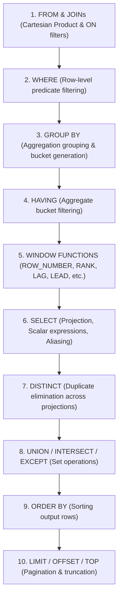
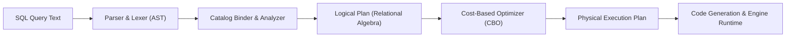

# 🏛️ Architecture Deep Dive: Logical vs. Physical Query Execution

## 1. Overview & Theoretical Foundations

In relational database systems (RDBMS) and distributed query engines (Databricks Photon, Trino, Snowflake, BigQuery, Spark SQL), there is a fundamental distinction between:
1. **Logical Query Processing**: The conceptual order in which an ANSI SQL statement is evaluated according to relational algebra.
2. **Physical Query Execution**: The actual operational plan generated by the Cost-Based Optimizer (CBO) and executed by the storage engine across CPU, memory, and disk.

Understanding this dual lifecycle is the prerequisite for diagnosing query performance regressions, index bypasses, cardinality misestimations, and distributed bottlenecks.

---

## 2. Logical Query Processing Order

While SQL syntax requires writing `SELECT` first, the database engine conceptually processes clauses in the following strict order:



### Critical Architectural Implications of Logical Order:
- **Column Aliases in `WHERE`**: Why can't you use a column alias defined in `SELECT` inside a `WHERE` clause? Because `WHERE` (Step 2) executes before `SELECT` (Step 6).
- **`WHERE` vs. `HAVING`**: `WHERE` eliminates rows *before* aggregation occurs; `HAVING` filters group rows *after* the aggregation hash table is materialized. Filtering 10M rows down to 10k in `WHERE` avoids building an in-memory hash table for 10M rows.
- **Window Functions in `WHERE`**: Window functions cannot appear in `WHERE` or `HAVING` because they execute at Step 5, after groups are formed. To filter on a window function (e.g., `WHERE rn = 1`), you *must* wrap it in a Common Table Expression (CTE) or subquery.

---

## 3. Physical Query Compilation Pipeline

The SQL text is transformed into machine execution code through five discrete compiler phases:



### Phase Details:
1. **Lexical Analysis & Parsing**: The SQL string is tokenized and transformed into an Abstract Syntax Tree (AST). Syntax errors (misspelled keywords, mismatched parentheses) fail here.
2. **Catalog Binding & Analysis**: Table names, column references, and data types are verified against the data catalog/schema metadata. Schema resolution errors (`column "x" does not exist`) fail here.
3. **Logical Optimization (Rule-Based)**:
   - **Predicate Pushdown**: Pushing filters down as close to the storage layer as possible.
   - **Projection Pruning**: Discarding unreferenced columns immediately.
   - **Constant Folding & Expression Simplification**: Evaluating `1 + 1` or static subexpressions once at compile time.
4. **Physical Optimization (Cost-Based Optimizer / CBO)**:
   - Evaluates multiple candidate execution algorithms based on table statistics and histogram distributions.
   - Decides Join Type: **Nested Loop Join**, **Hash Join**, or **Sort-Merge Join**.
   - Decides Index Strategy: **Index Seek**, **Index Scan**, or **Table/Clustered Index Scan**.
   - In distributed engines: Decides Data Exchange: **Broadcast Join** vs. **Shuffle / Hash Partitioned Join**.
5. **Code Generation & Vectorized Execution**:
   - Modern engines (Databricks Photon, DuckDB, Trino, Snowflake) compile physical plan operators into vectorized C++ or LLVM JIT bytecode processing arrays of 1,024+ records (SIMD execution).

---

## 4. Join Physical Implementation Matrix

| Physical Join Algorithm | Best Used When | Time Complexity | Memory Requirement | Common Pitfall / Failure Mode |
| :--- | :--- | :--- | :--- | :--- |
| **Nested Loop Join** | One side is tiny (< 100 rows) and inner table has indexed join key. | $\mathcal{O}(N \times \log M)$ | Minimal ($\mathcal{O}(1)$) | Catastrophic $\mathcal{O}(N \times M)$ Cartesian explosion when inner side is unindexed or cardinality underestimated. |
| **Hash Join** | Both tables are large, unsorted, equality predicate (`=`), build side fits in RAM. | $\mathcal{O}(N + M)$ | Build table hash table in RAM ($\mathcal{O}(M)$) | Hash table exceeds RAM $\rightarrow$ TempDB / disk spill; high memory pressure. |
| **Sort-Merge Join** | Both inputs are already sorted on join keys or large tables exceed available RAM. | $\mathcal{O}(N \log N + M \log M)$ | Low streaming memory footprint | Expensive sort phase if inputs are not pre-sorted by clustered index or storage layout. |
| **Broadcast Hash Join** | One table is small enough to replicate to all worker nodes in distributed engine. | $\mathcal{O}(N)$ local | Size of small table replicated per worker | Driver OOM or network saturation if broadcast threshold misconfigured. |

---

## 5. Production Plan Inspection Protocol

To inspect the physical execution plan across leading database engines:

```sql
-- PostgreSQL
EXPLAIN (ANALYZE, BUFFERS, VERBOSE, SETTINGS, FORMAT JSON)
SELECT ... ;

-- DuckDB
EXPLAIN ANALYZE
SELECT ... ;

-- Databricks / Apache Spark SQL
EXPLAIN EXTENDED
SELECT ... ;

-- Snowflake
EXPLAIN
SELECT ... ;
-- Inspect via Snowflake UI Query Profile for graphical operator trees and spill metrics.

-- Microsoft SQL Server / Azure Synapse
SET STATISTICS IO, TIME ON;
-- In SSMS: Press Ctrl + M to include Actual Execution Plan.
```

### Critical Plan Red Flags:
1. **Actual Rows $\gg$ Estimated Rows**: Outdated statistics causing the CBO to choose a catastrophic Nested Loop Join over a Hash Join.
2. **Implicit Conversions (`CONVERT_IMPLICIT`)**: Non-SARGable predicate preventing Index Seek.
3. **Table Spills to Workfile / TempDB**: Insufficient `work_mem` or shuffle memory causing disk write penalties.
4. **Broadcast Exchange with Massive Data**: Worker or driver memory exhaustion due to skewed dimensions.
