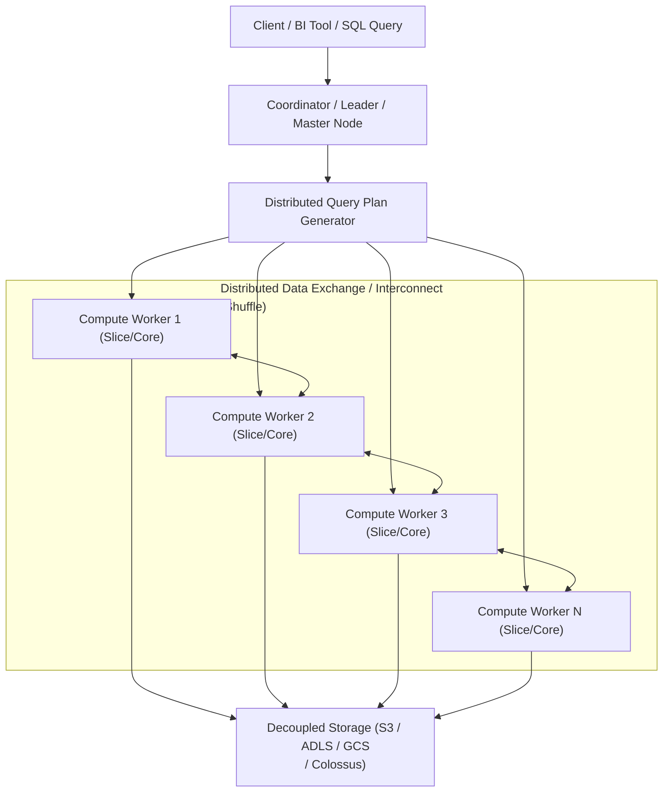
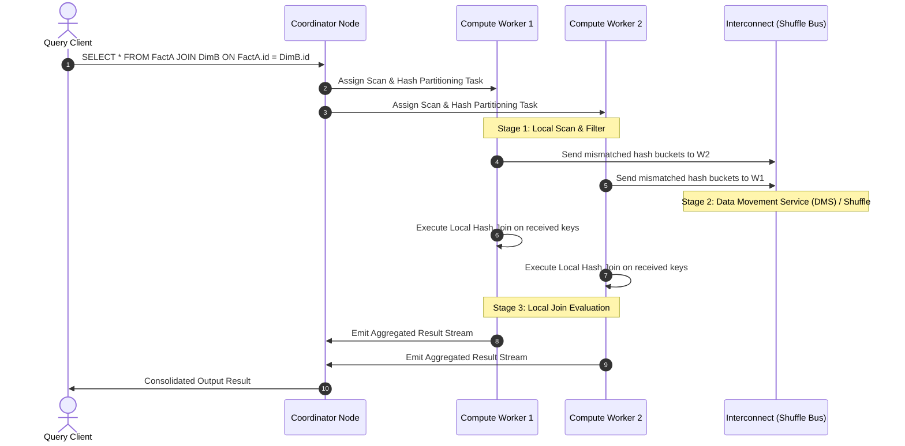
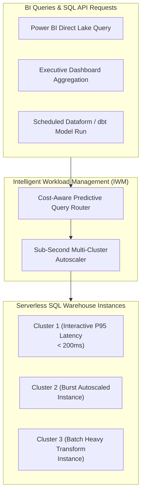

# 🏛️ Architecture Deep Dive: MPP Distributed SQL & Data Movement


> *Architectural Blueprint: [Apache Spark Memory Architecture & Shuffle Mechanics](../docs/whiteboard_diagrams/README.md#spark-shuffle-memory-execution). View full multi-persona breakdown and engine mechanisms in the master index.*


> *Architectural Blueprint: [Apache Spark Join Strategy Selection Decision Tree](../docs/whiteboard_diagrams/README.md#spark-join-decision-tree). View full multi-persona breakdown and engine mechanisms in the master index.*

## 1. Massively Parallel Processing (MPP) vs. SMP Architecture

Traditional Symmetric Multiprocessing (SMP) databases (PostgreSQL, MySQL, single-node SQL Server) share a single pool of memory, CPU, and storage. In contrast, Massively Parallel Processing (MPP) data warehouses (Snowflake, BigQuery, Databricks SQL, Azure Synapse, Amazon Redshift) scale queries horizontally across a shared-nothing or decoupled-storage-and-compute architecture.



---

## 2. Table Distribution Strategies

How rows are distributed across parallel compute nodes dictates whether a join is zero-network (colocated) or network-choked (shuffle).

| Distribution Strategy | Physical Mechanism | Optimal Workload | Trade-offs & Penalties |
| :--- | :--- | :--- | :--- |
| **Hash Distribution** | Rows are assigned to nodes using a deterministic hash of a designated column: `hash(key) % num_nodes`. | Large fact tables (> 100M rows) joined frequently on that specific key. | If the key has low cardinality or high skew (e.g., NULLs, Default Tenant ID), one node receives 90% of rows (Straggler node). |
| **Replicated / Broadcast** | A complete, identical copy of the table is stored or cached on every single compute node. | Small-to-medium dimension tables (< 2GB, e.g., Date Dim, Store Dim, Currency Dim). | High storage redundancy; update/write penalty when dimension undergoes frequent DML modifications. |
| **Round-Robin** | Rows are distributed uniformly in sequential order across all nodes without evaluating column values. | Staging / raw ingestion tables before transformation; ad-hoc datasets with unknown join patterns. | Joins *always* require a full network shuffle because matching keys reside on different nodes. |

---

## 3. Distributed Join Mechanics & Data Movement

When two distributed tables are joined, the query coordinator must align matching join keys onto the exact same physical node before evaluating the join predicate.



### The 3 Core Data Movement Operations:
1. **Colocated Join (Zero Data Movement)**:
   - Both tables are hash-distributed on the exact same join key (with identical bucket counts).
   - Compute nodes evaluate the join locally without sending a single byte across the network.
   - *Performance*: Fastest possible distributed join ($\approx 10\times$ faster than shuffle).
2. **Broadcast Join (`Move Broadcast` / `BroadcastHashJoin`)**:
   - The smaller table is broadcast across the network to every node.
   - Large table remains untouched and is scanned locally.
   - *Performance*: Highly efficient if the small table is < 100MB. If size exceeds broadcast thresholds, it exhausts worker memory and triggers driver OOMs.
3. **Shuffle / Repartition Join (`Shuffle Hash Join`)**:
   - Both tables are hashed and repartitioned across all nodes over the network interconnect.
   - *Performance*: Network-bound bottleneck. If network bandwidth or CPU serialization saturates, query runtime balloons exponentially.

---

## 4. The MPP Skew Disaster & Straggler Node Problem

In an MPP cluster of 64 nodes, query completion time is determined by the **slowest single node** (Amdahl's Law).

$$T_{query} = \max(T_{node_1}, T_{node_2}, \dots, T_{node_{64}})$$

### Root Causes of Skew:
1. **Join Key High Nullity**: Joining on a key where 30% of rows are `NULL`. All `NULL` rows hash to the identical bucket on Node 17.
2. **Entity Hotspotting**: In B2B SaaS, tenant ID `0` (internal platform testing) represents 40% of all activity. Node 4 receives 40% of the entire table while 63 nodes finish in 2 seconds.

### Surgical Mitigation — Key Salting:
When joining a skewed fact table with a dimension table, append a random integer salt ($0 \dots K-1$) to the fact table's join key, and replicate/explode the dimension table $K$ times with matching salt keys. This splits the single hotspot into $K$ distinct uniform buckets distributed evenly across workers.

```sql
-- Step 1: Salt the skewed fact table (0 to 9)
WITH salted_fact AS (
    SELECT
        customer_id,
        CASE
            WHEN customer_id = 0 THEN CAST(customer_id AS VARCHAR) || '_' || CAST(FLOOR(RANDOM() * 10) AS VARCHAR)
            ELSE CAST(customer_id AS VARCHAR) || '_0'
        END AS salted_customer_key,
        amount
    FROM fact_transactions
),
-- Step 2: Explode dimension table 10x for the skewed key
exploded_dim AS (
    SELECT
        d.customer_id,
        CASE
            WHEN d.customer_id = 0 THEN CAST(d.customer_id AS VARCHAR) || '_' || CAST(s.salt AS VARCHAR)
            ELSE CAST(d.customer_id AS VARCHAR) || '_0'
        END AS salted_customer_key,
        d.customer_name
    FROM dim_customer d
    CROSS JOIN (
        SELECT 0 AS salt UNION ALL SELECT 1 UNION ALL SELECT 2 UNION ALL SELECT 3 UNION ALL SELECT 4
        UNION ALL SELECT 5 UNION ALL SELECT 6 UNION ALL SELECT 7 UNION ALL SELECT 8 UNION ALL SELECT 9
    ) s
)
SELECT
    f.customer_id,
    d.customer_name,
    SUM(f.amount) AS total_spend
FROM salted_fact f
JOIN exploded_dim d ON f.salted_customer_key = d.salted_customer_key
GROUP BY f.customer_id, d.customer_name;
```

---

## 5. Modern Cloud Warehouse Architecture Comparison

| Dimension | Snowflake | Google BigQuery | Databricks SQL | Azure Synapse (Dedicated) |
| :--- | :--- | :--- | :--- | :--- |
| **Compute Model** | Virtual Warehouses (EC2/Azure VMs/GCP) | Dremel multi-tenant slots | Photon C++ vectorized serverless clusters | Control node + Compute nodes (DWUs) |
| **Storage Model** | Proprietary micro-partitions (immutable) | Capacitor columnar on Colossus | Delta Lake / Parquet on Object Storage | Clustered Columnstore on 60 distributions |
| **Data Layout** | Automatic micro-partitioning + Clustering Keys | Physical Partitioning + Clustering (up to 4 cols) | Liquid Clustering (`CLUSTER BY`) + Z-Order | Hash (60 distributions), Replicated, Round-Robin |
| **Scaling Mechanism** | Multi-cluster warehouse auto-scaling | Dynamic on-demand slot allocation / reservations | Serverless cluster auto-scaling & disk auto-tiering | Manual DWU scale up/down with cluster pause |
| **File Compaction** | Automatic background re-clustering | Automatic background clustering & storage optimization | `OPTIMIZE table_name` / Auto-compaction | Manual index rebuild / partition reorg |

---

## 4. Serverless Databricks SQL & Intelligent Workload Management (IWM)

Serverless Databricks SQL decouples concurrency management through **Intelligent Workload Management (IWM)**, dynamically routing queries to optimal warehouse cluster sizes and warm compute fleets.



### Production Configuration: Serverless SQL Warehouse Autoscaling
```sql
-- Databricks SQL Serverless warehouse configuration parameters
-- Intelligent Workload Management automatically allocates clusters
ALTER WAREHOUSE serverless_bi_warehouse
SET AUTO_STOP_MINS = 5,
    MIN_NUM_CLUSTERS = 1,
    MAX_NUM_CLUSTERS = 6,
    SPOT_INSTANCE_POLICY = 'COST_OPTIMIZED';
```

### Key MPP Routing Invariants:
- **Sub-Second Scaling**: Serverless compute provisions additional clusters in under 5 seconds during bursty dashboard query spikes.
- **Predictive De-queuing**: Large analytical scans are automatically isolated from short interactive BI queries to prevent head-of-line blocking.
