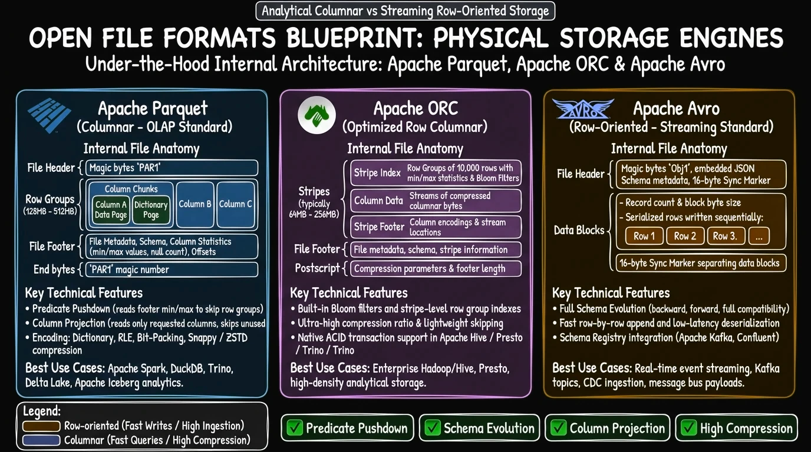
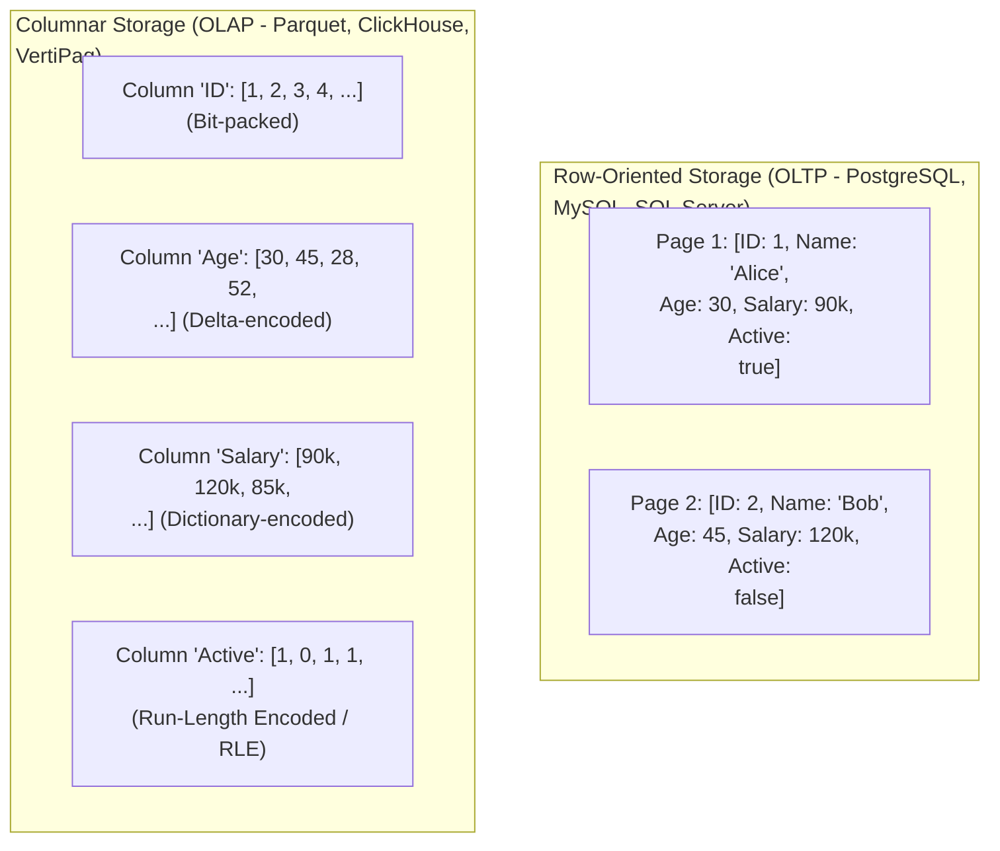
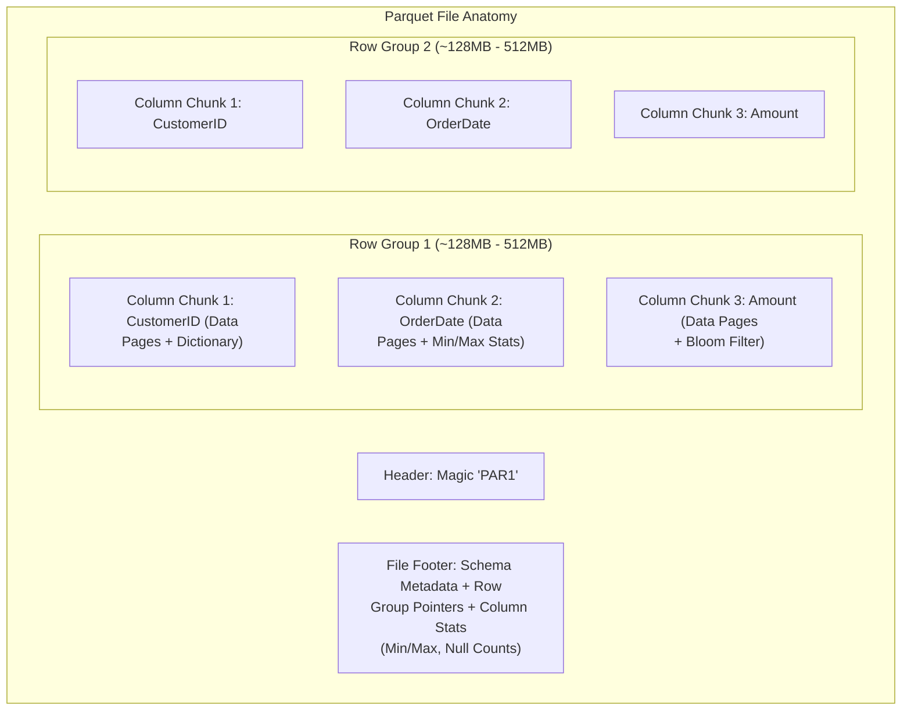
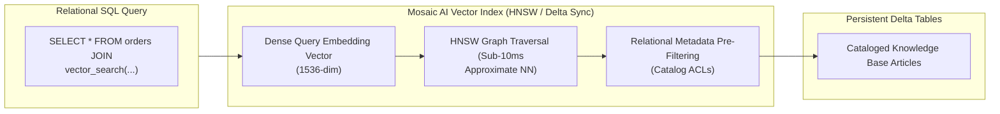

# 🏛️ Architecture Deep Dive: Storage Engines — Row-Store, Columnar & Lakehouse Formats


> *Architectural Blueprint: [Open Table Formats Blueprint: Lakehouse Storage Engines](../docs/whiteboard_diagrams/README.md#open-table-formats-lakehouse). View full multi-persona breakdown and engine mechanisms in the master index.*


> *Architectural Blueprint: [Open File Formats Blueprint: Physical Storage Engines](../docs/whiteboard_diagrams/README.md#open-file-formats-storage). View full multi-persona breakdown and engine mechanisms in the master index.*

## 1. Storage Architecture Taxonomy

Database storage architecture determines I/O efficiency, cache locality, and compression ratios. Workloads broadly partition into:
1. **OLTP (Online Transaction Processing)**: Point queries, single-row inserts/updates, high write concurrency. Optimized by **Row-Oriented B-Tree / Heap Storage**.
2. **OLAP (Online Analytical Processing)**: Multi-million row scans, aggregations over a subset of columns, bulk inserts. Optimized by **Columnar Storage & Vectorized Compression**.
3. **Open Lakehouse Storage**: Cloud object storage (S3, ADLS Gen2, GCS) backed by open columnar files (Parquet) and an ACID transaction metadata log (**Delta Lake, Apache Iceberg, Apache Hudi**).



---

## 2. Row-Oriented Storage Mechanics

### Physical Organization:
- Data is written in fixed-size blocks (typically **8 KB** in PostgreSQL and SQL Server).
- A single page holds multiple complete rows (tuples) alongside a slot array / pointer directory.
- **B+ Tree Indexing**: Intermediate nodes store navigation keys and child page pointers; leaf nodes store either the full row (Clustered Index) or a pointer (RowID / tuple pointer) to a heap page (Non-Clustered Index).

### Trade-offs:
- **Pros**: Inserting, updating, or fetching an entire record (`SELECT * WHERE id = 42`) requires reading exactly **one 8 KB page** into the buffer pool.
- **Cons**: Running `SELECT AVG(salary) FROM employees` requires reading the *entire* table into memory — 95% of the I/O reads irrelevant columns (`name`, `bio`, `address`, `metadata`).

---

## 3. Column-Oriented Storage & Compression Mechanics

In columnar files (Apache Parquet, Apache ORC, VertiPaq, ClickHouse), each column is stored contiguously on disk in **Row Groups** (typically 100k to 1M rows per group).

### Why Columnar Storage Dominates Analytics:
1. **Projection Pruning**: If a query requests only `customer_id` and `amount`, only the disk blocks containing those two columns are transferred from disk/object storage. All other columns incur **zero I/O cost**.
2. **Homogeneous Data Compression**:
   - Because all values in a column share the exact same data type, compression algorithms achieve $5\times$ to $10\times$ higher compression ratios than row stores.
   - **Run-Length Encoding (RLE)**: `[US, US, US, US, UK, UK]` becomes `(US, 4), (UK, 2)`.
   - **Dictionary Encoding**: Strings are replaced with 1-byte integer IDs referencing a dictionary header.
   - **Bit-Packing & Frame-of-Reference**: Timestamps or sequence numbers store only differences from a baseline integer.
3. **Vectorized Instruction Execution (SIMD)**:
   - Modern CPUs process contiguous arrays of 32-bit or 64-bit integers using AVX-512 / ARM Neon vector instructions, evaluating aggregate filters (`WHERE age > 65`) at over 1 billion rows per second per core.

### Parquet File Internal Structure:



---

## 4. Open Lakehouse Table Formats (Delta Lake, Apache Iceberg, Apache Hudi)

Cloud object storage (Amazon S3, Azure ADLS Gen2, Google Cloud Storage) lacks native POSIX filesystem guarantees (no atomic directory renames, eventual consistency, no file-level locking).

Open table formats solve this by introducing an **ACID Transaction Log** on top of immutable Parquet files.

| Feature | Delta Lake | Apache Iceberg | Apache Hudi |
| :--- | :--- | :--- | :--- |
| **Transaction Log** | `_delta_log/*.json` + checkpoint `.checkpoint.parquet` files (Single-writer commit protocol) | Hierarchical JSON snapshot metadata -> Manifest Lists -> Manifest Files | Timeline metadata (`.hoodie/`) with instantaneous commits and compaction records |
| **Catalog Independence** | Unity Catalog, Hive Metastore, or standalone filesystem path | Requires catalog (Iceberg REST Catalog, Unity, Glue, Nessie, Snowflake) | Hive Metastore, AWS Glue, filesystem |
| **Concurrency Control** | Optimistic Concurrency Control (OCC) with Mutual Exclusion via commit coordinator | Optimistic Concurrency Control with atomic pointer swap in catalog | OCC with multi-writer lock provider (Zookeeper, DynamoDB, Hive) |
| **Multi-Engine Interop** | Delta Universal Format (**UniForm**) generates Iceberg/Hudi metadata on commit | Native Iceberg engine support (Trino, Spark, Flink, Snowflake, DuckDB) | Native Spark/Flink/Presto connectors |
| **Clustering / Layout** | **Liquid Clustering (`CLUSTER BY`)** & Z-Order multidimensional curves | Partition evolution & sorting / Z-order compaction | Clustering & Space-filling curve sorting |
| **Row-Level Mutations** | Deletion Vectors (Roaring Bitmaps) & Copy-on-Write (CoW) | Position Delete Files / Equality Deletes (Merge-on-Read) & CoW | Merge-on-Read (Avro log deltas) & Copy-on-Write |

---

## 5. The Small File Problem & Production Compaction

### The Failure Mode:
Streaming ingestion pipelines (Kafka $\rightarrow$ Spark Structured Streaming / Flink) append batches every 10 seconds. In 24 hours:
$$8,640 \text{ intervals} \times 16 \text{ partitions} = 138,240 \text{ files of } 50 \text{ KB each}$$

Querying this table requires 138,240 HTTP `GET` requests to S3/ADLS. Metadata listing alone takes 3 minutes before query processing even begins.

### Surgical Remediation Protocol:
1. **Bin-Packing Compaction**: Combine thousands of tiny 50KB files into uniform 128MB–512MB Parquet files.
   ```sql
   -- Databricks / Delta Lake
   OPTIMIZE gold_sales_orders;

   -- With Liquid Clustering
   OPTIMIZE gold_sales_orders CLUSTER BY (customer_id, order_date);
   ```
2. **Vacuum Stale Files**: Remove physical files marked deleted by previous transactions older than retention horizon:
   ```sql
   -- Retain 7 days of audit time travel; purge older unreferenced Parquet files
   VACUUM gold_sales_orders RETAIN 168 HOURS;
   ```
3. **Deletion Vectors**: In modern Delta Lake ($3.0+$) and Iceberg ($v2$), row-level `DELETE` and `UPDATE` statements do *not* rewrite entire 128MB Parquet files. Instead, they write tiny **Deletion Vectors** (compressed Roaring Bitmaps marking row offsets as deleted). Reading engines apply the bitmap during vectorized scan with near-zero latency impact.

---

## 4. Vector Search & Semantic Similarity Retrieval in SQL

Modern Lakehouse SQL integrates semantic vector indexing directly into the relational query engine via the `vector_search()` table-valued function.



### Production Implementation: Vector Search Table Function in SQL
```sql
-- Hybrid semantic retrieval query combining vector search with relational filters
SELECT
    kb.article_id,
    kb.title,
    vs.score AS semantic_similarity_score
FROM vector_search(
    index => 'prod_catalog.knowledge_base.tech_docs_index',
    query_text => 'How do I tune liquid clustering for multi-column joins?',
    num_results => 5
) AS vs
INNER JOIN prod_catalog.knowledge_base.articles AS kb
    ON vs.id = kb.article_id
WHERE kb.publication_status = 'PUBLISHED'
ORDER BY semantic_similarity_score DESC;
```

### Key Semantic Retrieval Invariants:
- **Pre-Filtering with Metadata**: Relational `WHERE` predicates are pushed down directly into the vector index before graph traversal, ensuring strict tenant isolation.
- **Delta Sync Ingestion**: When new documents are inserted into the Delta table, the vector search index syncs incrementally without manual re-indexing.
