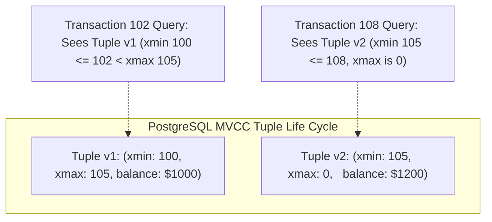
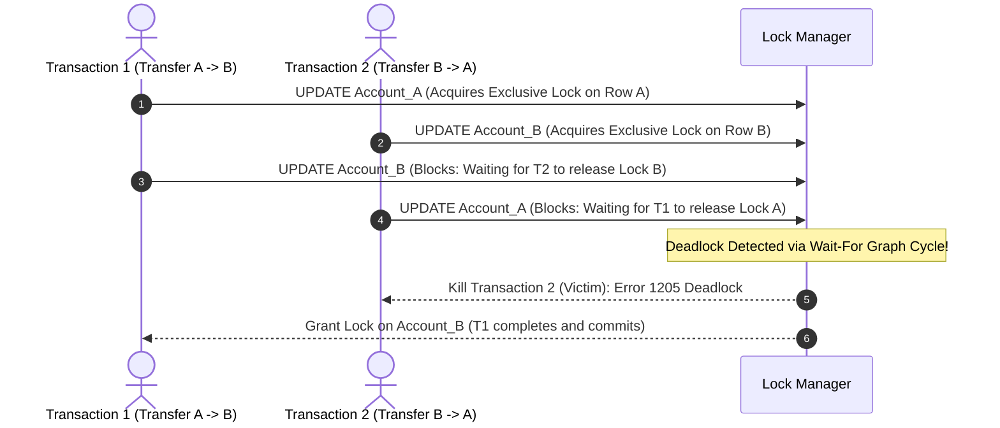
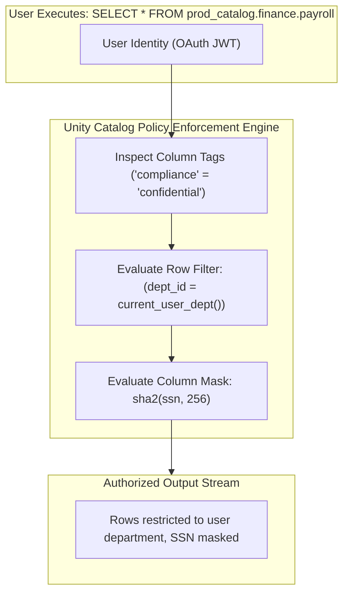

# 🏛️ Architecture Deep Dive: Concurrency Control, MVCC & Distributed Consensus


> *Architectural Blueprint: [Lakehouse ACID Concurrency & Write Conflict Resolution Matrix](../docs/whiteboard_diagrams/README.md#lakehouse-acid-concurrency). View full multi-persona breakdown and engine mechanisms in the master index.*


> *Architectural Blueprint: [Delta Lake vs. Apache Iceberg Storage & Metadata Architecture](../docs/whiteboard_diagrams/README.md#delta-vs-iceberg-architecture). View full multi-persona breakdown and engine mechanisms in the master index.*


## 1. The ACID Paradigm & Concurrency Anomalies

Database concurrency control ensures that multiple transactions executing concurrently yield identical state to a serial execution schedule. 

### The ANSI SQL Isolation Hierarchy & Anomalies Matrix:

| Isolation Level | Dirty Read | Non-Repeatable Read | Phantom Read | Write Skew | Implementation Mechanism |
| :--- | :---: | :---: | :---: | :---: | :--- |
| **Read Uncommitted** | ❌ Allowed | ❌ Allowed | ❌ Allowed | ❌ Allowed | Reads dirty data without acquiring shared locks. |
| **Read Committed** | ✅ Prevented | ❌ Allowed | ❌ Allowed | ❌ Allowed | MVCC statement snapshot (Postgres) or short-term Shared locks. |
| **Repeatable Read** | ✅ Prevented | ✅ Prevented | ❌ Allowed* | ❌ Allowed | MVCC transaction start snapshot; prevents row updates. (*Prevented in Postgres MVCC). |
| **Snapshot Isolation** | ✅ Prevented | ✅ Prevented | ✅ Prevented | ❌ Allowed | Read from start snapshot; First-committer-wins on conflicting writes. |
| **Serializable** | ✅ Prevented | ✅ Prevented | ✅ Prevented | ✅ Prevented | Strict 2PL (Pessimistic) or Serializable Snapshot Isolation (SSI). |

---

## 2. Deep Dive: The 5 Concurrency Anomalies

### 1. Dirty Read ($G_1$)
- **Scenario**: Transaction $T_1$ updates row $X$ from \$100 to \$200. Transaction $T_2$ reads $X = \$200$. $T_1$ executes `ROLLBACK`. $T_2$ has acted upon data that never officially committed to the database.

### 2. Non-Repeatable Read ($G_{2a}$)
- **Scenario**: Transaction $T_1$ reads row $X = \$100$. Transaction $T_2$ updates $X = \$150$ and commits. $T_1$ reads row $X$ again in the same transaction and receives $\$150$. The row mutated underneath $T_1$.

### 3. Phantom Read ($A3$)
- **Scenario**: Transaction $T_1$ executes `SELECT COUNT(*) FROM orders WHERE status = 'PENDING'` (returns 5). Transaction $T_2$ inserts a brand-new pending order and commits. $T_1$ re-executes the count and receives 6. New rows ("phantoms") appeared in the predicate range.

### 4. Write Skew ($A5B$) — The Classic On-Call Doctor Trap
- **Constraint**: A hospital requires at least **one doctor on call** at all times.
- **State**: Alice and Bob are currently on call (Count = 2).
- **Execution**:
  1. $T_1$ (Alice): Checks `SELECT COUNT(*) FROM doctors WHERE on_call = true` (Count is 2).
  2. $T_2$ (Bob): Checks `SELECT COUNT(*) FROM doctors WHERE on_call = true` (Count is 2).
  3. $T_1$: Updates Alice `on_call = false` and commits.
  4. $T_2$: Updates Bob `on_call = false` and commits.
- **Result**: Count is now **0**. Neither transaction updated the same row, so Snapshot Isolation allowed both to commit. Only **Serializable** isolation or explicit predicate locking (`SELECT ... FOR UPDATE`) prevents this anomaly.

### 5. Lost Update ($P4$)
- **Scenario**: Two transactions read account balance \$1,000 simultaneously. $T_1$ deposits \$200 (balance becomes \$1,200). $T_2$ deposits \$300 (balance becomes \$1,300) and commits. $T_1$'s \$200 deposit is completely overwritten and lost.

---

## 3. Multi-Version Concurrency Control (MVCC) Internals

Modern database engines (PostgreSQL, CockroachDB, Snowflake, MySQL InnoDB) implement MVCC: **Readers never block writers, and writers never block readers**.



### PostgreSQL MVCC Mechanism:
- Every table row includes hidden system columns:
  - `xmin`: The transaction ID that inserted this row version.
  - `xmax`: The transaction ID that deleted or updated this row version (0 if active).
- When an `UPDATE` occurs, Postgres does **not** overwrite the existing disk bytes. It creates a brand-new physical row tuple with `xmin = current_tx` and sets `xmax = current_tx` on the old row.
- **Transaction Visibility Rules**: A transaction only reads tuples where `xmin` is committed and $\le$ transaction snapshot ID, and `xmax` is either uncommitted, aborted, or $>$ transaction snapshot ID.
- **Table Bloat & VACUUM**: When dead tuples (`xmax` committed and visible to no running transaction) accumulate, storage space balloons. `VACUUM` scans heap pages and marks dead tuple slots reusable for future inserts.

---

## 4. Pessimistic Locking & Deadlock Resolution

In systems utilizing Two-Phase Locking (2PL), transactions acquire lock handles:
- **Shared Lock (S)**: Acquired for read operations (`SELECT ...`). Multiple readers can hold concurrent S locks.
- **Exclusive Lock (X)**: Acquired for write operations (`UPDATE`, `DELETE`, `INSERT`). No other transaction can hold S or X locks on that resource.

### Deadlock Cycle (Error 1205):
A deadlock occurs when two transactions form a cyclic dependency waiting for resources locked by each other.



### The Universal Deadlock Defense: **Strict Global Resource Ordering**
Always access multiple resources in the exact same deterministic order across the entire codebase:
$$\forall (A, B) \text{ such that } A < B \implies \text{Always lock } A \text{ before } B$$

```sql
-- Production Deadlock-Proof Balance Transfer
CREATE PROCEDURE TransferFunds(
    @FromAccount INT,
    @ToAccount INT,
    @Amount DECIMAL(18,2)
)
AS
BEGIN
    SET NOCOUNT ON;
    SET XACT_ABORT ON;
    
    -- Canonical ordering: Lock smaller ID first regardless of transfer direction!
    DECLARE @FirstAccount INT = IIF(@FromAccount < @ToAccount, @FromAccount, @ToAccount);
    DECLARE @SecondAccount INT = IIF(@FromAccount < @ToAccount, @ToAccount, @FromAccount);

    BEGIN TRANSACTION;
        -- Lock first
        SELECT balance FROM accounts WITH (UPDLOCK, ROWLOCK) WHERE account_id = @FirstAccount;
        -- Lock second
        SELECT balance FROM accounts WITH (UPDLOCK, ROWLOCK) WHERE account_id = @SecondAccount;

        -- Safe debit & credit execution guaranteed zero-deadlock
        UPDATE accounts SET balance = balance - @Amount WHERE account_id = @FromAccount;
        UPDATE accounts SET balance = balance + @Amount WHERE account_id = @ToAccount;
    COMMIT TRANSACTION;
END;
```

---

## 5. Distributed Consensus & Cross-Node Transactions

When data is partitioned across multiple cloud regions or physical server nodes (CockroachDB, Google Spanner, YugabyteDB):

1. **Two-Phase Commit (2PC)**:
   - **Phase 1 (Prepare)**: Coordinator asks all participant nodes if they can commit. Nodes acquire local locks and write intentions to WAL.
   - **Phase 2 (Commit)**: If all respond "Ready", coordinator writes "Commit" to its log and commands all participants to commit. If any node fails or times out, all nodes execute rollback.
   - *Limitation*: 2PC is a blocking protocol; if the coordinator crashes during Phase 2, participant nodes remain locked indefinitely.
2. **Distributed Clocks (TrueTime & HLC)**:
   - To achieve external consistency (Linearizable reads) without locking across data centers, Google Spanner uses **TrueTime API** (synchronized GPS and atomic clocks bounding time uncertainty $\epsilon \approx 7 \text{ ms}$).
   - Other distributed engines (CockroachDB, YugabyteDB) implement **Hybrid Logical Clocks (HLC)** combining physical NTP time with Lamport logical counters.

---

## 4. Dynamic Row Filters, Column Masks & ABAC in Modern SQL

Enterprise SQL security mandates declarative, centralized policy enforcement using **Dynamic Row Filters** and **Column Masks** governed by Attribute-Based Access Control (ABAC).



### Production Security Implementation: Row-Level Security & Cryptographic Masking
```sql
-- 1. Create reusable cryptographic column mask
CREATE OR REPLACE FUNCTION prod_catalog.security.mask_ssn(ssn STRING)
RETURN CASE
    WHEN IS_ACCOUNT_GROUP_MEMBER('hr_executives') THEN ssn
    ELSE concat('XXX-XX-', right(ssn, 4))
END;

-- 2. Create dynamic row filter restricting data by department
CREATE OR REPLACE FUNCTION prod_catalog.security.filter_by_dept(dept_id STRING)
RETURN (
    IS_ACCOUNT_GROUP_MEMBER('c_suite') OR
    dept_id = current_user()
);

-- 3. Apply security policies to sensitive table
ALTER TABLE prod_catalog.finance.payroll
ALTER COLUMN social_security_number SET MASK prod_catalog.security.mask_ssn;

ALTER TABLE prod_catalog.finance.payroll
SET ROW FILTER prod_catalog.security.filter_by_dept ON (department_id);
```

### Key Security Invariants:
- **No View Sprawl**: Row filters and column masks attach directly to physical tables, eliminating the need to maintain hundreds of custom security views.
- **Deterministic Execution**: Filter and mask expressions run inside the query engine physical plan, ensuring optimization without leaking raw values.
