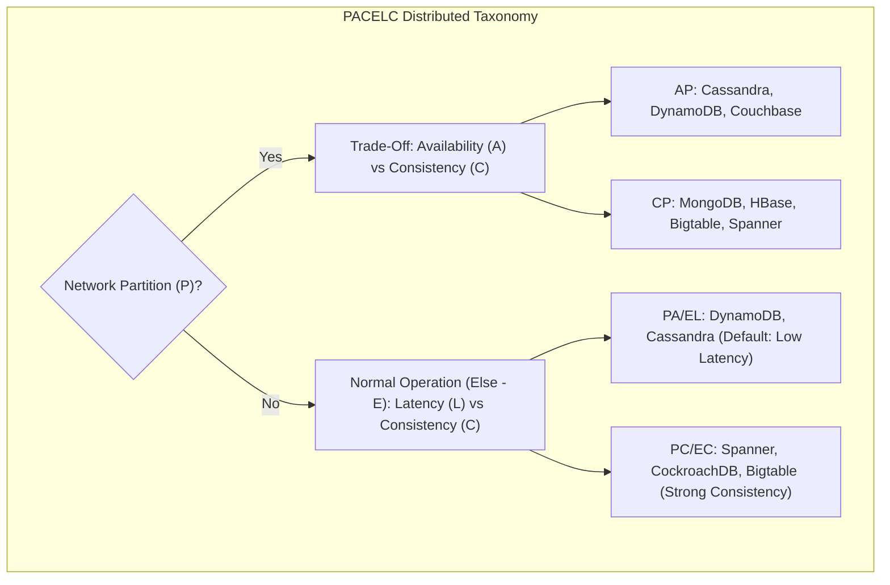
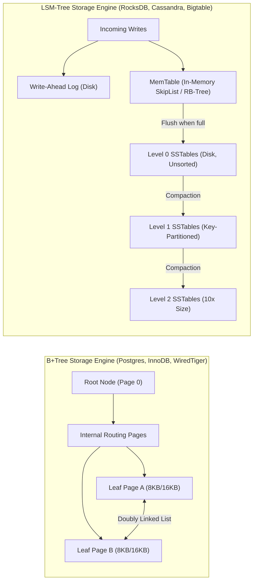
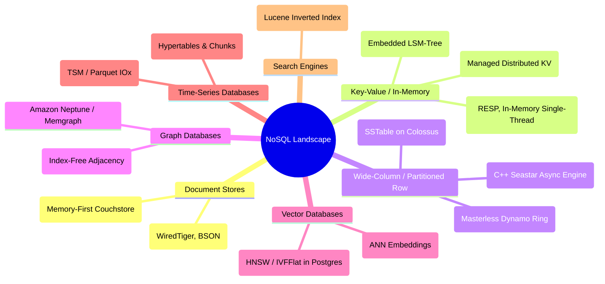

# 🏛️ Architecture Deep Dive: NoSQL Systems, Storage Engines & Trade-Offs


> *Architectural Blueprint: [Open Table Formats Blueprint: Lakehouse Storage Engines](../docs/whiteboard_diagrams/README.md#open-table-formats-lakehouse). View full multi-persona breakdown and engine mechanisms in the master index.*

---

## 1. The NoSQL Paradigm & The CAP / PACELC Theoretical Foundations

While relational database systems (RDBMS) prioritize the **ACID** (Atomicity, Consistency, Isolation, Durability) guarantees formulated for normalized transactions on a single node, modern distributed and non-relational systems often operate under the **BASE** (Basically Available, Soft state, Eventual consistency) model.

### The CAP Theorem (Brewer, 2000)
In any asynchronous network subject to network partitions ($P$), a distributed data store can guarantee at most two of the following three properties:
1. **Consistency ($C$)**: Every read receives the most recent write or an error.
2. **Availability ($A$)**: Every non-failing node returns a non-error response for every request (without guaranteeing it is the most recent write).
3. **Partition Tolerance ($P$)**: The system continues to operate despite an arbitrary number of messages being dropped or delayed by the network between nodes.

Because physical network hardware inevitably experiences packet drops, cable cuts, or switch failures, **Partition Tolerance ($P$) is non-negotiable** in distributed systems. Therefore, architectures must choose between **CP** (Consistency over Availability) or **AP** (Availability over Consistency).

### The PACELC Theorem (Abadi, 2012)
The CAP theorem only describes behavior **during** a network partition. The PACELC theorem provides a complete categorization:
> If there is a **P**artition, trade off **A**vailability versus **C**onsistency;  
> **E**lse, trade off **L**atency versus **C**onsistency.



| Engine | Partition Mode | Normal Operation | PACELC Classification | Primary Concurrency Mechanism |
| :--- | :---: | :---: | :---: | :--- |
| **MongoDB** | Consistency | Consistency | **PC/EC** | Raft-like Replica Set Primary election, WiredTiger MVCC |
| **Apache Cassandra** | Availability | Latency | **PA/EL** | Masterless Dynamo Ring, Tunable Quorum ($R + W > N$) |
| **AWS DynamoDB** | Availability | Latency | **PA/EL** | Paxos leader per storage partition, Request Router |
| **Google Cloud Bigtable** | Consistency | Consistency | **PC/EC** | Single Master, Colossus SSTables, Chubby distributed locks |
| **Redis (Cluster)** | Availability | Latency | **PA/EL** | Asynchronous master-replica replication, Hash slots |
| **Neo4j (Causal Cluster)** | Consistency | Consistency | **PC/EC** | Raft consensus for Core servers, Read Replicas |
| **Google Cloud Spanner** | Consistency | Consistency | **PC/EC** | Multi-Paxos per split, TrueTime atomic hardware clocks |

---

## 2. Storage Engine Mechanics: B+Tree vs. Log-Structured Merge-Tree (LSM)

The fundamental performance trade-off in modern databases comes down to disk access patterns: **Random I/O (in-place updates)** vs. **Sequential I/O (append-only logs)**.



### Quantitative Storage Amplification Metrics:
1. **Write Amplification Factor (WAF)**:
   $$\text{WAF} = \frac{\text{Bytes Written to Storage Media}}{\text{Bytes Written by Application}}$$
   - *B+Tree*: High WAF ($10\times - 100\times$). Modifying a single 32-byte column requires dirtying and flushing an entire 8KB (PostgreSQL) or 16KB (MySQL InnoDB) page to disk, plus WAL overhead.
   - *LSM-Tree*: Moderate WAF during ingestion (sequential write to WAL + Memtable), but increases ($10\times - 30\times$) during multi-level background compaction.
2. **Read Amplification Factor (RAF)**:
   $$\text{RAF} = \frac{\text{Bytes Read from Storage Media}}{\text{Bytes Requested by Application}}$$
   - *B+Tree*: Low RAF ($\mathcal{O}(\log_B N)$). Point lookups traverse $3-4$ indexed nodes directly to the exact target leaf page.
   - *LSM-Tree*: Higher RAF. Must check Memtable, followed by Bloom Filters, and potentially multiple SSTable levels on disk until the key or deletion tombstone is discovered.
3. **Space Amplification Factor (SAF)**:
   $$\text{SAF} = \frac{\text{Disk Space Occupied by Database}}{\text{Uncompressed Logical Data Size}}$$
   - *B+Tree*: Suffers from page fragmentation and internal free-space slack ($30\% - 50\%$ overhead).
   - *LSM-Tree*: Highly compact due to immutability and prefix block compression, but temporarily spikes during major compactions ($2\times$ temporary footprint).

---

## 3. The 7 NoSQL Categories & Database Engines



### 3.1 Document Stores: MongoDB
- **Underlying Engine**: WiredTiger storage engine. Uses B-Trees for indexes and collections with block compression (Snappy/zlib).
- **Data Model**: BSON (Binary JSON), dynamic schema with field-level indexing, secondary indexes, and rich aggregation pipelines (`$match`, `$group`, `$lookup`, `$unwind`).
- **Concurrency & Transactions**: Document-level locking via WiredTiger tickets (`wiredTiger.concurrentReadTransactions` and `concurrentWriteTransactions`). Supports multi-document ACID transactions across replica sets since version 4.0.
- **Critical Anti-Patterns**:
  - *Unbounded Array Growth*: Storing rapidly accumulating events (e.g. user comments or sensor telemetry) inside an embedded array in a single document. Once the document breaches the **16MB BSON limit**, writes hard-fail. Furthermore, frequent array resizing causes extensive memory reallocation and disk fragmentation.
  - *Large Schema-less Documents*: Fetching a 5MB document to update a single integer field causes severe network and WiredTiger buffer pool churn.

### 3.2 Key-Value & In-Memory Stores: Redis & RocksDB
#### Redis
- **Architecture**: Single-threaded event loop driven by I/O multiplexing (`epoll`/`kqueue`), eliminating mutex contention and context-switching overhead.
- **Data Structures**: String, Hash, List, Set, Sorted Set (SkipList), HyperLogLog, Bitmaps, Geospatial, Streams.
- **Memory Eviction Policies**: `volatile-lru`, `allkeys-lru`, `volatile-lfu`, `allkeys-lfu`, `volatile-random`, `allkeys-random`, `volatile-ttl`, `noeviction` (returns OOM error on write).
- **Persistence Modes**:
  - *RDB (Redis Database)*: Point-in-time snapshot created via background `bgsave` fork. Minimal write latency overhead, but risks data loss between snapshot intervals.
  - *AOF (Append Only File)*: Logs every write command. Fsync policy can be `always` (maximum durability, severe latency), `everysec` (recommended balance: max 1s data loss), or `no` (delegated to OS).
- **Cluster Sharding**: 16,384 deterministic hash slots ($CRC16(key) \pmod{16384}$). Multi-key operations are restricted to keys mapping to the same hash slot unless assigned explicit hash tags: `{user:1001}.profile` and `{user:1001}.orders`.

#### RocksDB
- **Architecture**: High-performance embedded key-value store developed by Meta, based on Google's LevelDB.
- **Internal Pipeline**: Writes append to a sequential Write-Ahead Log (WAL) and insert into an in-memory **Memtable** (SkipList). When full, the Memtable becomes read-only and a background thread flushes it to disk as a **Sorted String Table (SSTable)** at Level 0.
- **Compaction Styles**:
  - *Leveled Compaction (Default)*: Level $L+1$ is $10\times$ the size of Level $L$. Guarantees no key overlap within Levels $1+$, optimizing read performance.
  - *Universal Compaction*: Appends all flushed SSTables and merges them in bulk, optimizing write throughput at the cost of higher space amplification.

### 3.3 Distributed Key-Value: AWS DynamoDB
- **Architecture**: Fully managed serverless distributed key-value/document store built on Paxos-replicated storage partitions.
- **Data Modeling Primitives**:
  - **Partition Key (PK)**: Hashed to determine the physical storage partition.
  - **Sort Key (SK)**: Stores items ordered within the physical partition (enabling 1-to-many range queries).
  - **Local Secondary Index (LSI)**: Shares the same PK as the base table, different SK. Strong or eventual consistency. Strict 10GB partition size limit.
  - **Global Secondary Index (GSI)**: Can define entirely new PK and SK. Replicated asynchronously (eventually consistent only).
- **Capacity Modes**: On-Demand vs Provisioned (Read Capacity Units: 1 RCU = one 4KB strongly consistent read/sec; Write Capacity Units: 1 WCU = one 1KB write/sec).
- **Partition Throttling Traps**: Each physical partition is allocated a maximum of 1,000 WCU and 3,000 RCU. If traffic disproportionately targets a single partition key (e.g. `PK = "STATUS_ACTIVE"`), DynamoDB throttles with HTTP 429 (`ProvisionedThroughputExceededException`), regardless of unconsumed capacity across other partitions.

### 3.4 Wide-Column / Partitioned Row Stores: Apache Cassandra & ScyllaDB
- **Architecture**: Masterless peer-to-peer ring topology based on the Amazon Dynamo paper and Google Bigtable data model.
- **Partitioning & Replication**: Consistent hashing over a token ring using the **Murmur3Partitioner** ($[-2^{63}, 2^{63}-1]$). Virtual nodes (vnodes) distribute tokens evenly across physical nodes.
- **Tunable Consistency Formula**:
  $$\text{Strong Consistency Condition: } R + W > N$$
  Where $N$ is the replication factor, $R$ is read quorum, and $W$ is write quorum.
  - *Example ($N=3$)*: $W = \text{QUORUM}$ (2 nodes), $R = \text{QUORUM}$ (2 nodes) $\implies 2 + 2 = 4 > 3$. Strong consistency guaranteed.
  - *Example ($N=3$)*: $W = \text{ONE}$ (1 node), $R = \text{QUORUM}$ (2 nodes) $\implies 1 + 2 = 3 \ngtr 3$. Stale reads permitted.
- **The Tombstone Read Timeout Incident**: In Cassandra, `DELETE` does not immediately erase data from immutable SSTables; it appends a **tombstone marker** with a deletion timestamp. During subsequent reads, the coordinator must scan and filter out all tombstones. If a query scans more than `tombstone_failure_threshold` (default: 100,000), Cassandra throws a `ReadFailureException` to protect node heap memory.

### 3.5 Graph Databases: Neo4j & Cypher
- **Architecture**: **Index-Free Adjacency (IFA)**. Each node directly holds physical double-linked pointers on disk to its adjacent relationships and neighbor nodes.
- **Complexity**: Traversal cost is proportional to the size of the traversed subgraph ($\mathcal{O}(k)$ where $k$ is neighbor degree), completely independent of the total graph size ($\mathcal{O}(N)$). In contrast, performing multi-hop traversals in relational SQL requires chaining foreign key `JOIN` operations, whose complexity scales exponentially with table size.
- **Cypher Declarative Querying**:
  ```cypher
  // Find friends-of-friends who purchased the same fraud-flagged item
  MATCH (u:User {id: 'U9812'})-[:FRIEND]->(f:User)-[:PURCHASED]->(p:Product)<-[:PURCHASED]-(suspicious:User)
  WHERE suspicious.is_flagged = true
  RETURN f.name, p.title, COUNT(suspicious) AS risk_score
  ORDER BY risk_score DESC
  LIMIT 10;
  ```
- **Supernode Trap**: A node with millions of incident relationships (e.g. an e-commerce platform's "Guest" account or a celebrity user profile). Traversing a supernode causes pointer-chasing CPU spikes and memory exhaustion.

### 3.6 Vector Databases: pgvector, Milvus, Pinecone
- **Core Problem**: Finding the $k$-nearest neighbors ($k$-NN) in high-dimensional vector spaces ($\mathbb{R}^D$, typically $D \in [384, 3072]$) representing deep-learning text and image embeddings.
- **Distance Metrics**:
  - **Cosine Distance**: $1 - \frac{\mathbf{u} \cdot \mathbf{v}}{\|\mathbf{u}\|_2 \|\mathbf{v}\|_2}$ (direction-sensitive, normalized).
  - **Euclidean (L2) Distance**: $\|\mathbf{u} - \mathbf{v}\|_2 = \sqrt{\sum_{i=1}^D (u_i - v_i)^2}$.
  - **Inner Product (Dot Product)**: $-\mathbf{u} \cdot \mathbf{v}$ (optimal when vectors are unit-normalized).
- **Indexing Algorithms**:
  - **HNSW (Hierarchical Navigable Small World)**: Multi-layer graph where upper layers have long-range skips and bottom layers contain dense local connections. Delivers highest query throughput and recall ($>95\%$) at the cost of high memory footprint during index build.
  - **IVFFlat (Inverted File Flat)**: Partitions vector space into Voronoi cells using $k$-means clustering. Faster build time and lower RAM, but lower recall on skewed distributions.
- **pgvector in PostgreSQL**:
  ```sql
  -- Enable vector extension
  CREATE EXTENSION IF NOT EXISTS vector;

  -- Create table with 1536-dimensional embeddings (OpenAI text-embedding-3-small)
  CREATE TABLE doc_embeddings (
      id BIGSERIAL PRIMARY KEY,
      content TEXT NOT NULL,
      embedding vector(1536) NOT NULL
  );

  -- Build HNSW index with cosine distance metric
  CREATE INDEX idx_doc_embeddings_hnsw 
  ON doc_embeddings 
  USING hnsw (embedding vector_cosine_ops)
  WITH (m = 16, ef_construction = 64);

  -- Perform Approximate Nearest Neighbor (ANN) search
  SELECT id, content, 1 - (embedding <=> '[0.012, -0.045, ...]'::vector) AS cosine_similarity
  FROM doc_embeddings
  ORDER BY embedding <=> '[0.012, -0.045, ...]'::vector
  LIMIT 5;
  ```

### 3.7 Time-Series Databases: TimescaleDB
- **Architecture**: Packaged as a native PostgreSQL extension that abstracts large time-series tables into automated partitions called **Hypertables**.
- **Chunking Mechanism**: Hypertables transparently partition incoming rows into underlying standard PostgreSQL tables (**chunks**) based on two dimensions: **Time interval** (e.g. 1 day or 1 week) and optional **Space** (e.g. device ID hash).
- **Benefits**:
  - *Sustained Ingestion*: Prevents B-Tree index degradation by ensuring the active chunk and its indexes fit entirely within RAM (`shared_buffers`).
  - *Native Columnar Compression*: Chunks older than a retention threshold are automatically converted from row-oriented storage into hybrid columnar formats with Run-Length, Gorilla, and Delta-of-Delta encodings, slashing storage footprint by $90\%+$.
  - *Continuous Aggregates*: Incrementally materialized views that auto-refresh as new raw events arrive.

---

## 4. Comprehensive Architectural Decision Matrix

| Dimension | Relational (PostgreSQL / MySQL) | Document (MongoDB) | In-Memory (Redis) | Wide-Column (Cassandra) | Graph (Neo4j) | Vector (pgvector / Milvus) | Time-Series (TimescaleDB) |
| :--- | :--- | :--- | :--- | :--- | :--- | :--- | :--- |
| **Primary Data Model** | Relations (Tables, Rows, FKs) | BSON Hierarchical Documents | Key-Value & Data Structures | Wide-Column Sparse Multi-Dimensional | Nodes, Edges, Labeled Properties | High-Dimensional Embeddings ($\mathbb{R}^D$) | Time-Stamped Relational Events |
| **Storage Structure** | Slotted Pages B+Tree / Heap | WiredTiger B-Tree & Cache | In-Memory RAM + Append Log / RDB | LSM-Tree (Memtable + SSTables) | Double-Linked Record Store (IFA) | Proximity Graphs (HNSW) / Voronoi | Hypertables (Row chunks + Columnar) |
| **Transactions & ACID** | Full ACID (Serializable) | Document ACID / Multi-doc Replica ACID | Single-Command Atomic / Redis MULTI | Eventual Consistency / Lightweight Paxos | Full ACID (Graph Transactions) | Inherits Host Engine ACID (Postgres) | Full ACID (Postgres Engine) |
| **Query Paradigm** | Declarative ANSI SQL | MQL (Mongo Query Language) / Pipeline | Imperative Key Commands & RESP | CQL (Cassandra Query Language) | Cypher Graph Query Language | ANN Distance Operators (`<=>`, `<->`) | ANSI SQL + Time-Series Extensions |
| **Scaling Axis** | Vertical (Scale-up) / Read-Replicas | Horizontal Sharding (Mongos Router) | Hash Slot Cluster (16,384 slots) | Masterless Horizontal Scale-out | Causal Cluster Read Replicas | Horizontal Distributed Search | Partitioned Chunks across Nodes |
| **Ideal Workload** | Financial ledgers, ERP, complex joins | Product catalogs, user profiles, CMS | Caching, session state, rate limiters | Massive IoT telemetry, messaging, audit | Fraud rings, social networks, knowledge | RAG, semantic search, image similarity | Sensor feeds, financial tick data, metrics |
