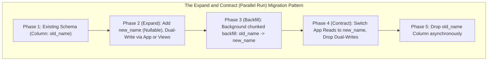
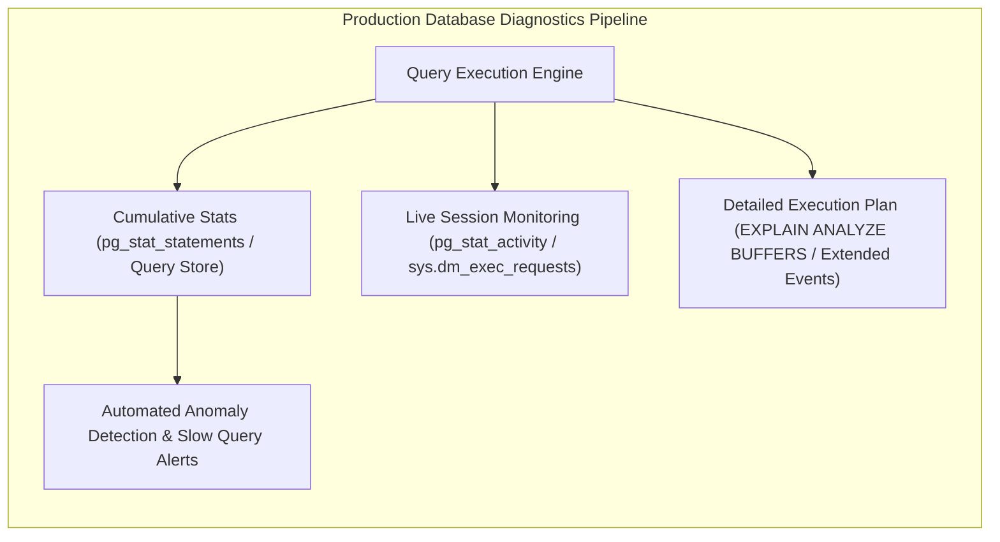
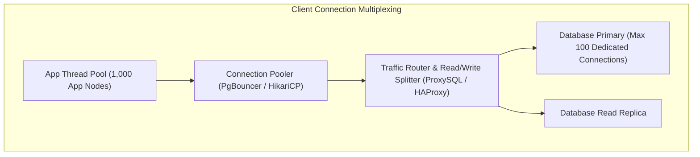
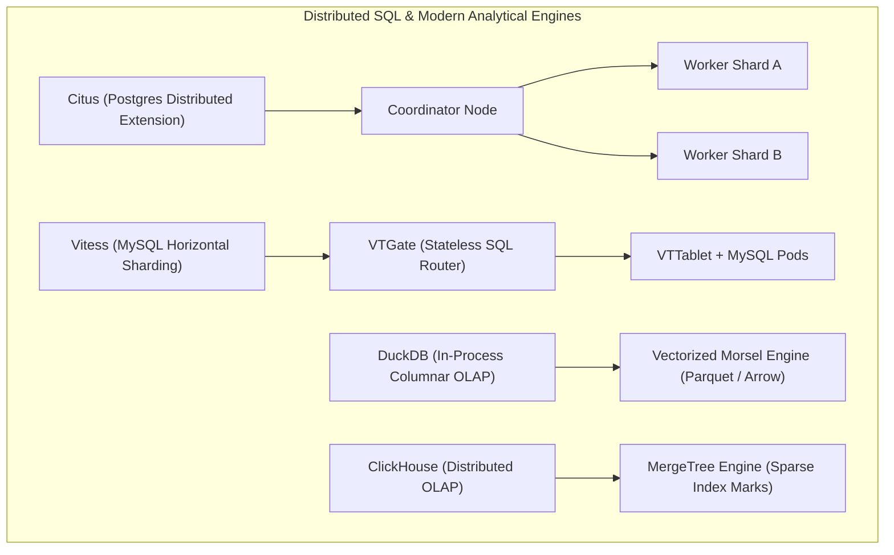

# 🏛️ Architecture Deep Dive: Database Tooling — Migrations, Profiling, Pooling & Distributed Engines


> *Architectural Blueprint: [Delta Lake vs. Apache Iceberg Storage & Metadata Architecture](../docs/whiteboard_diagrams/README.md#delta-vs-iceberg-architecture). View full multi-persona breakdown and engine mechanisms in the master index.*

---

## 1. Zero-Downtime Database Schema Migration Engines

Database schema evolution is one of the highest-risk operational procedures in modern software engineering. Running a naive `ALTER TABLE users ADD COLUMN status VARCHAR(20) DEFAULT 'ACTIVE' NOT NULL;` on a table with 100 million rows in older PostgreSQL or MySQL versions takes an exclusive table lock (`ACCESS EXCLUSIVE` in Postgres, metadata lock in MySQL), blocking all reads and writes until the entire table is rewritten on disk, triggering cascading application connection exhaustion.



### 1.1 Declarative & Imperative Tooling: Flyway vs. Liquibase
- **Flyway**:
  - *Mechanism*: Migration files ordered by semantic version numbers (`V1__init.sql`, `V2.1__add_index.sql`, `R__views.sql`).
  - *Metadata Table*: Tracks state in `flyway_schema_history` using SHA-256 checksums to guarantee idempotency and prevent out-of-order execution.
  - *Locking*: Acquires an exclusive advisory lock or row-level lock on the metadata table during migration runs.
  - *Philosophy*: SQL-first, forward-only migrations. Down migrations (rollbacks) are strongly discouraged in production due to destructive data loss risks.
- **Liquibase**:
  - *Mechanism*: Declarative change tracking using XML, YAML, JSON, or SQL changesets (`<changeSet id="1" author="eng">`).
  - *Locking*: Enforces single-process execution via `DATABASECHANGELOGLOCK` (stores locked boolean flag and locking node hostname).
  - *Capabilities*: Supports automated rollback generation for basic structural operations (e.g. automatically knows how to drop a created table).

### 1.2 Modern Zero-Downtime Migration Engines: pgroll, gh-ost, pt-online-schema-change
- **pgroll (PostgreSQL)**:
  - Implements the Expand/Contract pattern inside PostgreSQL natively using schema views.
  - Creates virtual schema versions simultaneously. The old application tier continues reading and writing to version 1 views, while the new application tier interacts with version 2 views.
  - Underlying PostgreSQL triggers synchronize data mutations bidirectionally in real time until the cutover is finalized.
- **gh-ost (GitHub's Online Schema Migrations for MySQL)**:
  - *Triggerless Architecture*: Unlike `pt-online-schema-change`, which attaches SQL triggers to tables (causing lock amplification and deadlocks during high-write throughput), `gh-ost` does **not** use database triggers.
  - *Binlog Tailing*: Creates a shadow table (`_users_gho`), applies the `ALTER TABLE` to the empty shadow table, copies existing rows in throttled chunks, and streams real-time mutations by reading MySQL binary logs (binlog).
  - *Cutover*: Performs an atomic two-table rename:
    ```sql
    RENAME TABLE users TO _users_old, _users_gho TO users;
    ```
  - *Throttling*: Dynamically throttles chunk copying based on replication lag, active thread count, and OS disk I/O metrics.

---

## 2. Query Profiling, Diagnostics & Observability Tools

Diagnosing production database degradation requires deep visibility into query plan structures, cache hit ratios, lock wait graphs, and resource consumption.



### 2.1 PostgreSQL Diagnostics
- **`pg_stat_statements`**: The definitive extension for query telemetry. Tracks normalized query fingerprints, execution counts, total/mean runtime, buffer cache reads (`shared_blks_hit`), disk reads (`shared_blks_read`), dirty blocks, and WAL generation.
  ```sql
  -- Top 5 queries by total CPU and I/O time
  SELECT
      queryid,
      SUBSTRING(query, 1, 80) AS query_snip,
      calls,
      ROUND(total_exec_time::numeric, 2) AS total_time_ms,
      ROUND(mean_exec_time::numeric, 2) AS mean_time_ms,
      ROUND(100.0 * shared_blks_hit / NULLIF(shared_blks_hit + shared_blks_read, 0), 2) AS cache_hit_pct
  FROM pg_stat_statements
  ORDER BY total_exec_time DESC
  LIMIT 5;
  ```
- **`EXPLAIN (ANALYZE, BUFFERS, VERBOSE, SETTINGS, WAL)`**:
  - `ANALYZE`: Executes the query and outputs actual wall-clock execution time and row counts.
  - `BUFFERS`: Discloses shared buffer cache hits, disk reads, and temporary disk spills (crucial for detecting I/O bottlenecks).
  - `WAL`: Discloses the number of WAL records and bytes generated by mutations.

### 2.2 MySQL Diagnostics
- **Performance Schema & `sys` Schema**:
  - Provides low-level instrumentation of mutexes, file I/O, memory allocations, and query stages.
  - `sys.statement_analysis`: Displays normalized query execution metrics, lock times, and rows examined vs rows sent.
- **`EXPLAIN FORMAT=JSON`**:
  - Provides query cost estimations and discloses execution algorithms (e.g. `using_index`, `using_temporary`, `using_filesort`).
- **`OPTIMIZER_TRACE`**:
  - Exposes the internal decisions of the MySQL cost-based optimizer, explaining why a specific index was chosen or rejected over alternative paths.

### 2.3 SQL Server Diagnostics
- **Query Store (The Internal Flight Recorder)**:
  - Automatically captures history of queries, execution plans, runtime statistics, and wait categories.
  - Detects **plan regressions** (e.g. when an updated statistic causes a plan change from an Index Seek to a Clustered Index Scan).
  - Allows database administrators to force a previous plan (`sp_query_store_force_plan`) without code changes.
- **Dynamic Management Views (DMVs)**:
  - `sys.dm_exec_query_stats`: Aggregated query CPU, elapsed time, physical reads, and logical writes.
  - `sys.dm_os_waiting_tasks`: Active threads blocked on locks (`LCK_M_X`, `LCK_M_S`), latches, or memory grants (`RESOURCE_SEMAPHORE`).

---

## 3. Connection Pooling & Traffic Governance

Database connections are heavy operating system entities. In PostgreSQL, each incoming connection spawns a dedicated Linux process consuming $5 - 10\text{MB}$ of resident memory, plus internal per-process cache allocations (`work_mem`, `temp_buffers`).

Exceeding 200–500 direct client connections triggers severe CPU context switching, OS thread contention, and cache thrashing.



### 3.1 PgBouncer (PostgreSQL Connection Pooler)
PgBouncer provides three pooling modes:
1. **Session Pooling**: A client is allocated a server connection upon connecting and holds it until the client disconnects. Provides zero connection reuse benefits during application idle times.
2. **Transaction Pooling (Production Standard)**: A server connection is assigned to the client only for the duration of a transaction (`BEGIN` to `COMMIT`/`ROLLBACK`). As soon as the transaction completes, the server connection returns to the pool.
   - *Critical Gotcha*: Breaks session-level features: `SET TIMEZONE`, advisory locks, temporary tables, and **named prepared statements** (`PREPARE stmt`). Must use anonymous prepared statements or configure `max_prepared_statements` in PgBouncer 1.21+.
3. **Statement Pooling**: Server connection is released after every single SQL statement. Transactions containing multiple statements are strictly prohibited.

#### The PostgreSQL Connection Formula:
$$\text{Max DB Connections} \approx (\text{CPU Cores} \times 2) + \text{Effective Spindle Count}$$
*Example*: A 16-vCPU database instance on NVMe storage should have its database `max_connections` sized around **32–50**. 5,000 application threads should be multiplexed through PgBouncer into this small pool of 50 fast connections.

### 3.2 HikariCP (JVM High-Performance Connection Pool)
- Recognized as the fastest JVM connection pool due to bytecode-level micro-optimizations, zero-allocation collections (`FastList`), and custom lock-free primitives.
- **Key Parameters**:
  - `maximumPoolSize`: Maximum physical connections HikariCP opens to the database or pooler (typically $10 - 20$ per microservice pod).
  - `minimumIdle`: Equal to `maximumPoolSize` (fixed-size pool prevents latency spikes caused by connection ramp-ups).
  - `connectionTimeout`: Max wait time for a connection from the pool before throwing `SqlTimeoutException` (default: 30,000ms; recommended: 3,000ms to fail fast).
  - `leakDetectionThreshold`: Detects application code leaking connections (e.g. failing to close in a `finally` block).

---

## 4. Distributed SQL & In-Process Analytical Engines



### 4.1 Citus: Distributed PostgreSQL
- Transforms standard PostgreSQL into a distributed relational database.
- **Distributed Tables**: Sharded across worker nodes using hash partitioning on a distribution column (e.g. `tenant_id`).
- **Co-Located Joins**: When two tables share the same distribution key, joins occur locally on the worker nodes without any cross-node network shuffle, preserving standard relational query latency.
- **Reference Tables**: Replicated in full across every worker node (ideal for small dimension tables like `currencies` or `countries`).

### 4.2 Vitess: Cloud-Native Horizontal Sharding for MySQL
- Originally developed by YouTube to scale MySQL horizontally to billions of users.
- **VTGate**: Stateless proxy that parses SQL queries, consults the declarative **VSchema**, routes queries to the appropriate shards, and aggregates the results.
- **VTTablet**: Sits in front of each MySQL process to provide connection pooling, query deduplication, memory limits, and automated failover orchestration.
- **Resharding**: Provides online, zero-downtime split and merge resharding workflows with automated validation.

### 4.3 DuckDB: The "SQLite for Analytics"
- **Architecture**: In-process, serverless columnar OLAP database written in C++.
- **Key Capabilities**:
  - *Vectorized Execution*: Processes data in batches of 2,048 tuples using CPU SIMD vector instructions, minimizing instruction cache misses and function call overhead.
  - *Zero-Copy Arrow Integration*: Queries in-memory Apache Arrow buffers, Polars DataFrames, and Pandas without data duplication.
  - *Direct Cloud Parquet Scanning*: Leverages HTTP range requests to scan Parquet files directly from S3/GCS, reading only requested columns and byte offsets via predicate pushdown.

### 4.4 ClickHouse: High-Throughput Columnar DBMS
- Designed for sub-second aggregations across trillions of event rows.
- **MergeTree Storage Engine**:
  - Data is written in sorted parts. Background threads merge parts asynchronously.
  - **Sparse Primary Index**: Indexes only one row every 8,192 rows (1 mark). Allows the entire index for billions of rows to reside entirely in RAM.
  - Vectorized SIMD query execution optimizes aggregations across integers and low-cardinality strings to billions of rows per core per second.
