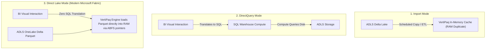

# 🎓 Interview Question Bank — Tier 4: Staff & Lakehouse Architect (System Design & Governance)

> **Focus Areas**: Enterprise Medallion Lakehouse Architecture, Kimball vs. Data Vault 2.0, Delta Lake Internals, Direct Lake Mode, Cross-Engine Interoperability (UniForm), and Multi-Tier Governance.

---

### Q4.1: Contrast Kimball Dimensional Modeling with Data Vault 2.0. When would you select each for an enterprise architecture?

**Answer:**  

| Architecture Dimension | Kimball Dimensional Modeling | Data Vault 2.0 |
| :--- | :--- | :--- |
| **Core Philosophy** | Business-process oriented, optimized for reporting consumption & star-schema analytics. | System-of-record oriented, optimized for raw auditability, rapid ingestion, and schema resilience. |
| **Primary Primitives** | Fact Tables (Measures/Grain) & Dimension Tables (Context). | **Hubs** (Business Keys), **Links** (Unit of Work Relationships), and **Satellites** (Context & Temporal History). |
| **Handling Source Schema Changes**| Fragile: Schema modifications often require altering wide dimensions and recalculating fact keys. | Highly resilient: Adding a column simply adds a new Satellite table without touching Hubs or Links. |
| **Consumability by BI Tools** | Exceptional: Direct drag-and-drop star schemas for Power BI, Tableau, and ad-hoc analysts. | Poor for direct BI: Requires a downstream "Information Mart" (Kimball presentation layer) on top. |
| **ETL Complexity** | Moderate-to-high (Lookups for surrogate keys, concurrency in SCD2). | Pure parallel inserts: Hubs, Links, and Satellites can be loaded independently and asynchronously. |

**Architectural Recommendation**:
- Choose **Data Vault 2.0** for large enterprise Core/Silver layers with 50+ source systems undergoing constant upstream schema changes (e.g. banking, healthcare).
- Place a **Kimball Star Schema** in the Gold presentation layer for BI and downstream SQL consumers.

---

### Q4.2: Why is Liquid Clustering (`CLUSTER BY`) replacing physical Hive directory partitioning in modern Lakehouse engines?

**Answer:**  
Legacy Hive partitioning physically divides tables into nested directories on object storage (e.g., `/country=US/year=2024/month=05/day=15/`).

**Problems with Hive Directory Partitioning**:
1. **The Small File Trap**: High-cardinality partitions create hundreds of thousands of tiny directories containing 50KB files, overwhelming object storage metadata listing.
2. **Query Inflexibility**: Directory pruning only activates if the user filters on the exact partition column. Filtering on a non-partitioned column forces a scan of all subdirectories.
3. **Partition Rigidity**: Changing partition layout requires rewriting the entire multi-terabyte table.

**Liquid Clustering Mechanics**:
- Liquid Clustering (`CLUSTER BY (col1, col2)`) stores data in flat, uniform 128MB–512MB Parquet files without creating filesystem directories.
- It clusters data multidimensionally using Hilbert space-filling curves or Z-order algorithms.
- **Dynamic Adaptability**: Clustering columns can be redefined (`ALTER TABLE t CLUSTER BY (new_col)`) without rewriting existing historical files.
- Works seamlessly with Delta Lake Deletion Vectors for fast row-level mutations.

---

### Q4.3: Explain the Delta Lake Transaction Log protocol (`_delta_log`). How does it guarantee ACID transactions over object storage?

**Answer:**  
Cloud object storage (Amazon S3, Azure ADLS) does not support multi-file atomic transactions. Delta Lake implements ACID via an append-only JSON transaction log:

1. **Atomic Commits**:
   - Every operation (commit) is written as an ordered JSON file: `000000.json`, `000001.json`, etc.
   - A single-writer protocol (or external DynamoDB/storage lease coordinator) ensures sequential commit numbering via atomic put-if-absent.
2. **Snapshot Materialization**:
   - Every 10 commits, Delta writes a consolidated Parquet checkpoint file (`000010.checkpoint.parquet`).
   - A reader reconstructs current table state by reading the latest checkpoint plus subsequent JSON deltas, avoiding listing millions of individual data files.
3. **Optimistic Concurrency Control (OCC)**:
   - When a transaction starts, it reads table snapshot $V$.
   - At commit time, it checks if snapshot has advanced ($V + 1$).
   - If changed, it validates whether the concurrent commit modified files intersecting with its own predicate. If no conflict exists, it auto-rebases and commits; otherwise, it throws a concurrent write exception.

---

### Q4.4: What is Power BI Direct Lake mode, and how does it fundamentally differ from Import Mode and DirectQuery?

**Answer:**  

- **Import Mode**: Blazing fast in-memory VertiPaq queries, but requires duplicating hundreds of gigabytes into Power BI memory and waiting for multi-hour scheduled refresh pipelines.
- **DirectQuery Mode**: Real-time data, but sluggish visual latency because every button click translates into a complex SQL query executed on a remote SQL warehouse.
- **Direct Lake Mode**: The VertiPaq query engine reads Parquet columnar pages **directly from OneLake storage** without any SQL intermediary or data duplication. Visuals query cold-to-hot cached Parquet columns at native in-memory speeds without data refresh pipelines.
