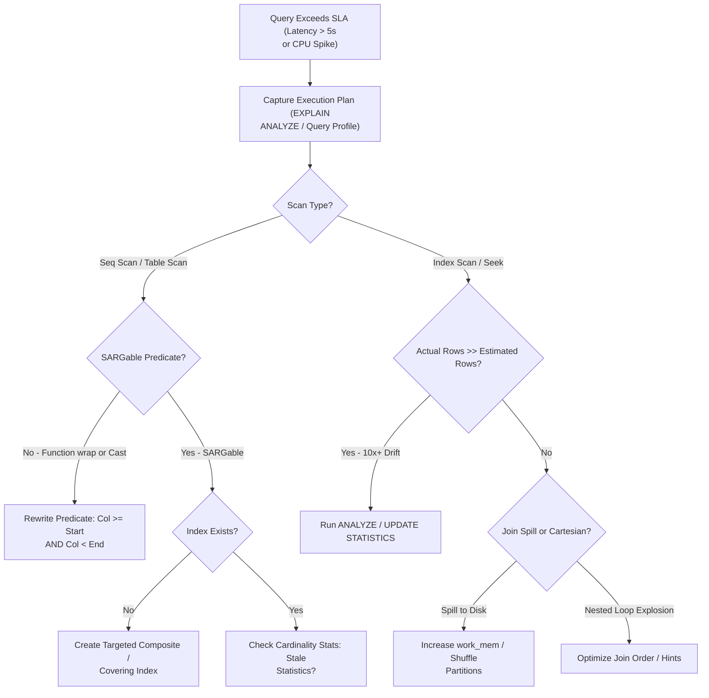

# ⚡ Production Runbook 02: Query Performance & Execution Plan Tuning

> **Incident Severity**: SEV-2 / SEV-3  
> **Target Systems**: PostgreSQL, MySQL, SQL Server, DuckDB, Snowflake, BigQuery, Databricks SQL  
> **Objective**: Identify query execution bottlenecks, fix non-SARGable predicates, eliminate unneeded scans, and tune cardinality statistics.

---

## 1. Emergency Decision Tree



---

## 2. Non-SARGable Predicate Remediation Matrix

A predicate is **SARGable** (Search Argument Able) if the database engine can traverse the B-Tree index structure via an **Index Seek** ($\mathcal{O}(\log N)$) rather than scanning the entire table or index ($\mathcal{O}(N)$).

| Anti-Pattern (Non-SARGable) | Root Cause of Failure | Production Surgical Fix (SARGable) |
| :--- | :--- | :--- |
| `WHERE YEAR(created_at) = 2024` | Scalar function evaluated per row prevents index seek. | `WHERE created_at >= '2024-01-01' AND created_at < '2025-01-01'` |
| `WHERE DATE(transaction_time) = '2024-05-15'` | Truncation function strips index usability. | `WHERE transaction_time >= '2024-05-15 00:00:00' AND transaction_time < '2024-05-16 00:00:00'` |
| `WHERE LOWER(email) = 'user@company.com'` | String transformation prevents index traversal. | Create Functional Index: `CREATE INDEX idx_user_email_lower ON users (LOWER(email));` |
| `WHERE CAST(account_id AS VARCHAR) = '1052'` | Type conversion on left-side column. | `WHERE account_id = 1052` (Keep column pure; cast the literal). |
| `WHERE phone_number LIKE '%5551234'` | Leading wildcard (`%`) cannot seek B-Tree. | Use Trigram Index (PG `pg_trgm`) or Reverse String Index: `WHERE reverse_phone LIKE '4321555%'`. |
| `WHERE ISNULL(status, 'NEW') = 'NEW'` | Wrapper function evaluates every row. | `WHERE status = 'NEW' OR status IS NULL` |
| `WHERE amount + 10 > 100` | Arithmetic expression on column. | `WHERE amount > 90` (Isolate column alone on LHS). |

---

## 3. Cardinality Estimation & Statistics Drifts

When the database Cost-Based Optimizer makes a catastrophic decision (such as picking a Nested Loop Join for 10M rows), the cause is almost universally **stale cardinality statistics**.

### Verification & Remediation:

#### PostgreSQL
```sql
-- Check last analyze timestamp and dead tuple ratio
SELECT
    schemaname,
    relname,
    n_live_tup,
    n_dead_tup,
    ROUND(100.0 * n_dead_tup / NULLIF(n_live_tup + n_dead_tup, 0), 2) AS dead_tuple_percent,
    last_analyze,
    last_autoanalyze
FROM pg_stat_user_tables
WHERE relname = 'fact_orders';

-- Manually recompute table statistics and histograms with full sample
ANALYZE VERBOSE fact_orders;
```

#### Microsoft SQL Server / Azure Synapse
```sql
-- Check stats date and modification counter
SELECT
    s.name AS stats_name,
    sp.last_updated,
    sp.rows,
    sp.rows_sampled,
    sp.modification_counter,
    CAST(sp.modification_counter AS FLOAT) / NULLIF(sp.rows, 0) * 100 AS drift_percent
FROM sys.stats s
CROSS APPLY sys.dm_db_stats_properties(s.object_id, s.stats_id) sp
WHERE s.object_id = OBJECT_ID('fact_orders');

-- Force full-scan statistics rebuild
UPDATE STATISTICS fact_orders WITH FULLSCAN;
```

---

## 4. Parameter Sniffing & Plan Cache Regressions

### The Symptom:
A stored procedure or parameterized query runs in 50 milliseconds for 99% of inputs, but suddenly begins taking 45 seconds across all calls.

### Root Cause:
The optimizer compiled an execution plan using the parameters from an outlier call (e.g., `tenant_id = 0`, which represents 25M records), choosing a table scan. Subsequent queries for normal tenants (100 records) are forced to reuse this un-indexed scan plan.

### Surgical Solutions:

```sql
-- Solution 1: Optimize for typical distribution (SQL Server)
SELECT * FROM orders
WHERE tenant_id = @TenantId
OPTION (OPTIMIZE FOR (@TenantId = 1001));

-- Solution 2: Recompile query per invocation for highly skewed parameters
SELECT * FROM orders
WHERE tenant_id = @TenantId
OPTION (RECOMPILE);

-- Solution 3: Parameter masking via local variable assignment (prevents sniffing)
CREATE PROCEDURE GetTenantOrders (@InputTenantId INT)
AS
BEGIN
    DECLARE @LocalTenantId INT = @InputTenantId;
    SELECT * FROM orders WHERE tenant_id = @LocalTenantId;
END;
```

---

## 5. In-Database GenAI SQL Functions (ai_query) Latency Triage

### 5.1 Incident Symptoms & Root Cause
- **Symptoms**: ETL batches using `ai_query()` or `ai_classify()` experience query runtimes jumping from 5 minutes to 45 minutes, with warehouse logs reporting `HTTP 429 Too Many Requests` or `Gateway Timeout 504`.
- **Root Cause**: The query processes millions of unpruned rows simultaneously, overwhelming the provisioned tokens-per-second capacity on the target Mosaic AI Model Serving endpoint.

### 5.2 Remediation & Rate Limit Circuit Breakers
1. **Pre-Filter Input Data**: Strip nulls, short strings, and duplicate inputs using `DISTINCT` or micro-batch filtering before invoking the LLM function:
```sql
-- Deduplicate and filter strings before LLM evaluation
WITH distinct_inputs AS (
    SELECT DISTINCT raw_text
    FROM staging_comments
    WHERE raw_text IS NOT NULL AND length(trim(raw_text)) > 15
),
classified_inputs AS (
    SELECT
        raw_text,
        ai_classify(raw_text, ARRAY('bug', 'feature', 'billing')) AS tag
    FROM distinct_inputs
)
SELECT s.comment_id, c.tag
FROM staging_comments s
JOIN classified_inputs c ON s.raw_text = c.raw_text;
```

2. **Increase Endpoint Provisioned Concurrency**: Navigate to Databricks Model Serving and increase the endpoint's provisioned throughput to accommodate SQL warehouse parallelism.
