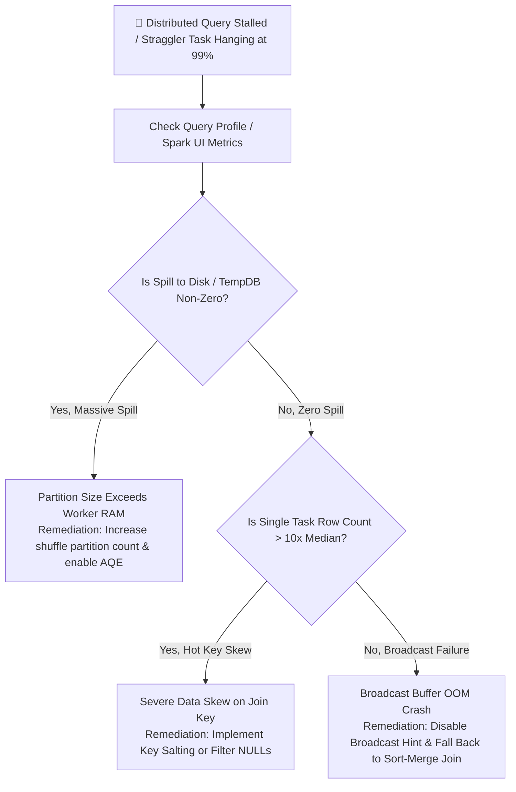

# 🌪️ Production Runbook 03: MPP Skew, Memory Spill & Broadcast Failures

> **Incident Severity**: SEV-1 / SEV-2  
> **Target Systems**: Databricks SQL, Apache Spark, Snowflake, Google BigQuery, Azure Synapse, Amazon Redshift  
> **Objective**: Triage 99% straggler worker nodes, eliminate Tungsten / TempDB disk spills, and fix broadcast join memory crashes.

---

## 1. Emergency Decision Tree



---

## 2. Straggler Triage Diagnostic Protocol

In distributed query execution, 199 tasks finish in 10 seconds, while task 200 runs for 2 hours before crashing with an OutOfMemoryError.

```
                  ┌────────────────────────────────────────────────────────┐
                  │      Distributed Query Stalled / Straggler Task        │
                  └───────────────────────────┬────────────────────────────┘
                                              │
                    Check Spark UI / Warehouse Query Profile Metrics
                                              │
                      ┌───────────────────────┴───────────────────────┐
                      ▼                                               ▼
         [Spill (Memory) & Spill (Disk)]                 [Data Skew / Hotspotting]
                      │                                               │
           Partition size exceeds RAM                     One task processes 50x rows
                      │                                               │
           Tune Partition Sizing Formula                  Apply Surgical Key Salting
           Target: 100MB - 200MB per slice                 or Enable AQE Skew Join
```

---

## 2. Diagnosing Skew Across Distributed Engines

### 2.1 Databricks SQL & Apache Spark UI
1. Open the **Spark Web UI** $\rightarrow$ Navigate to **Stages Tab** $\rightarrow$ Click the stalled Stage.
2. Expand the **Summary Metrics for Tasks** table:
   - Compare the **75th percentile** vs. the **Max** for **Duration** and **Shuffle Read Size**.
   - **Diagnosis**: If 75th percentile is $50 \text{ MB}$ and Max is $45 \text{ GB}$, you have catastrophic **Data Skew**.

### 2.2 Snowflake Query Profile
1. Open **Query History** $\rightarrow$ Click Query ID $\rightarrow$ View **Query Profile**.
2. Inspect the **Bytes Spilled to Local Storage** and **Bytes Spilled to Remote Storage**:
   - Local Spill = Warehouse RAM exhausted; intermediate sort/hash written to SSD.
   - Remote Spill = Local SSD exhausted; spilled to S3/Azure Blob (severe performance crash).
3. Check operator node execution time distribution across warehouse compute threads.

### 2.3 Azure Synapse Dedicated SQL Pool
```sql
-- Check row skew across the 60 physical distributions
SELECT 
    distribution_id,
    row_count
FROM sys.dm_pdw_nodes_db_partition_stats
WHERE object_id = OBJECT_ID('dbo.fact_transactions')
ORDER BY row_count DESC;
-- Ratio of MAX(row_count) to MIN(row_count) > 1.2 indicates actionable distribution skew!
```

---

## 3. Surgical Remediation Techniques

### 3.1 Two-Phase Key Salting (The Universal Skew Breaker)
When joining a massive fact table containing skewed keys (e.g. `customer_id = 0` or `NULL`) with a dimension table:

```sql
-- Phase 1: Salt the skewed rows on the fact table with a random integer 0-9
WITH fact_salted AS (
    SELECT 
        transaction_id,
        customer_id,
        CASE 
            WHEN customer_id = 0 OR customer_id IS NULL 
            THEN CAST(COALESCE(customer_id, -1) AS VARCHAR) || '_' || CAST(FLOOR(RAND() * 10) AS VARCHAR)
            ELSE CAST(customer_id AS VARCHAR) || '_0'
        END AS join_key_salted,
        amount
    FROM raw_transactions
),
-- Phase 2: Replicate the dimension table 10x for the skewed keys
dim_exploded AS (
    SELECT 
        d.customer_id,
        d.customer_name,
        d.tier,
        CASE 
            WHEN d.customer_id = 0 
            THEN CAST(d.customer_id AS VARCHAR) || '_' || CAST(s.salt AS VARCHAR)
            ELSE CAST(d.customer_id AS VARCHAR) || '_0'
        END AS join_key_salted
    FROM dim_customers d
    CROSS JOIN (
        SELECT 0 AS salt UNION ALL SELECT 1 UNION ALL SELECT 2 UNION ALL SELECT 3 UNION ALL SELECT 4
        UNION ALL SELECT 5 UNION ALL SELECT 6 UNION ALL SELECT 7 UNION ALL SELECT 8 UNION ALL SELECT 9
    ) s
)
-- Phase 3: Execute balanced join across all worker partitions
SELECT 
    f.transaction_id,
    d.customer_name,
    d.tier,
    f.amount
FROM fact_salted f
JOIN dim_exploded d ON f.join_key_salted = d.join_key_salted;
```

---

## 4. Tuning Memory Spill & Shuffle Partitions

### The Partition Sizing Rule:
Target **100 MB to 200 MB** of uncompressed data per shuffle partition.

$$\text{Ideal Shuffle Partitions} = \frac{\text{Total Uncompressed Shuffle Stage Volume (MB)}}{150 \text{ MB}}$$

*Example*: If your query shuffles $300 \text{ GB}$ ($300,000 \text{ MB}$):
$$\frac{300,000 \text{ MB}}{150 \text{ MB}} = 2,000 \text{ partitions}$$
*(Default Spark value of 200 is $10\times$ too small, triggering massive Tungsten disk spill!)*

```sql
-- In Databricks / Spark SQL session:
SET spark.sql.shuffle.partitions = 2000;
SET spark.sql.adaptive.enabled = true;
SET spark.sql.adaptive.skewJoin.enabled = true;
SET spark.sql.adaptive.skewJoin.skewedPartitionFactor = 5;
SET spark.sql.adaptive.skewJoin.skewedPartitionThresholdInBytes = 268435456; -- 256MB
```
