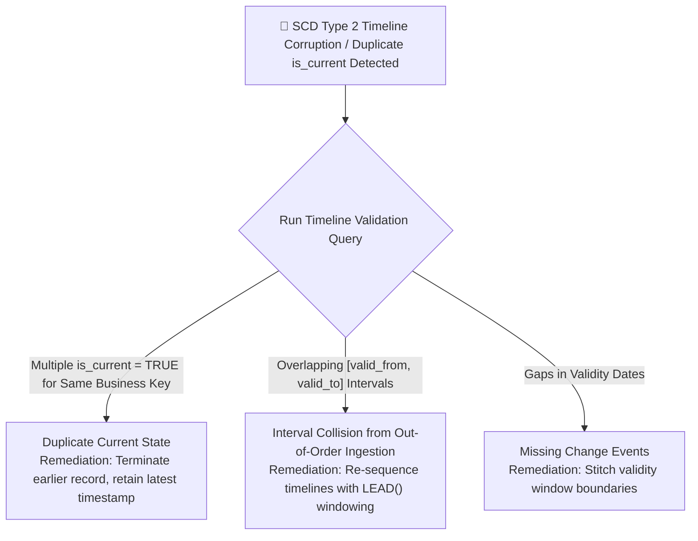
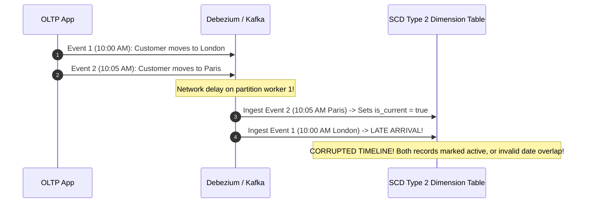

# 🩹 Production Runbook 04: SCD Type 2 & CDC Reconciliation Disaster Recovery

> **Incident Severity**: SEV-1 / SEV-2  
> **Target Systems**: Delta Lake, Snowflake, PostgreSQL, BigQuery, Databricks, SQL Server  
> **Objective**: Detect and heal corrupted SCD Type 2 dimension timelines, eliminate overlapping validity intervals, and fix duplicate `is_current = true` rows resulting from out-of-order CDC streams.

---

## 1. Emergency Decision Tree



---

## 2. The CDC Pipeline Failure Scenario

In real-time Lakehouse pipelines (Debezium $\rightarrow$ Kafka $\rightarrow$ Spark Structured Streaming / Delta Live Tables), network partitions or worker retries cause **out-of-order event arrival**.



---

## 2. Integrity Audit Queries (Detecting Timeline Corruption)

### Audit 1: Duplicate Active Records (`is_current = TRUE` Multipliers)
A business key must have **strictly one** active record. If this returns rows, downstream fact table joins will experience catastrophic row multiplication!

```sql
SELECT 
    customer_id,
    COUNT(*) AS active_record_count
FROM dim_customers_scd2
WHERE is_current = TRUE
GROUP BY customer_id
HAVING COUNT(*) > 1;
```

### Audit 2: Overlapping Date Intervals
A customer cannot reside at two different addresses simultaneously. `valid_from` must always be $\ge$ previous `valid_to`.

```sql
WITH interval_check AS (
    SELECT 
        customer_id,
        valid_from,
        valid_to,
        LAG(valid_to) OVER (
            PARTITION BY customer_id 
            ORDER BY valid_from ASC
        ) AS prev_valid_to
    FROM dim_customers_scd2
)
SELECT * 
FROM interval_check
WHERE prev_valid_to IS NOT NULL 
  AND valid_from < prev_valid_to;
```

---

## 3. The Self-Healing Reconstruction Protocol

When an SCD Type 2 table becomes corrupted due to late-arriving events or duplicate writes, executing manual row updates leads to further degradation. 

The battle-tested remediation is to **rebuild the dimension timeline deterministically** using analytical window functions:

```sql
-- Production Self-Healing SCD Type 2 Rebuilder
CREATE OR REPLACE TABLE dim_customers_scd2_rebuilt AS
WITH deduplicated_events AS (
    -- Step 1: Deduplicate exact duplicate event records by business key & event timestamp
    SELECT 
        customer_id,
        customer_name,
        city,
        tier,
        event_timestamp,
        ROW_NUMBER() OVER (
            PARTITION BY customer_id, event_timestamp 
            ORDER BY ingested_at DESC
        ) AS rn
    FROM raw_customer_cdc_events
),
valid_events AS (
    SELECT * FROM deduplicated_events WHERE rn = 1
),
timeline_sequenced AS (
    -- Step 2: Recalculate valid_from, valid_to, and is_current deterministically
    SELECT 
        customer_id,
        customer_name,
        city,
        tier,
        event_timestamp AS valid_from,
        -- valid_to is the next event's timestamp, or '9999-12-31' if latest
        COALESCE(
            LEAD(event_timestamp) OVER (
                PARTITION BY customer_id 
                ORDER BY event_timestamp ASC
            ),
            TIMESTAMP '9999-12-31 23:59:59'
        ) AS valid_to,
        -- is_current is true ONLY for the terminal record in the series
        CASE 
            WHEN LEAD(event_timestamp) OVER (
                PARTITION BY customer_id 
                ORDER BY event_timestamp ASC
            ) IS NULL THEN TRUE
            ELSE FALSE
        END AS is_current
    FROM valid_events
)
SELECT 
    -- Step 3: Generate immutable MD5 surrogate key based on business key and effective timestamp
    MD5(CAST(customer_id AS VARCHAR) || '_' || CAST(valid_from AS VARCHAR)) AS customer_surrogate_key,
    customer_id,
    customer_name,
    city,
    tier,
    valid_from,
    valid_to,
    is_current,
    CURRENT_TIMESTAMP AS dwh_reconciled_at
FROM timeline_sequenced;
```

---

## 4. Production Prevention: Idempotent Lakehouse Merge Pattern

To guarantee that late-arriving events never corrupt the timeline again, use Delta Lake / Databricks SQL micro-batch `MERGE INTO` with stage-gate checks:

```sql
MERGE INTO dim_customers_scd2 target
USING (
    SELECT 
        source.customer_id,
        source.customer_name,
        source.city,
        source.tier,
        source.event_timestamp
    FROM raw_cdc_staging source
    JOIN (
        -- Only process the latest event per business key within the micro-batch
        SELECT customer_id, MAX(event_timestamp) AS max_event
        FROM raw_cdc_staging
        GROUP BY customer_id
    ) latest ON source.customer_id = latest.customer_id 
           AND source.event_timestamp = latest.max_event
) incoming
ON target.customer_id = incoming.customer_id 
   AND target.is_current = TRUE 
   AND incoming.event_timestamp > target.valid_from -- Rejects older out-of-order events!

-- Action 1: Expire previous active row
WHEN MATCHED THEN
    UPDATE SET 
        target.valid_to = incoming.event_timestamp,
        target.is_current = FALSE;

-- Action 2: Insert new active row handled via staged union in driver pipeline.
```
