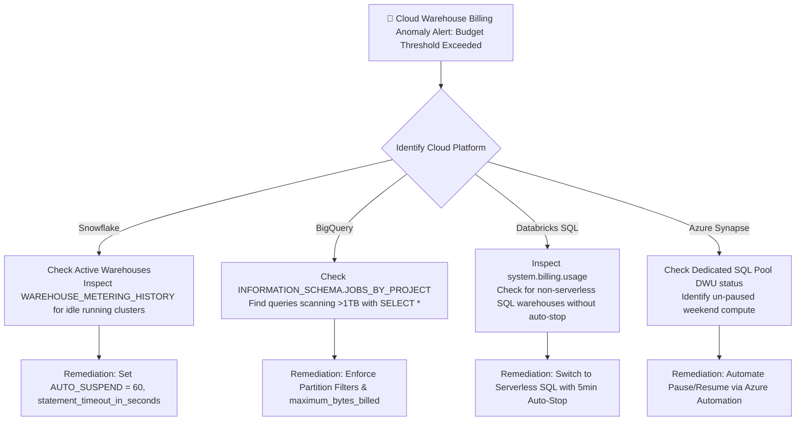
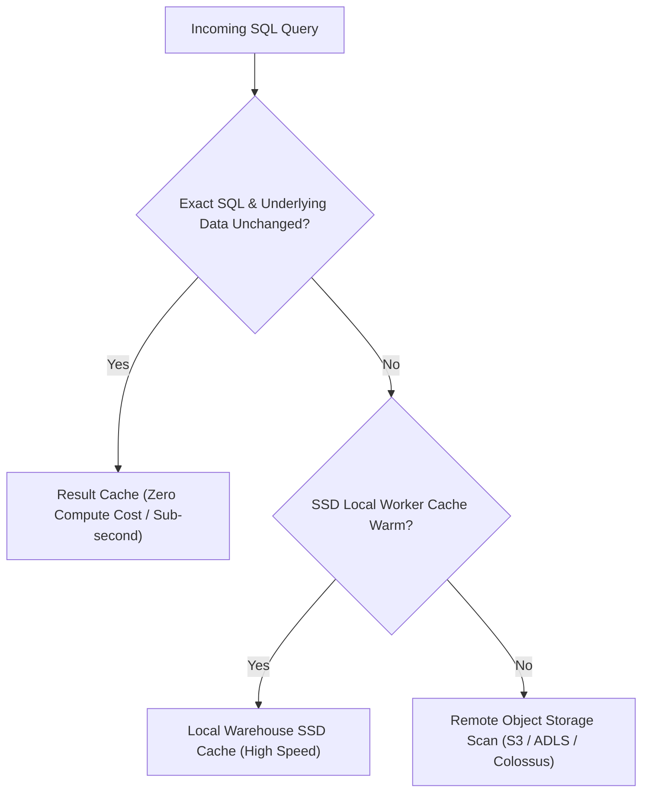

# 💰 Production Runbook 06: FinOps & Cloud Warehouse Cost Optimization

> **Target Systems**: Snowflake, Google BigQuery, Databricks SQL, Azure Synapse  
> **Objective**: Eliminate idle warehouse burn, prevent runaway full-table scans, right-size compute allocations, and enforce strict FinOps budget guards.

---

## 1. Emergency Decision Tree



---

## 2. Cloud Warehouse Billing Models

| Platform | Core Billing Metric | Runaway Cost Risk | Primary Cost Levers |
| :--- | :--- | :--- | :--- |
| **Snowflake** | Credits per second while warehouse is active. | Idle warehouses left running; oversized sizes (e.g. 4X-Large for simple tasks). | `AUTO_SUSPEND = 60`, `AUTO_RESUME = TRUE`, Multi-cluster standard scaling. |
| **Google BigQuery** | Bytes scanned (\$6.25 per TB on On-Demand) or Slot-hours (Editions). | Unpartitioned queries scanning 50TB on every BI dashboard refresh. | Strict partitioning + clustering, `MAX_BYTES_BILLED`, BI Engine. |
| **Databricks SQL** | Databricks Units (DBUs) + Cloud Compute VM runtime. | All-purpose compute used for scheduled SQL jobs; missing auto-stop. | Serverless SQL Warehouses, Spot VMs, Photon for high-concurrency SQL. |
| **Azure Synapse** | Data Warehouse Units (DWUs) per hour continuously. | Leaving DWU1000c running over weekends with zero user queries. | Scheduled pause/resume pipelines via Azure Automation / ADF. |

---

## 2. Snowflake Cost Hardening Configuration

Execute these commands to eliminate common Snowflake credit waste:

```sql
-- 1. Create cost-controlled virtual warehouse
CREATE OR REPLACE WAREHOUSE wh_analytics_prod
    WITH WAREHOUSE_SIZE = 'X-SMALL'
    AUTO_SUSPEND = 60                     -- Auto-suspend after 60s of inactivity
    AUTO_RESUME = TRUE
    MIN_CLUSTER_COUNT = 1
    MAX_CLUSTER_COUNT = 3                 -- Multi-cluster scaling for peak concurrency
    SCALING_POLICY = 'STANDARD'
    INITIALLY_SUSPENDED = TRUE
    COMMENT = 'FinOps hardened production analytics warehouse';

-- 2. Enforce runaway query execution guardrails (Kill queries exceeding 30 minutes)
ALTER WAREHOUSE wh_analytics_prod SET STATEMENT_TIMEOUT_IN_SECONDS = 1800;
ALTER WAREHOUSE wh_analytics_prod SET STATEMENT_QUEUED_TIMEOUT_IN_SECONDS = 300;

-- 3. Audit top 10 most expensive queries in the last 7 days
SELECT
    query_id,
    user_name,
    warehouse_name,
    execution_time / 1000.0 AS duration_seconds,
    total_elapsed_time / 1000.0 AS total_seconds,
    bytes_scanned / 1e9 AS gb_scanned,
    credits_used_cloud_services,
    query_text
FROM snowflake.account_usage.query_history
WHERE start_time >= DATEADD(day, -7, CURRENT_TIMESTAMP())
ORDER BY total_elapsed_time DESC
LIMIT 10;
```

---

## 3. Google BigQuery Scan Reduction Protocol

In BigQuery on-demand billing, every query scans uncompressed columns from Colossus. Scanning 10 TB costs \$62.50 per query.

### 1. Enforce Partition Filters at DDL Level
Prevent users from ever querying a multi-terabyte table without specifying a partition date:

```sql
CREATE OR REPLACE TABLE prod_lakehouse.fact_events
PARTITION BY DATE(event_timestamp)
CLUSTER BY customer_id, event_type
OPTIONS (
    require_partition_filter = true -- BLOCKS any query without a WHERE filter on event_timestamp!
) AS
SELECT * FROM staging_events;
```

### 2. Guard Against Runaway Scans with `maximum_bytes_billed`
In client scripts and BI tools, always inject the maximum byte limit (e.g., 50 GB = $53,687,091,200$ bytes):

```python
from google.cloud import bigquery

client = bigquery.Client()
job_config = bigquery.QueryJobConfig(
    maximum_bytes_billed=50 * 1024 * 1024 * 1024 # 50 GB hard cap
)
# If query estimates 60 GB scan, it aborts instantly with 0 cost!
query_job = client.query("SELECT * FROM prod_lakehouse.fact_events WHERE ...", job_config=job_config)
```

---

## 4. Caching Mechanics Across Cloud Warehouses

Maximize zero-cost cache hits before scaling compute:



### Best Practices to Maximize Cache Hits:
1. **Avoid Non-Deterministic Functions in Filters**: Queries containing `CURRENT_TIMESTAMP()`, `NOW()`, or `RANDOM()` **bypass the result cache entirely** on Snowflake and BigQuery.
2. **Standardize SQL Formatting in BI Tools**: Snowflake result caching requires identical query text. Consistent SQL casing and whitespace preserves cache reuse.
