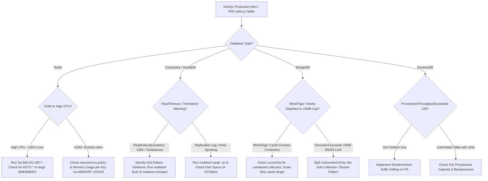

# ⚡ Production Runbook 07: NoSQL Production Triage & Sharding Incidents

> **Incident Severity**: SEV-1 / SEV-2  
> **Target Systems**: Redis, MongoDB, Apache Cassandra, ScyllaDB, AWS DynamoDB, RocksDB  
> **Objective**: Triage and resolve catastrophic NoSQL production failures including in-memory OOM evictions, tombstone read timeouts, hot partition throttling, and document bloat.

---

## 1. Emergency Decision Tree



---

## 2. Emergency Remediation: Redis Production Incidents

### Incident 1: Single-Threaded CPU Lockup (`KEYS *` and Blocking Calls)
- **Symptom**: Redis CPU spikes to 100% on its single thread; all upstream applications timeout on cache reads.
- **Immediate Triage**:
  ```bash
  # Connect to Redis CLI with timeout
  redis-cli --latency-history -h <host> -p <port>

  # Inspect recent slow queries (queries exceeding slowlog-log-slower-than threshold)
  redis-cli SLOWLOG GET 10
  ```
- **Remediation**:
  1. Identify offending commands: Common culprits are `KEYS *`, `FLUSHALL`, `HGETALL` on a hash with millions of keys, or `SMEMBERS` on giant sets.
  2. Kill runaway command if running via Lua script:
     ```bash
     redis-cli SCRIPT KILL
     ```
  3. Replace `KEYS *` with non-blocking cursor iteration:
     ```bash
     # Iterate safely in chunks of 1000
     SCAN 0 MATCH "session:*" COUNT 1000
     ```
  4. Enforce command disabling in `redis.conf`:
     ```text
     rename-command KEYS ""
     rename-command FLUSHALL ""
     rename-command FLUSHDB ""
     ```

### Incident 2: Out of Memory (OOM) & Eviction Catastrophe
- **Symptom**: Applications receive `OOM command not allowed when used memory > 'maxmemory'`.
- **Immediate Recovery Action**:
  ```bash
  # Check memory breakdown
  redis-cli INFO memory

  # Dynamically adjust maxmemory-policy to LRU or LFU without restarting
  redis-cli CONFIG SET maxmemory-policy allkeys-lru

  # Increase memory ceiling temporarily if host RAM permits
  redis-cli CONFIG SET maxmemory 16gb
  ```

---

## 3. Emergency Remediation: Cassandra & ScyllaDB Tombstone Storms

### Incident: `ReadFailureException: Scanned over 100001 tombstones`
- **Root Cause**: Frequent `DELETE` or `null` updates insert tombstone markers into immutable SSTables. When a query scans a partition with thousands of deleted records, Cassandra reads tombstones to ensure deleted data is not returned. If tombstone count exceeds `tombstone_failure_threshold` (100,000), the coordinator kills the query to prevent JVM OutOfMemoryError.
- **Immediate Recovery Action**:
  1. Identify the failing table and partition from system logs (`/var/log/cassandra/system.log`).
  2. Trigger immediate memtable flush and force minor compaction on the node:
     ```bash
     # Flush in-memory tables to SSTables
     nodetool flush <keyspace> <table_name>

     # Force major compaction to purge expired tombstones
     nodetool compact <keyspace> <table_name>
     ```
  3. Adjust `gc_grace_seconds` if tombstones are past replication window:
     ```sql
     -- If cluster is healthy and repair runs frequently, temporarily lower gc_grace
     ALTER TABLE keyspace_prod.user_activity WITH gc_grace_seconds = 86400; -- 1 day instead of 10
     ```
  4. Surgical Query Fix: Never perform range queries across partitions with high delete velocity; query by exact clustering key or refactor into time-windowed tables (TWCS - Time Window Compaction Strategy).

---

## 4. Emergency Remediation: MongoDB WiredTiger Cache & Document Bloat

### Incident 1: WiredTiger Cache Exhaustion & Ticket Depletion
- **Symptom**: `wiredTiger.concurrentReadTransactions.available` or `concurrentWriteTransactions.available` drops to 0. All queries queue indefinitely.
- **Immediate Recovery Action**:
  ```javascript
  // Connect via mongosh and inspect active running operations
  db.currentOp({
      "active": true,
      "secs_running": { "$gt": 5 }
  });

  // Kill long-running unindexed collection scans
  db.killOp(<opid>);
  ```
- **Remediation**:
  - Dynamically increase WiredTiger eviction threads:
    ```javascript
    db.adminCommand({
        setParameter: 1,
        wiredTigerEngineRuntimeConfig: "eviction=(threads_min=4,threads_max=8)"
    });
    ```

### Incident 2: Unbounded Array Document Exceeding 16MB Cap
- **Root Cause**: Storing log events, messages, or history items inside an embedded array (`$push`) inside the root document. Once the BSON size hits 16MB, all updates fail with `BSONObjectTooLarge`.
- **Remediation Architecture (The Bucket Pattern)**:
  - Migrate from 1-document-per-entity to 1-document-per-bucket (e.g. 500 items per bucket):
  ```javascript
  // Sub-collection bucket pattern
  db.user_telemetry_buckets.updateOne(
      { 
          userId: "USR-9921", 
          count: { $lt: 500 } 
      },
      { 
          $push: { events: { timestamp: new Date(), action: "PAGE_VIEW" } },
          $inc: { count: 1 }
      },
      { upsert: true }
  );
  ```

---

## 5. Emergency Remediation: AWS DynamoDB Hot Partition Throttling

### Incident: HTTP 429 `ProvisionedThroughputExceededException`
- **Root Cause**: Traffic disproportionately hitting a single partition key (exceeding 1,000 WCU or 3,000 RCU limit per physical partition), even though the overall table has ample capacity.
- **Immediate Recovery Action**:
  1. Inspect Amazon CloudWatch Contributor Insights for DynamoDB to isolate the exact hot partition key.
  2. If using Provisioned Mode, switch table to **On-Demand Mode** or increase provisioned capacity to trigger automated partition splits.
  3. **Application Key Salting (Surgical Fix)**:
     - Append a random suffix ($0 \dots N$) to the partition key during write:
     ```python
     import random
     
     def write_event(tenant_id, event_data):
         # Salt partition key across 10 virtual shards
         salt = random.randint(0, 9)
         partition_key = f"{tenant_id}#{salt}"
         
         dynamo_table.put_item(
             Item={
                 'pk': partition_key,
                 'timestamp': event_data['ts'],
                 'payload': event_data['payload']
             }
         )
     ```
     - For reads, query all $N$ partition keys in parallel using asynchronous client routines and merge the result sets.
