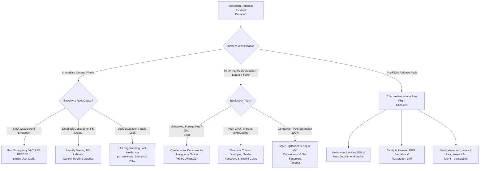

# ⚡ Production Runbook 08: Pre-Flight Checklist & Top 25 Production Database Gotchas

> **Incident Severity**: SEV-1 Prevention & Emergency Disaster Recovery  
> **Target Systems**: PostgreSQL, MySQL, SQL Server, Oracle, DynamoDB, MongoDB, Cassandra, Redis  
> **Objective**: Standardize production database deployment verification, automated backup drills, and diagnose the Top 25 most catastrophic production database gotchas and design traps.

---

## 1. Emergency Decision Tree



---

## 2. Production Database Pre-Flight Checklist

Before deploying any application release, schema migration, or database parameter change to production, verify each of the following 5 core operational pillars:

### Pillar 1: Schema Migrations & Non-Blocking DDL
- [ ] **No Exclusive Table Locks**: All `CREATE INDEX` statements MUST use `CONCURRENTLY` (PostgreSQL) or `ONLINE = ON` (SQL Server / MySQL InnoDB).
- [ ] **Non-Blocking Column Additions**: Adding a new column with a `DEFAULT` value must not trigger a full table rewrite. (In PostgreSQL $\ge 11$, non-volatile defaults are metadata-only; in older versions, add as `NULL`, set default, and backfill in batches).
- [ ] **Safe Constraint Validation**: Never add a `FOREIGN KEY` or `CHECK` constraint with immediate full validation on tables with $>1\text{M}$ rows. Always use two phases:
  ```sql
  -- Step 1: Add constraint without table scan lock
  ALTER TABLE orders ADD CONSTRAINT fk_orders_customer
  FOREIGN KEY (customer_id) REFERENCES customers(id) NOT VALID;

  -- Step 2: Validate existing rows with share update lock (non-blocking)
  ALTER TABLE orders VALIDATE CONSTRAINT fk_orders_customer;
  ```
- [ ] **Idempotent Migration Runner**: Migrations must be version-controlled (Flyway, Liquibase, pgroll) with transactional wrapping where supported.

### Pillar 2: Connection Pooling & Concurrency Sizing
- [ ] **Enforce Connection Limits**: Database `max_connections` sized per the hardware formula:
  $$\text{Max DB Connections} \approx (\text{CPU Cores} \times 2) + \text{Effective Spindle Count}$$
- [ ] **Transaction Pooler Configuration**: Ensure PgBouncer or HikariCP multiplexes thousands of application threads into a small pool (30–60) of fast dedicated server connections.
- [ ] **Prepared Statement Compatibility**: If using PgBouncer in **transaction pooling** mode, ensure client drivers do not rely on session-level named prepared statements (use unnamed/anonymous prepared statements).

### Pillar 3: Defensive Timeouts
- [ ] **Statement Timeout**: Enforce strict query execution limits (e.g. `statement_timeout = '15s'` for OLTP APIs) to prevent slow runaway queries from saturating worker threads.
- [ ] **Lock Timeout**: Set `lock_timeout = '3s'` on all migration and DDL scripts so migrations fail fast rather than queuing behind locks and taking down the API.
- [ ] **Idle-In-Transaction Timeout**: Configure `idle_in_transaction_session_timeout = '30s'` to automatically sever connections that open `BEGIN` and hang waiting for external network I/O.

### Pillar 4: Backup, PITR & Disaster Recovery
- [ ] **Continuous WAL / Redo Log Archiving**: Ensure Write-Ahead Logs are continuously streamed to immutable cloud object storage (e.g. AWS S3 with Object Lock or GCS Bucket Lock).
- [ ] **Automated Point-In-Time-Recovery (PITR) Drills**: Schedule automated monthly restoration drills that restore the database from backup into an isolated staging VPC and run automated assertion test suites.
- [ ] **RPO and RTO SLA Verification**: Ensure Recovery Point Objective ($\text{RPO} < 5\text{ minutes}$) and Recovery Time Objective ($\text{RTO} < 30\text{ minutes}$) meet business continuity standards.

### Pillar 5: Observability & Saturation Alerts
- [ ] **Replication Lag Alert**: Alert on replication lag $>10\text{ seconds}$ on read replicas.
- [ ] **Disk Fill Rate**: Alert when disk space utilization exceeds $80\%$; hard emergency at $85\%$.
- [ ] **Transaction ID Wraparound Age**: Alert when `max(age(datfrozenxid)) > 500,000,000` (PostgreSQL).
- [ ] **Connection Saturation**: Alert when connection pool usage exceeds $85\%$.

---

## 3. Top 25 Catastrophic Production Database Gotchas & Postmortems

### Gotcha 1: Transaction ID (TXID) Wraparound Emergency (Postgres)
- **Root Cause**: PostgreSQL uses 32-bit transaction IDs ($\approx 4\text{ billion}$ values). At any time, $2\text{ billion}$ IDs are in the "past" and $2\text{ billion}$ are in the "future". If a database runs 2 billion transactions without `VACUUM FREEZE` advancing `relfrozenxid`, PostgreSQL will shut down completely and refuse all writes to prevent data corruption.
- **Remediation**:
  ```bash
  # In an emergency shutdown, restart postgres in single-user mode:
  postgres --single -D /var/lib/postgresql/data template1

  # Run emergency freeze vacuum across oldest tables:
  VACUUM FREEZE ANALYZE;
  ```

### Gotcha 2: Unindexed Foreign Keys Deadlock Storm
- **Root Cause**: In PostgreSQL and Oracle, deleting or updating a row in a parent table acquires a share lock or row share lock on the child table. If the child table's foreign key column is **not indexed**, the engine must acquire a lock on the **entire child table** and perform a full table scan. High-frequency parent deletes cause severe deadlocks and system lockups.
- **Remediation**:
  ```sql
  -- Find all unindexed foreign keys in PostgreSQL:
  SELECT
      c.conrelid::regclass AS child_table,
      a.attname AS fk_column,
      c.conname AS fk_constraint_name
  FROM pg_constraint c
  JOIN pg_attribute a ON a.attnum = ANY(c.conkey) AND a.attrelid = c.conrelid
  WHERE c.contype = 'f'
    AND NOT EXISTS (
        SELECT 1 FROM pg_index i
        WHERE i.indrelid = c.conrelid
          AND i.indkey[0] = a.attnum
    );

  -- Surgical Fix:
  CREATE INDEX CONCURRENTLY idx_orders_customer_id ON orders(customer_id);
  ```

### Gotcha 3: The Offset Pagination Memory & CPU Death Spiral
- **Root Cause**: `SELECT * FROM transactions ORDER BY created_at LIMIT 50 OFFSET 5000000;`. The database must physically scan, sort, and discard 5,000,000 preceding rows in memory before returning 50 rows.
- **Remediation**:
  - Replace with **Keyset / Seek Pagination** ($\mathcal{O}(1)$):
  ```sql
  SELECT * FROM transactions
  WHERE (created_at, id) < (:last_created_at, :last_id)
  ORDER BY created_at DESC, id DESC
  LIMIT 50;
  ```

### Gotcha 4: Implicit Type Conversion Silently Dropping B-Tree Indexes
- **Root Cause**: Querying an indexed `VARCHAR` column with an unquoted integer literal: `SELECT * FROM users WHERE phone_number = 1234567890;`. Relational type precedence rules dictate that strings are converted to integers, forcing `CAST(phone_number AS INTEGER)` on every row and triggering a full table scan.
- **Remediation**: Always pass literals and parameters matching the exact column type: `WHERE phone_number = '1234567890'`.

### Gotcha 5: The `NOT IN (subquery with NULL)` Zero-Result Trap
- **Root Cause**: If the subquery in `WHERE id NOT IN (SELECT supervisor_id FROM employees)` returns even a single `NULL` value, Three-Valued Logic causes the entire boolean condition to evaluate to `UNKNOWN` (falsy) for every single row, returning **0 rows**.
- **Remediation**: Use `NOT EXISTS` or filter NULLs in subquery:
  ```sql
  WHERE NOT EXISTS (SELECT 1 FROM employees e WHERE e.supervisor_id = m.id);
  ```

### Gotcha 6: Lock Escalation from Row to Table Lock during Bulk Updates
- **Root Cause**: In Microsoft SQL Server, if a single statement acquires more than 5,000 row-level locks on a single table, the engine automatically escalates the locks to an **Exclusive Table Lock (`X`)**, blocking all other concurrent readers and writers.
- **Remediation**: Break bulk operations into batched loops with explicit transaction commits:
  ```sql
  WHILE 1 = 1
  BEGIN
      DELETE TOP (2000) FROM logs WHERE created_at < DATEADD(month, -6, GETDATE());
      IF @@ROWCOUNT = 0 BREAK;
  END
  ```

### Gotcha 7: Missing Transaction Timeouts Leading to Connection Exhaustion
- **Root Cause**: An application microservice opens a database transaction (`BEGIN`), queries a row, makes a slow external REST API call that hangs for 60 seconds, and holds the database transaction open. In-flight locks accumulate, blocking other threads until the database pool exhausts all connections.
- **Remediation**:
  ```sql
  -- PostgreSQL
  ALTER SYSTEM SET idle_in_transaction_session_timeout = '15s';
  ALTER SYSTEM SET statement_timeout = '30s';
  SELECT pg_reload_conf();
  ```

### Gotcha 8: MongoDB Unbounded Array Document Bloat Exceeding 16MB Cap
- **Root Cause**: Pushing notification or audit log events into an embedded array inside a `User` document. Once the document size exceeds 16MB, BSON validation rejects all subsequent writes.
- **Remediation**: Implement the **Bucket Pattern** (separate collection with 500 events per bucket document) or 1-to-many referenced collections.

### Gotcha 9: Cassandra Tombstone Overwhelming / Read Timeout Dropouts
- **Root Cause**: High-velocity deletes create hundreds of thousands of tombstone records in immutable SSTables. Subsequent range queries scan $>100,000$ tombstones, triggering `ReadFailureException`.
- **Remediation**: Trigger immediate SSTable compaction via `nodetool compact`, use Time Window Compaction Strategy (TWCS), or drop partitions by dropping entire tables.

### Gotcha 10: Redis Single-Threaded Blocking Commands (`KEYS *`, `FLUSHALL`)
- **Root Cause**: Running `KEYS pattern` or a blocking Lua script on a Redis instance containing millions of keys monopolizes the single event loop, freezing all application cache requests.
- **Remediation**: Replace `KEYS` with `SCAN`, disable dangerous commands via `rename-command KEYS ""`, and use `UNLINK` instead of `DEL` for large keys to deallocate memory asynchronously in a background thread.

### Gotcha 11: Autovacuum Starvation Caused by Long-Running Analytic Queries
- **Root Cause**: PostgreSQL autovacuum cannot clean up dead tuples from rows deleted or updated *after* the oldest active snapshot. A single analytical query or forgotten `psql` session open for 12 hours prevents vacuuming across the entire database, causing severe table and index bloat.
- **Remediation**: Terminate idle transactions with `idle_in_transaction_session_timeout` and set `vacuum_failsafe_age` and `autovacuum_vacuum_cost_limit`.

### Gotcha 12: MySQL Gap Lock / Next-Key Lock Phantom Deadlocks on `UPSERT`
- **Root Cause**: In InnoDB under Repeatable Read, executing concurrent `INSERT ... ON DUPLICATE KEY UPDATE` acquires Gap and Next-Key locks on non-existent ranges. When two transactions attempt to insert into adjacent gaps concurrently, they mutually block on gap lock acquisition, causing deadlocks.
- **Remediation**: Switch transaction isolation level to **Read Committed** (`SET SESSION TRANSACTION ISOLATION LEVEL READ COMMITTED;`), which completely disables Gap Locking except for foreign-key constraint checking.

### Gotcha 13: Prepared Statement Incompatibility with Transaction-Level Connection Poolers
- **Root Cause**: Application drivers (e.g. Node pg, JDBC, Npgsql) cache named prepared statements (`PREPARE stmt_1 AS ...`). In PgBouncer **transaction pooling**, statement 1 is prepared on server connection A, but the subsequent execution is routed to server connection B, resulting in `ERROR: prepared statement "stmt_1" does not exist`.
- **Remediation**: Configure client driver to use anonymous/unnamed prepared statements, or set `protocol_version=3` and configure `max_prepared_statements` in PgBouncer 1.21+.

### Gotcha 14: Parameter Sniffing & Bad Plan Caching in Stored Procedures
- **Root Cause**: When a stored procedure compiles, the query optimizer optimizes the plan based on the parameters passed on the first run. If the first run passes an outlier parameter (e.g. `country_code = 'US'` returning 90% of rows), the compiled plan uses a Table Scan. Subsequent runs passing rare parameters (`country_code = 'IS'`) are forced to use the slow Table Scan instead of an Index Seek.
- **Remediation**: Use query hints: `OPTION (RECOMPILE)` or `OPTION (OPTIMIZE FOR UNKNOWN)` in SQL Server, or disable parameter sniffing.

### Gotcha 15: UUIDv4 Random Key B-Tree Page Fragmentation & Cache Eviction
- **Root Cause**: Using purely random UUIDv4 (`gen_random_uuid()`) as clustered primary keys causes inserts to scatter randomly across all physical B-Tree leaf pages. Every insert splits a leaf page (50/50 page split), creating $50\%$ empty space, doubling table size, and completely evicting hot pages from the buffer cache.
- **Remediation**: Use sequentially ordered, time-sortable identifiers like **UUIDv7**, **ULID**, or `BIGSERIAL` / `IDENTITY`.

### Gotcha 16: The Halloween Problem (In-Flight Mutation Scanning)
- **Root Cause**: An `UPDATE employees SET salary = salary * 1.1 WHERE salary < 50000;` using an index on `salary`. As a row's salary is increased, the index entry moves forward in the B-Tree, causing the cursor to encounter the same row again and increment its salary repeatedly.
- **Remediation**: Modern engines introduce a spool or materialization fence between the scan and the update to ensure rows are mutated only once.

### Gotcha 17: Distributed Two-Phase Commit (2PC) Coordinator Failure
- **Root Cause**: In distributed databases using 2PC, if the coordinator node crashes after sending `PREPARE` but before broadcasting `COMMIT`, worker shards hold locks on prepared resources indefinitely ("in-doubt transactions"), blocking all other queries on those keys.
- **Remediation**: Modern distributed databases replace 2PC with **Raft** or **Paxos** distributed consensus protocols to elect a new leader and automatically resolve in-doubt transactions.

### Gotcha 18: Stale Database Statistics Causing 1000x Estimation Errors
- **Root Cause**: After a massive bulk insert (e.g. 10 million rows), the database optimizer believes the table still has 100 rows. It selects a **Nested Loop Join** instead of a **Hash Join**, transforming a 2-second query into a 4-hour stall.
- **Remediation**: Run `ANALYZE table_name;` immediately after bulk ingestion, or adjust autovacuum analyze scale factor: `autovacuum_analyze_scale_factor = 0.05`.

### Gotcha 19: DynamoDB Partition Hotspotting on Low-Cardinality Keys
- **Root Cause**: Setting Partition Key to a low-cardinality attribute (e.g. `PK = status` where 95% of rows are `ACTIVE`). All writes and reads funnel into a single physical partition, exceeding the 1,000 WCU / 3,000 RCU partition ceiling and generating HTTP 429 errors.
- **Remediation**: Implement synthetic partition key salting (`PK = "ACTIVE#" + random(0, 10)`) or use high-cardinality composite keys (`PK = customer_id`).

### Gotcha 20: Sequence / SERIAL Exhaustion (INT4 2.14B Limit)
- **Root Cause**: Defining primary keys as `SERIAL` or `INTEGER` (signed 32-bit integer, maximum value $+2,147,483,647$). Once the sequence hits the limit, all subsequent `INSERT` operations fail with `integer out of range`.
- **Remediation**:
  - Proactively migrate all primary key and foreign key columns to **`BIGINT`** (64-bit integer, max value $9.22 \times 10^{18}$).
  - Monitor sequence progress in system catalogs:
  ```sql
  SELECT sequence_name, last_value, max_value,
         ROUND(100.0 * last_value / max_value, 2) AS pct_exhausted
  FROM information_schema.sequences;
  ```

### Gotcha 21: Unlogged Tables / Dirty Page Drops on System Crash (fsync bug)
- **Root Cause**: Marking tables as `UNLOGGED` in PostgreSQL bypasses Write-Ahead Logging to speed up writes. If the database crashes or server loses power, all unlogged tables are completely truncated to empty tables on recovery.
- **Remediation**: Never use `UNLOGGED` tables for persistent production data; restrict strictly to disposable staging or intermediate cache tables.

### Gotcha 22: Multi-Region Replication Conflict (Last-Write-Wins Overwrites)
- **Root Cause**: In multi-master distributed databases (e.g. DynamoDB Global Tables, Couchbase), concurrent writes in separate regions to the same row are resolved using Last-Write-Wins (LWW) based on NTP timestamps. Clock drift or network latency causes newer data to be silently overwritten by older data.
- **Remediation**: Use Conflict-Free Replicated Data Types (CRDTs) or route all mutations for a specific customer or entity to an authoritative designated primary region.

### Gotcha 23: Elasticsearch Mapping Explosion Causing JVM OOM
- **Root Cause**: Ingesting dynamic, deeply nested JSON objects where users or microservices introduce thousands of distinct, arbitrary field names. Elasticsearch creates an inverted index and Lucene field structure for each field, consuming JVM heap until the cluster experiences an OutOfMemoryError.
- **Remediation**: Set `index.mapping.total_fields.limit = 1000` and configure dynamic mapping to `strict` or `false` on unstructured payload fields.

### Gotcha 24: Truncation & Silent Overflow in Mathematical DECIMAL Rounding
- **Root Cause**: Defining monetary values with inadequate scale: `DECIMAL(10, 2)`. Computing compound interest, cryptocurrency fractions, or tax rates introduces cumulative precision errors and catastrophic rounding drift.
- **Remediation**: Standardize financial ledgers on high-precision fixed-point numerics (`DECIMAL(28, 8)` or `DECIMAL(38, 18)`), or store values as integer micro-units (e.g. integer cents or satoshis) in application domain logic.

### Gotcha 25: Vector Search Index HNSW High Memory Footprint OOM
- **Root Cause**: Building an HNSW index on 10 million 1536-dimensional vectors inside PostgreSQL (`pgvector`) without sufficient RAM. HNSW creates a multi-layered graph with 16–64 connections per node, requiring 20GB–40GB of memory. During index creation, `maintenance_work_mem` exhaustion or Linux OOM Killer kills the database server process.
- **Remediation**: Size RAM appropriately ($\text{Index Size} \approx \text{Vectors} \times \text{Dimensions} \times 4\text{ bytes} \times 1.5$), build index with controlled `maintenance_work_mem`, or utilize dedicated distributed vector databases (Milvus, Pinecone) for collections exceeding 5 million high-dimensional embeddings.
